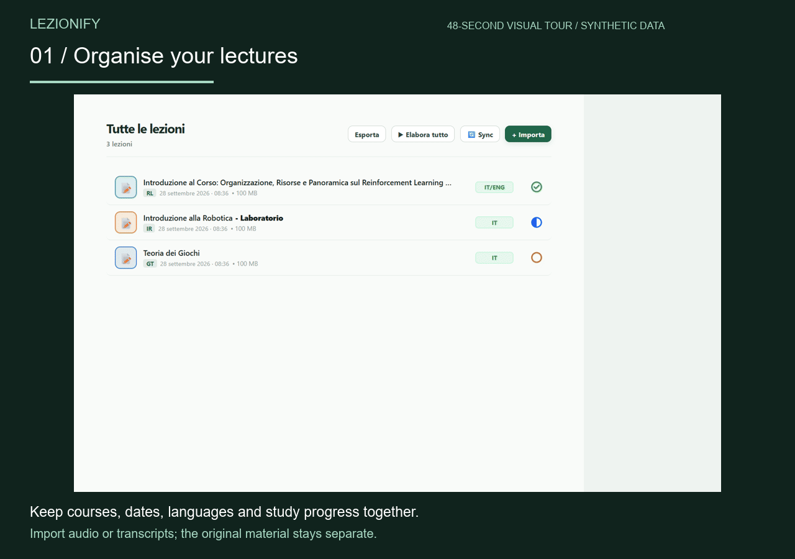

<div align="center">
  
  <h1>Lezionify</h1>
  <p><strong>Dalle registrazioni universitarie a uno spazio di studio ordinato.</strong></p>
  <p>App desktop local-first per Windows, sviluppata con Electron, React e TypeScript.</p>
  <p>
    <a href="https://github.com/giovannistefanuto/Lezionify/actions/workflows/ci.yml"></a>
    
    
  </p>
  <p><a href="README.md" lang="en">English</a> · <strong>Italiano</strong></p>
  <p>
    <a href="https://github.com/giovannistefanuto/lezionify-appunti"><strong>Leggi gli appunti</strong></a> ·
    <a href="#avvio-in-locale"><strong>Avvia l’app</strong></a> ·
    <a href="#scelte-ingegneristiche"><strong>Esplora il codice</strong></a>
  </p>
</div>

Ho creato Lezionify per riunire il mio flusso di studio: organizzare le registrazioni universitarie, trascriverle altrove, copiare testi nei servizi AI e ricomporre il materiale. L’app affianca registrazioni, dispense, slide e domande, mantenendo **audio originale e trascrizione grezza separati da ogni elaborazione AI**.

**Disponibilità:** alpha personale utilizzata dall’autore. Per avviare l’app serve attualmente un ambiente di sviluppo; non è disponibile una release Windows pubblica firmata. L’interfaccia è in italiano. Puoi leggere gli [appunti pubblicati in italiano e inglese](https://github.com/giovannistefanuto/lezionify-appunti) senza installare nulla o configurare chiavi API.

## Guarda lo spazio di studio


**Focus tiene insieme materiale e domanda:** slide PDF a sinistra, dispensa al centro e discussione ancorata a un passaggio a destra. I pannelli hanno scorrimento e dimensioni indipendenti; il punto di lettura viene conservato anche dopo un riavvio.

<details>
<summary><strong>Guarda il tour visuale di 48 secondi</strong> — archivio → Focus → domande → esportazione PDF</summary>



Il tour con didascalie inglesi usa schermate reali dei componenti Electron con dati e risposte sintetici. Mostra le schermate del percorso, senza rappresentare una registrazione continua o una chiamata AI dal vivo. [Schermate statiche e descrizione testuale accessibile](docs/assets/demo/README.md).

</details>

## Cosa puoi fare

| Passaggio | In Lezionify |
| --- | --- |
| **Raccogli e organizza** | Importa audio, trascrizioni o video; evita i duplicati; assegna corso e data; cerca nell’archivio locale. |
| **Prepara il materiale** | Richiedi esplicitamente a Gemini trascrizioni, dispense Markdown strutturate e traduzioni inglesi. Conserva le fonti e riprendi le elaborazioni interrotte. |
| **Studia nel contesto** | Leggi dispense e slide PDF affiancate, fai domande su un passaggio o interroga i documenti locali del corso con citazioni delle fonti. |
| **Porta con te i risultati** | Esporta una lezione o quelle selezionate di un corso in PDF, con formule, diagrammi e pagine quadrettate per gli appunti. Puoi pubblicare i testi in un repository GitHub dedicato. |

Gli strumenti di studio comprendono anche Memo raggruppati, timer, avanzamento, vocabolario EN ↔ IT offline, traduzione locale opzionale di frasi e suoni di sottofondo scaricabili. [Guide alle funzioni e limiti](docs/README.md#prodotto).

## Avvio in locale

**Requisiti:** Windows 10 o 11, Node.js 22.13.0 o successivo, npm e Git per clonare il repository. Per i controlli completi serve anche Python 3.10 o successivo.

```powershell
git clone https://github.com/giovannistefanuto/Lezionify.git
cd Lezionify
npm ci
npm run dev
```

Usa la finestra Electron aperta dal comando. Inizia importando un audio o una trascrizione e assegnando corso e data. Puoi organizzare, cercare e leggere il materiale locale senza una chiave AI. Per generare le dispense, configura la chiave Gemini nelle **Impostazioni** e avvia esplicitamente l’elaborazione. Non inserire chiavi nei sorgenti o in `.env`.

Modelli per tradurre frasi e suoni di sottofondo sono download opzionali. La sincronizzazione dei testi su GitHub richiede un repository e credenziali dedicati; Spotify richiede una configurazione separata dell’account. [Guide d’uso](docs/README.md#prodotto).

## Scelte ingegneristiche

Tre problemi hanno guidato l’implementazione. Sono punti d’ingresso per approfondire il codice:

| Problema | Scelta adottata | Implementazione e verifiche |
| --- | --- | --- |
| Le elaborazioni AI lunghe possono interrompersi per quote, rete o riavvio dell’app. | Stato dei lavori e checkpoint persistenti, pausa e ripresa esplicite, gestione condivisa delle richieste. | [Pipeline](electron/main/ai/archivePipeline.ts) · [Test di ripresa e concorrenza](tests/unit/archivePipeline.test.ts) |
| La traduzione tecnica può alterare formule, codice e diagrammi. | Richiesta dei frammenti di prosa e ricostruzione locale dei contenuti protetti. Controlli strutturali e recupero del Mermaid originale se la traduzione ne cambia la struttura. | [Piano di traduzione](electron/main/ai/translationPlan.ts) · [Integrità](electron/main/ai/translationIntegrity.ts) · [Regressioni](tests/unit/translationPlan.test.ts) |
| Il materiale locale deve restare leggibile dopo scritture fallite o concorrenti. | Sostituzioni atomiche serializzate, backup recuperabili e validazioni runtime ai confini dei dati. | [Scritture atomiche](electron/main/atomicFile.ts) · [Validazione](electron/main/archiveValidation.ts) · [Test di recupero](tests/unit/quality.test.ts) |

### Architettura in breve

```text
Renderer React (src/)
        ↕ IPC tipizzato attraverso il preload (electron/preload/)
Processo principale Electron (electron/main/)
        ├── file locali, indice di ricerca e stato riprendibile dei lavori
        └── richieste Gemini / pubblicazione testi GitHub opzionali

shared/ → contratti e helper di validazione condivisi fra i processi
```

Il renderer usa React 19 e TypeScript. Markdown, KaTeX, Mermaid e PDF.js gestiscono i contenuti; MiniSearch la ricerca locale. La persistenza usa JSON e file locali. Electron gestisce integrazione desktop e stampa PDF; FFmpeg incluso converte i video in audio.

Approfondimenti: [mappa del repository](STRUTTURA_PROGETTO.md), [ricerca di corso e citazioni](docs/product/rag-corso-2026-10-17.md), [ricerche e benchmark ASR](docs/research/README.md). La documentazione tecnica estesa è attualmente in prevalenza italiana.

## Verifiche e limiti attuali

Ultimo collaudo completo documentato, **19 ottobre 2026**: **625 test Vitest, 24 test Python e 41 test Node**, oltre a scenari React nel runtime Electron e verifiche di PDF esportati realmente. [Report delle verifiche](docs/quality/pubblicazione-github-2026-10-19.md).

I controlli esercitano recupero dopo scritture fallite, ripresa dei lavori, ripristino del punto di lettura fra due processi Electron e PDF con formule e diagrammi. [Guida ai test](tests/README.md) · [CI Windows](.github/workflows/ci.yml).

```powershell
npm run check        # Typecheck, lint, test offline, scenari Electron, build e verifiche PDF
npm run build        # Build di produzione
npm run package:win  # Genera un installer Windows locale non firmato
```

I controlli automatici usano dati sintetici e non chiamano provider AI. I benchmark AI reali sono separati, facoltativi e richiedono credenziali e quota.

Limiti noti: risposte e traduzioni AI richiedono verifica umana; citazioni e controlli strutturali non garantiscono correttezza fattuale o linguistica. I PDF scansionati richiedono OCR esterno. Il collaudo Spotify/dispositivi resta incompleto e le dissolvenze riguardano i suoni locali. L’audit documentato delle dipendenze ha segnalazioni aperte; hardening Electron e accessibilità restano attività prima della release. [Stato dettagliato](docs/quality/pubblicazione-github-2026-10-19.md#limiti-e-seguito).

## Privacy e dati

Audio, trascrizioni e dispense risiedono nella directory dati locale dell’app. Le richieste AI inviano a Gemini il materiale selezionato quando richieste esplicitamente o durante una pipeline abilitata. Local-first non rende questi invii remoti privati o offline: si applicano le condizioni del provider.

Le credenziali usano Electron `safeStorage` quando disponibile. Archivio personale, credenziali e log sono esclusi da Git. La sincronizzazione GitHub opzionale pubblica i testi dopo configurazione e attivazione; non pubblica audio, PDF personali o conversazioni. [Policy di sicurezza](SECURITY.md).

## Prossime tappe

- Risolvere le segnalazioni dell’audit e completare l’hardening Electron.
- Completare i collaudi manuali di accessibilità, sospensione/ripresa e audio malformati.
- Preparare una release Windows firmata con istruzioni di installazione.

Il [backlog di prodotto](docs/product/idee-future-2026-10-13.md) conserva la coda completa, gli esperimenti e i lavori rinviati.

## Autore e metodo di sviluppo

**Giovanni Stefanuto** — progetto personale nato dal mio flusso di studio universitario. Definisco il problema e le scelte di prodotto, integro l’implementazione e ne verifico il comportamento. Gli assistenti AI supportano lo sviluppo; decisioni, regressioni e limiti delle verifiche sono documentati nel [registro delle decisioni](DECISIONI.md) e nei [report di qualità](docs/README.md#qualità).

## Documentazione e contributi

[Indice documentazione](docs/README.md) · [Visione originale](IDEA_INIZIALE.md) · [Decisioni](DECISIONI.md) · [Contribuire](CONTRIBUTING.md).

Issue e pull request mirate sono benvenute come feedback tecnico. Il codice è visibile pubblicamente a scopo portfolio, con **tutti i diritti riservati**; non è stata adottata una licenza open source. Vedi [LICENSE](LICENSE). I dati esterni del vocabolario hanno [licenza CC BY-SA 3.0 e attribuzioni separate](public/dictionaries/NOTICE.md).
