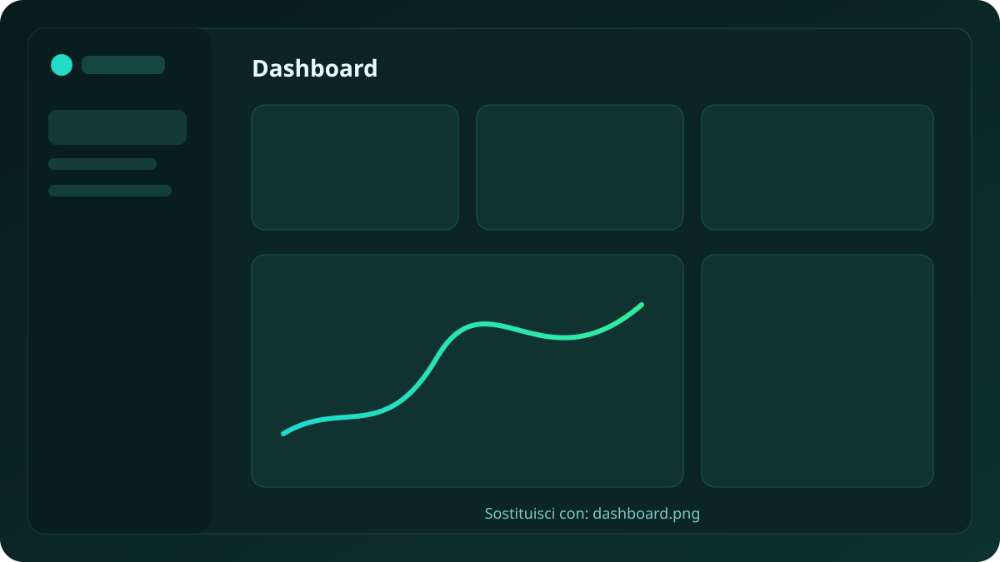
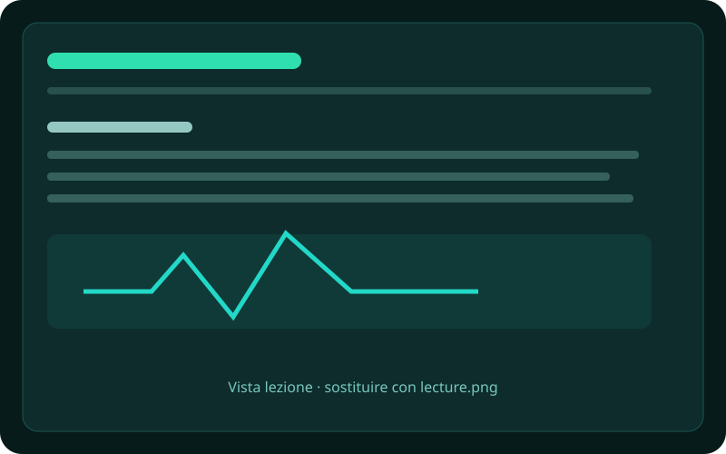
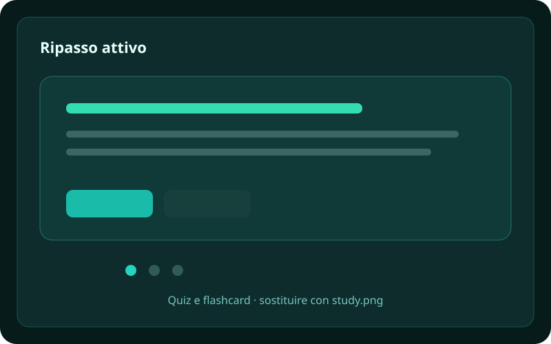
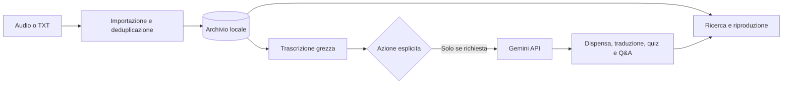

<div align="center">
  
  <h1>Lezionify</h1>
  <p><strong>Dalle registrazioni universitarie a un archivio di studio ordinato, ricercabile e verificabile.</strong></p>
  <p>Desktop app local-first built with Electron, React and TypeScript.</p>

  <p>
    
    <a href="https://github.com/giovannistefanuto/Lezionify/actions/workflows/ci.yml"></a>
    
    
    
    
  </p>
</div>

> [!IMPORTANT]
> Lezionify è un progetto personale in sviluppo attivo. Il codice è pubblicato come portfolio tecnico: alcune funzioni richiedono ancora collaudi manuali e non è disponibile una release firmata per utenti finali.

## Perché esiste

Registrare una lezione è semplice; trasformarla in materiale utile spesso significa rinominare file, lanciare trascrizioni altrove, copiare testi tra servizi AI e ricostruire manualmente il contesto settimane dopo.

Lezionify riunisce quel flusso in un'app desktop mantenendo una regola centrale: **audio originale e trascrizione grezza restano le fonti primarie**. Le dispense, le traduzioni, i quiz e le risposte AI sono derivazioni esplicite e tracciabili.

## Anteprima

<p align="center">
  
</p>

<table>
  <tr>
    <td width="50%"></td>
    <td width="50%"></td>
  </tr>
</table>

I riquadri sono segnaposto già dimensionati. Le istruzioni per sostituirli con schermate anonimizzate sono in [`docs/assets/screenshots`](docs/assets/screenshots/README.md).

## Funzionalità

- Importazione di file MP3 o cartelle, copia nell'archivio locale e deduplicazione SHA-256.
- Associazione assistita delle registrazioni a corso, data e orario settimanale.
- Conservazione separata di audio, trascrizione grezza, dispensa Markdown e traduzione.
- Ricerca full-text locale con MiniSearch e filtri per corso e stato di studio.
- Viewer Markdown con GFM, formule KaTeX, diagrammi Mermaid validati e fallback leggibile.
- Generazione opzionale con Gemini di dispense, traduzioni, quiz, flashcard e Q&A contestuale.
- Dashboard, sessioni di studio, timer, promemoria, evidenziazioni e Quick Capture.
- Scritture atomiche, backup recuperabile, mutex asincroni e validazione runtime ai confini IPC.
- Credenziali Gemini cifrate tramite Electron `safeStorage` quando disponibile.

## Come funziona



La libreria dell'utente è salvata nella directory dati privata dell'applicazione, non nel repository. Le chiamate remote avvengono solo quando l'utente avvia una funzione AI.

## Stack

| Area         | Tecnologie                                                |
| ------------ | --------------------------------------------------------- |
| Desktop      | Electron, electron-vite, electron-builder                 |
| Interfaccia  | React 19, TypeScript, CSS                                 |
| Contenuti    | react-markdown, KaTeX, Mermaid                            |
| Ricerca      | MiniSearch                                                |
| AI opzionale | Google Gen AI SDK / Gemini API                            |
| Qualità      | Vitest, ESLint, Prettier, test React nel runtime Electron |
| Persistenza  | JSON locale, file atomici, backup e cache in memoria      |

## Avvio in locale

### Requisiti

- Windows 10 o 11;
- Node.js 22 o successivo;
- npm;
- una chiave Gemini API solo per le funzioni AI opzionali.

```powershell
git clone https://github.com/giovannistefanuto/Lezionify.git
cd Lezionify
npm ci
npm run dev
```

La chiave API si configura dall'interfaccia dell'app e non deve essere inserita in `.env` o in file versionati.

### Comandi utili

| Comando                    | Scopo                                         |
| -------------------------- | --------------------------------------------- |
| `npm run dev`              | Avvia l'app in modalità sviluppo              |
| `npm run check`            | Esegue typecheck, lint, test, test UI e build |
| `npm test`                 | Esegue i test Vitest                          |
| `npm run test:hooks`       | Esegue gli scenari React in Electron nascosto |
| `npm run build`            | Genera la build di produzione                 |
| `npm run package:portable` | Genera il pacchetto portable Windows          |

Il test Q&A reale e i benchmark remoti sono intenzionalmente esclusi dalla CI perché richiedono credenziali, quote e consenso esplicito all'invio dei dati.

## Stato del progetto

La versione corrente è una **alpha utilizzabile dall'autore**, non ancora una release distribuita al pubblico.

- 120 test Vitest.
- 24 scenari React eseguiti nel runtime Electron.
- Typecheck, lint e build di produzione automatizzati in GitHub Actions.
- Pipeline AI reale verificata separatamente con dati sintetici.
- Installer Windows configurato ma non firmato.

Le verifiche manuali residue e i limiti noti sono riportati nella [checklist di qualità](docs/quality/quality-checklist.md).

## Struttura del repository

```text
Lezionify/
├── .github/            workflow CI e template GitHub
├── docs/               prodotto, ricerca, qualità e asset pubblici
├── electron/           processo main, servizi locali e preload IPC
├── resources/          icone usate dalla build desktop
├── shared/             contratti e tipi condivisi
├── src/                renderer React
├── tests/
│   ├── unit/           test Vitest deterministici
│   └── integration/    scenari React/Electron e test reali opzionali
└── tools/              script di sviluppo, benchmark e manutenzione
```

Per una mappa più dettagliata consulta [`STRUTTURA_PROGETTO.md`](STRUTTURA_PROGETTO.md). Le scelte tecniche sono registrate in ordine cronologico in [`DECISIONI.md`](DECISIONI.md).

## Privacy e dati

- Audio, trascrizioni reali, chiavi API, log e archivio personale sono esclusi da Git.
- Le API key vengono cifrate con le primitive del sistema operativo quando disponibili.
- Gli output AI non sovrascrivono mai la fonte grezza.
- Prima di aggiungere screenshot o fixture, rimuovere nomi, corsi, percorsi e contenuti personali.
- Nel Free Tier di Gemini i dati possono essere trattati secondo le condizioni del provider: l'upload deve restare una scelta consapevole dell'utente.

Consulta anche la [policy di sicurezza](SECURITY.md).

## Roadmap

- [x] Archivio locale, importazione e deduplicazione.
- [x] Viewer Markdown/LaTeX/Mermaid e ricerca full-text.
- [x] Generazione di dispense, Q&A e strumenti di studio.
- [x] Persistenza recuperabile e test di regressione principali.
- [ ] Screenshot reali e demo breve del flusso completo.
- [x] Aggiornamento delle dipendenze segnalate dall'audit npm.
- [ ] Hardening Electron con CSP e revisione delle policy di navigazione.
- [ ] Collaudo manuale completo di accessibilità, sospensione e audio corrotti.
- [ ] Prima release Windows firmata e documentata.
- [ ] Chat RAG trasversale alle lezioni di uno stesso corso.

## Documentazione

- [Indice della documentazione](docs/README.md)
- [Visione originale del prodotto](IDEA_INIZIALE.md)
- [Registro delle decisioni](DECISIONI.md)
- [Ricerca e benchmark ASR](docs/research/README.md)
- [Piano della chat globale di corso](docs/product/course-chat-plan.md)

## Contribuire

Issue e pull request sono benvenute come feedback tecnico. Prima di proporre modifiche consulta [`CONTRIBUTING.md`](CONTRIBUTING.md), in particolare le regole sui dati reali e sulle decisioni architetturali.

## Licenza

Il codice è visibile pubblicamente a scopo portfolio e valutazione. Tutti i diritti sono riservati; consulta [`LICENSE`](LICENSE). Una licenza open source non è ancora stata adottata.

<sub>Nota sul processo di sviluppo: gran parte del codice è stata realizzata con il supporto di Gemini, Claude e ChatGPT; progettazione, integrazione e verifica sono state curate dall'autore.</sub>
