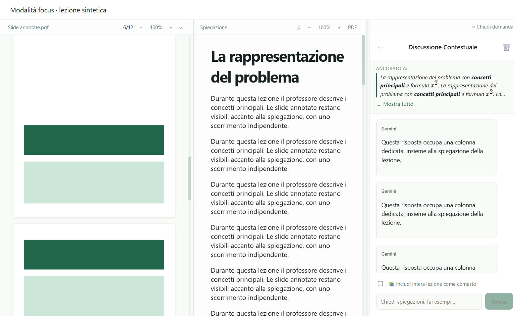
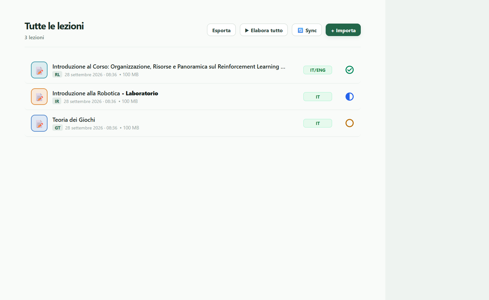
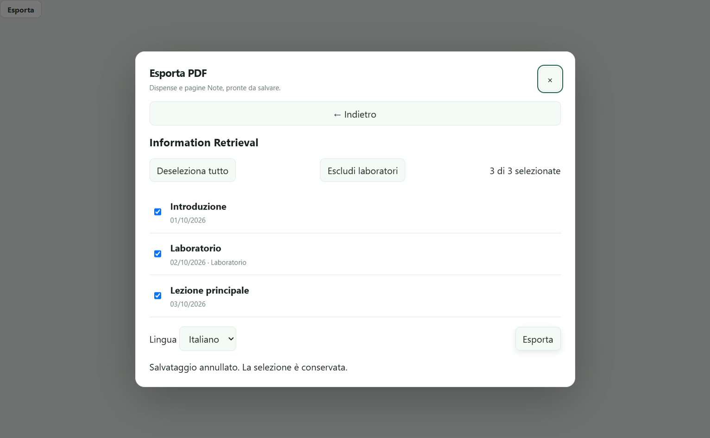
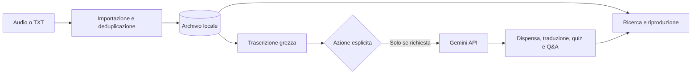

<div align="center">
  
  <h1>Lezionify</h1>
  <p><strong>Dalle registrazioni universitarie a un archivio di studio ordinato, ricercabile e verificabile.</strong></p>
  <p>Desktop app local-first built with Electron, React and TypeScript.</p>

  <p>
    
    <a href="https://github.com/giovannistefanuto/Lezionify/actions/workflows/ci.yml"></a>
    
    
    
    
  </p>
</div>

> [!IMPORTANT]
> Lezionify è un progetto personale in sviluppo attivo. Il codice è pubblicato come portfolio tecnico: alcune funzioni richiedono ancora collaudi manuali e non è disponibile una release firmata per utenti finali.

## Perché esiste

Registrare una lezione è semplice; trasformarla in materiale utile spesso significa rinominare file, lanciare trascrizioni altrove, copiare testi tra servizi AI e ricostruire manualmente il contesto settimane dopo.

Lezionify riunisce quel flusso in un'app desktop mantenendo una regola centrale: **audio originale e trascrizione grezza restano le fonti primarie**. Le dispense, le traduzioni, i quiz e le risposte AI sono derivazioni esplicite e tracciabili.

## Anteprima

<p align="center">
  
</p>

<table>
  <tr>
    <td width="50%"></td>
    <td width="50%"></td>
  </tr>
</table>

Schermate reali dei componenti Electron con dati sintetici: Focus con PDF e discussione, archivio delle lezioni ed esportazione selettiva. Nessun materiale personale o account reale. [Provenienza e riproduzione](docs/assets/screenshots/README.md).

## Funzionalità

- Importazione da file, cartelle e registratore USB, copia nell'archivio locale e deduplicazione SHA-256.
- Importazione di uno o più video con riordino e conversione locale in un unico MP3 tramite FFmpeg incluso. [Dettagli](docs/product/video-import.md).
- Associazione delle registrazioni a corso, data e orario; classificazione dei laboratori tramite calendario e correzione manuale.
- Conservazione separata di audio, trascrizione grezza, dispensa Markdown e traduzione.
- Ricerca full-text locale con MiniSearch e filtri per corso e stato di studio.
- Viewer Markdown con GFM, formule KaTeX, diagrammi Mermaid validati e fallback leggibile.
- Focus con dispensa, slide PDF locali e discussione in pannelli ridimensionabili, zoom separati e cambio lingua. [Dettagli](docs/product/focus-pdf.md).
- Esportazione PDF di una lezione o di lezioni selezionate del corso, in italiano o inglese, con formule, diagrammi e pagine Note quadrettate. Titoli IT/EN modificabili separatamente. [Dettagli](docs/product/lettura-export-pdf.md).
- Ripresa del punto di lettura di dispense e slide PDF anche dopo la chiusura della lezione o il riavvio dell'app.
- Generazione opzionale con Gemini di dispense, traduzioni, quiz, flashcard e Q&A contestuale.
- Chat del corso su trascrizioni, dispense e documenti locali PDF/Markdown/TXT, con citazioni apribili, ricerca locale e traccia delle fonti inviate. [Dettagli e limiti](docs/product/rag-corso-2026-10-17.md).
- Pipeline riprendibile per trascrizioni, dispense italiane e traduzioni inglesi; corsi archiviabili e ripristinabili.
- Traduzione delle dispense con prosa strutturata e reinserimento locale di formule e codice; recupero del Mermaid originale se il diagramma tradotto cambia struttura. [Dettagli](docs/product/traduzione-dispense.md).
- Sincronizzazione GitHub opzionale dei testi in italiano e inglese, con indici per corso e data e aggiornamento delle correzioni.
- Dashboard dei corsi attivi, tempi per lezione, sessioni, timer e stima dello studio residuo; Memo raggruppati con anteprima, promemoria ed evidenziazioni.
- Vocabolario EN ↔ IT offline con Ctrl+T e traduzione locale di frasi tramite modelli Bergamot opzionali. [Vocabolario](docs/product/vocabolario-offline.md) · [Strumenti offline](docs/product/funzioni-approvate-2026-10-15.md).
- Suoni di sottofondo offline scaricabili su richiesta, con dissolvenze configurabili; telecomando Spotify e raccolta YouTube aperta nel browser. [Uso e limiti](docs/product/memo-log-pdf-transizioni-2026-10-19.md).
- Log consultabili per giorno, diagnostica Gemini e gestione condivisa di quote, attese, annullamento e fallback senza registrare prompt, risposte o credenziali.
- Scritture atomiche, backup recuperabile, mutex asincroni e validazione runtime ai confini IPC.
- Credenziali Gemini cifrate tramite Electron `safeStorage` quando disponibile.

## Come funziona



La libreria dell'utente è salvata nella directory dati privata dell'applicazione. Le chiamate AI partono dalle azioni esplicite dell'utente o dalla pipeline abilitata nelle Impostazioni. Anche la chat di corso invia al provider i passaggi locali selezionati per rispondere. L'app resta utilizzabile per archivio, lettura e strumenti offline senza una chiave AI.

## Consultare le lezioni online

Le lezioni sono disponibili nel repository [Lezionify · Appunti](https://github.com/giovannistefanuto/lezionify-appunti).

1. Apri il corso che ti interessa dall'indice.
2. Scegli la data della lezione: l'elenco segue l'ordine cronologico, dalla più vecchia alla più recente.
3. Leggi **Italiano**, **English** oppure **Trascrizione** per consultare il testo grezzo.

Non serve installare Lezionify né configurare una chiave API per leggere su GitHub. Per la consultazione offline puoi scaricare **Code → Download ZIP** o clonare il repository degli appunti. Le cartelle hanno nomi leggibili: `Nome del corso/AAAA-MM-GG/`; eventuali lezioni dello stesso giorno sono distinte dal titolo. Le traduzioni ancora da generare sono indicate nell'indice.

Le dispense e le traduzioni sono elaborazioni AI e richiedono verifica rispetto alla trascrizione, alle slide e alle fonti del corso. Anche la trascrizione automatica può contenere errori. Gli appunti sono materiale personale di studio e non sostituiscono le risorse ufficiali del docente.

### Organizzare e condividere il proprio archivio

Nell'app importa gli audio o le trascrizioni, assegna corso e data, poi avvia la pipeline per produrre le dispense e le traduzioni. Audio originali e trascrizioni grezze restano separati dalle elaborazioni.

Per condividere i testi configura nelle **Impostazioni** un repository GitHub dedicato, il branch e un PAT, quindi abilita la sincronizzazione automatica. Git deve essere disponibile nel PATH. Da quel momento l'app controlla GitHub all'avvio e periodicamente, aggiorna le lezioni modificate e aggiunge le traduzioni disponibili. Nessuna traduzione viene generata dalla pubblicazione stessa: le chiamate AI restano azioni esplicite nell'app. Il PAT viene cifrato localmente e non entra nel repository.

*English readers: open [the lesson archive](https://github.com/giovannistefanuto/lezionify-appunti), choose a course and a date, then select **English**. No installation or API key is needed to read the notes.*

## Stack

| Area         | Tecnologie                                                |
| ------------ | --------------------------------------------------------- |
| Desktop      | Electron, electron-vite, electron-builder                 |
| Interfaccia  | React 19, TypeScript, CSS                                 |
| Contenuti    | react-markdown, KaTeX, Mermaid                            |
| PDF e video  | PDF.js, stampa PDF Electron, ffmpeg-static                |
| Ricerca      | MiniSearch                                                |
| Strumenti offline | FreeDict/WikDict, Bergamot WASM, Web Audio          |
| AI opzionale | Google Gen AI SDK / Gemini API                            |
| Qualità      | Vitest, ESLint, Prettier, test React nel runtime Electron |
| Persistenza  | JSON locale, file atomici, backup e cache in memoria      |

## Avvio in locale

### Requisiti

- Windows 10 o 11;
- Node.js 22.13.0 o successivo;
- npm;
- una chiave Gemini API solo per le funzioni AI opzionali.

```powershell
git clone https://github.com/giovannistefanuto/Lezionify.git
cd Lezionify
npm ci
npm run dev
```

La chiave API si configura dall'interfaccia dell'app e non deve essere inserita in `.env` o in file versionati.

I modelli per tradurre frasi e i suoni di sottofondo si scaricano separatamente dall'app su richiesta e vengono conservati nel profilo locale. Il telecomando Spotify richiede configurazione e consenso dell'account; YouTube apre il browser esterno. Git serve soltanto per la sincronizzazione opzionale dei testi su GitHub.

### Comandi utili

| Comando                    | Scopo                                         |
| -------------------------- | --------------------------------------------- |
| `npm run dev`              | Avvia l'app in modalità sviluppo              |
| `npm run check`            | Esegue typecheck, lint, test, test UI e build |
| `npm test`                 | Esegue i test Vitest                          |
| `npm run test:hooks`       | Esegue gli scenari React in Electron nascosto |
| `npm run test:benchmark`   | Esegue le regressioni Python offline dei benchmark |
| `npm run test:qna-benchmark` | Esegue le regressioni Node offline del benchmark Q&A |
| `npm run test:pdf-export`  | Verifica PDF sintetici reali, dopo la build |
| `npm run build`            | Genera la build di produzione                 |
| `npm run package:win`      | Genera il setup Windows NSIS locale           |
| `npm run package:portable` | Genera il pacchetto portable Windows          |

Il test Q&A reale e i benchmark remoti sono intenzionalmente esclusi dalla CI perché richiedono credenziali, quote e consenso esplicito all'invio dei dati.

## Stato del progetto

La versione corrente è una **alpha 0.1.0 utilizzabile dall'autore**, non ancora una release firmata distribuita al pubblico. Il codice include gli sviluppi fino al **19 ottobre 2026**; la versione del pacchetto non identifica ogni aggiornamento del sorgente.

- 625 test Vitest in 43 file per archivio, pipeline AI, sincronizzazione e regressioni applicative.
- 24 test Python e 41 test Node offline, scenari React nel runtime Electron e verifica di PDF esportati realmente.
- Typecheck, lint e build di produzione automatizzati in GitHub Actions.
- Collaudi AI reali documentati separatamente; il quality gate non chiama provider esterni e non usa la libreria personale.
- Installer Windows generabile localmente, non firmato e non incluso nei sorgenti Git.

Esiti della pubblicazione e verifiche: [report del 19 ottobre](docs/quality/pubblicazione-github-2026-10-19.md). La [checklist di qualità](docs/quality/quality-checklist.md) conserva gli interventi storici e i collaudi manuali residui.

Restano limiti espliciti: la chat può citare correttamente una fonte e interpretarla male; PDF scansionati senza testo richiedono OCR esterno; i controlli ENG non certificano la fedeltà linguistica. Le dissolvenze riguardano i suoni locali, mentre le transizioni Spotify/YouTube restano aperte. Il timer Amazfit Balance è un prototipo separato, senza collegamento hardware integrato.

## Struttura del repository

```text
Lezionify/
├── .github/            workflow CI e template GitHub
├── docs/               prodotto, ricerca, qualità e asset pubblici
├── electron/           processo main, servizi locali e preload IPC
├── resources/          icone usate dalla build desktop
├── public/             dizionari e asset con attribuzioni
├── prototypes/         esperimenti separati dall'app di produzione
├── shared/             contratti e tipi condivisi
├── src/                renderer React
├── tests/
│   ├── unit/           test Vitest deterministici
│   ├── integration/    scenari React/Electron e test reali opzionali
│   ├── python/         regressioni offline dei benchmark
│   └── node/           regressioni offline del benchmark Q&A
└── tools/              script di sviluppo, benchmark e manutenzione
```

Per una mappa più dettagliata consulta [`STRUTTURA_PROGETTO.md`](STRUTTURA_PROGETTO.md). Le scelte tecniche sono registrate in ordine cronologico in [`DECISIONI.md`](DECISIONI.md).

## Privacy e dati

- Audio, trascrizioni reali, chiavi API, log e archivio personale sono esclusi da Git.
- Le API key vengono cifrate con le primitive del sistema operativo quando disponibili.
- Gli output AI non sovrascrivono mai la fonte grezza.
- La sincronizzazione GitHub pubblica i testi soltanto dopo configurazione e attivazione esplicite: verificare diritti e contenuti prima di abilitarla. Audio, PDF personali e conversazioni non vengono pubblicati dal sincronizzatore.
- Prima di aggiungere screenshot o fixture, rimuovere nomi, corsi, percorsi e contenuti personali.
- Nel Free Tier di Gemini i dati possono essere trattati secondo le condizioni del provider: l'upload deve restare una scelta consapevole dell'utente.

Consulta anche la [policy di sicurezza](SECURITY.md).

## Roadmap

- [x] Archivio locale, importazione e deduplicazione.
- [x] Viewer Markdown/LaTeX/Mermaid e ricerca full-text.
- [x] Generazione di dispense, Q&A e strumenti di studio.
- [x] Persistenza recuperabile e test di regressione principali.
- [x] Chat RAG del corso con documenti locali e citazioni.
- [x] Focus con PDF, ripresa della lettura ed esportazione selettiva ITA/EN.
- [x] Pipeline riprendibile, sincronizzazione GitHub dei testi e archivio corsi.
- [x] Vocabolario, frasi e suoni offline; Memo e log per giorno.
- [x] Schermate dell’app con dati sintetici nel README.
- [ ] Demo breve del flusso completo.
- [ ] Risoluzione delle segnalazioni correnti di `npm audit` con collaudi dedicati.
- [ ] Hardening Electron con CSP e revisione delle policy di navigazione.
- [ ] Collaudo manuale completo di accessibilità, sospensione e audio corrotti.
- [ ] Prima release Windows firmata e documentata.
- [ ] Collaudi personali Spotify/dispositivi e percorso compatibile per le transizioni musicali.
- [ ] Timer pausa Amazfit Balance con verifica hardware.

## Documentazione

- [Indice della documentazione](docs/README.md)
- [Visione originale del prodotto](IDEA_INIZIALE.md)
- [Registro delle decisioni](DECISIONI.md)
- [Ricerca e benchmark ASR](docs/research/README.md)
- [Chat del corso: uso, fonti e limiti](docs/product/rag-corso-2026-10-17.md)
- [Backlog ordinato e stato delle attività](docs/product/idee-future-2026-10-13.md)
- [Proposta per un repository unico e il portfolio](docs/product/repository-portfolio-plan.md)

## Contribuire

Issue e pull request sono benvenute come feedback tecnico. Prima di proporre modifiche consulta [`CONTRIBUTING.md`](CONTRIBUTING.md), in particolare le regole sui dati reali e sulle decisioni architetturali.

## Licenza

Il codice è visibile pubblicamente a scopo portfolio e valutazione. Tutti i diritti sono riservati; consulta [`LICENSE`](LICENSE). Una licenza open source non è ancora stata adottata.

I dati esterni del vocabolario in [`public/dictionaries`](public/dictionaries/NOTICE.md) sono separatamente disponibili sotto **CC BY-SA 3.0**, con attribuzione a FreeDict/WikDict, Karl Bartel e ai contributori Wiktionary tramite DBnary.

<sub>Progetto personale di Giovanni Stefanuto: problema, idee e scelte di prodotto nascono dall'esperienza di studio dell'autore. Gemini, Claude e ChatGPT supportano sviluppo e rielaborazione; progettazione, integrazione e verifica restano a cura dell'autore.</sub>
