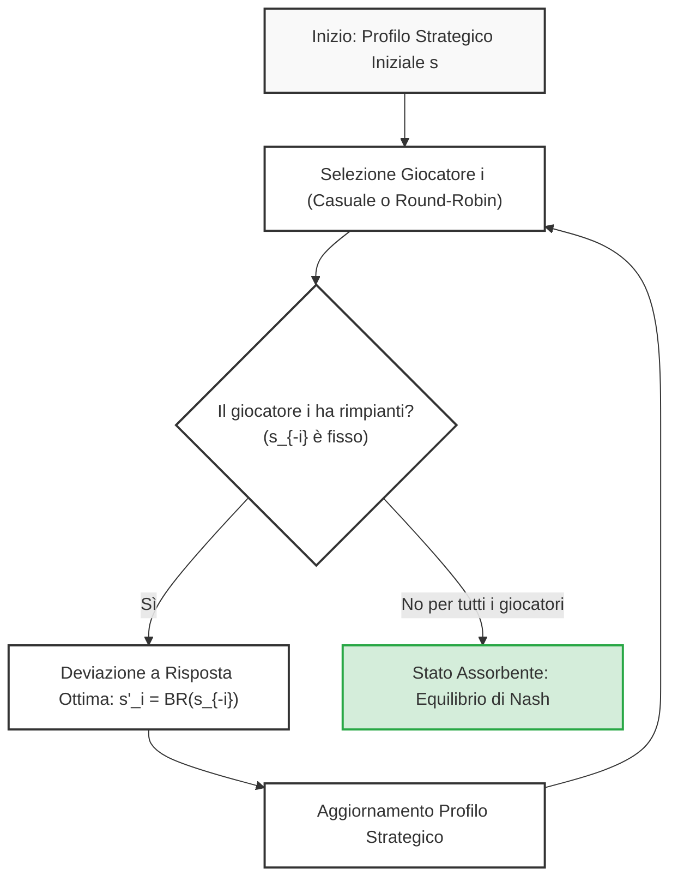

# Idee e modifiche future — 13 ottobre 2026

Raccolta delle richieste dell’utente per lo sviluppo futuro di Lezionify,
iniziata il 13 ottobre e aggiornata con nuove idee fino al 27 ottobre 2026.
La classificazione è preliminare: gli interventi immediati hanno un obiettivo
già definito e non richiedono una ricerca preventiva; restano necessari i normali
controlli del codice e i collaudi. Gli approfondimenti richiedono invece una
valutazione prima di scegliere come implementarli.

La raccolta iniziale è stata registrata in D-0256. Le caselle indicano lo stato
delle attività; gli interventi immediati sono stati implementati il 13 ottobre.
Uso, scelte e verifiche: [Lettura ed esportazione PDF](lettura-export-pdf.md).

Revisione iterativa del 15 ottobre, autorizzata su tutte le voci aperte:
[resoconto, correzioni e scelte residue](resoconto-interventi-2026-10-15.md).
Le ricerche concluse non chiudono le caselle delle funzioni ancora da integrare.

## Coda LISTA_ORDINE

### Ordine operativo aggiornato al 23 ottobre 2026

Su richiesta dell'utente, tutte le attività aperte sono riordinate per facilità
crescente, includendo lista, riassunto Gemini e interventi del
[report UX/UI del 21 ottobre](../quality/audit-ux-ui-2026-10-21.md).
La precisazione dell'utente associa «cose dell'audio» alle idee del riassunto:
non aggiunge una nuova funzione audio generica alle voci 31 e 38.

La stima considera ampiezza della modifica, incertezza diagnostica, integrità
dei dati, collaudi e dipendenze esterne; non è una promessa sui tempi.
**Facilità e gravità sono distinte:** i P1/P2 del report restano validi anche se
un intervento più facile li precede. Le voci restano identificativi stabili;
le posizioni indicano soltanto l'ordine attuale. Nessuna implementazione è
avviata da questo aggiornamento documentale (D-0390).

| Ordine e stato | Attività | Voce | Difficoltà stimata e motivo |
| --- | --- | --- | --- |
| 1. [x] | Q&A: aggiungere Media conservando Breve iniziale | 72 | D-0392: implementata e collaudata; dettagli e limiti nel report del 22 ottobre. |
| 2. [x] | Suggerimenti rigeneranti per pause di 5 / 15 / 30 minuti | 74 | D-0392: implementata e collaudata; dettagli e limiti nel report del 22 ottobre. |
| 3. [x] | Q&A: etichette accessibili e annuncio degli errori — U13 | 88 | D-0392: semantica, tastiera ed errori collaudati; NVDA non verificato. |
| 4. [x] | Elenco Q&A operabile da tastiera — U01 | 76 | D-0392: implementata e collaudata; dettagli e limiti nel report del 22 ottobre. |
| 5. [x] | Contrasto di metadati e Continua — U04 | 79 | D-0392: implementata e collaudata; dettagli e limiti nel report del 22 ottobre. |
| 6. [x] | Apertura lezione senza attesa del doppio clic — U12 | 87 | D-0392: implementata e collaudata; dettagli e limiti nel report del 22 ottobre. |
| 7. [x] | Ambito esplicito di Elabora archivio — U06 | 81 | D-0392: implementata e collaudata; dettagli e limiti nel report del 22 ottobre. |
| 8. [x] | Focus Lock: nome, focus interno e ritorno al controllo — U02 | 77 | D-0392: implementata e collaudata; dettagli e limiti nel report del 22 ottobre. |
| 9. [x] | Focus Lock leggibile con zoom 200% — U03 | 78 | D-0392: implementata e collaudata; dettagli e limiti nel report del 22 ottobre. |
| 10. [x] | Chat di corso: composizione sempre raggiungibile — U05 | 80 | D-0392: implementata e collaudata; dettagli e limiti nel report del 22 ottobre. |
| 11. [x] | Copia tutto/gruppo protetta 08:00–17:30 con frase da ricopiare | 67 | D-0392: implementata e collaudata; dettagli e limiti nel report del 22 ottobre. |
| 12. [x] | Nomi coerenti e comandi principali riconoscibili — U07 | 82 | D-0392: implementata e collaudata; dettagli e limiti nel report del 22 ottobre. |
| 13. [x] | Barre Focus/Q&A più chiare e chiusure distinte — U08 | 83 | D-0392: implementata e collaudata; dettagli e limiti nel report del 22 ottobre. |
| 14. [x] | Musica: pausa/volume sempre accessibili e gerarchia — U10 | 85 | D-0392: player nel pannello collaudato; in Focus resta soltanto l’icona già presente. |
| 15. [x] | Memo: leggere attività lunghe anche senza hover — U11 | 86 | D-0392: implementata e collaudata; dettagli e limiti nel report del 22 ottobre. |
| 16. [x] | Chat di corso: corso, copertura e certezza visibili — U09 | 84 | D-0392: implementata e collaudata; dettagli e limiti nel report del 22 ottobre. |
| 17. [x] | Scelta per corso delle lezioni da pubblicare su GitHub | 68 | D-0392: implementata e collaudata; dettagli e limiti nel report del 22 ottobre. |
| 18. [ ] | Ctrl / Ctrl+L e cerchio bianco attorno al mouse | 33 | Media incerta: test nativi positivi e cerchio spiegato; serve l'episodio personale storico. |
| 19. [x] | Diagnosi della stima di studio che non funziona | 70 | D-0433: corretti i buchi di campionamento della viewport; regressioni Electron e comunicazione delle soglie verificate. |
| 20. [ ] | Formule Q&A: caso epsilon-greedy / epsilon-soft | 73 | Media incerta: isolare testo ricevuto, normalizzazione, KaTeX/CSS e streaming. |
| 21. [x] | Diagnosi errore course-rag:ask «Risposta non completata» | 69 | D-0392: output strutturato, fallback e retry collaudati; due prove RAG complete reali riuscite con fonti sintetiche. D-0395: recupero da timeout/503 e confronto RL reale verificato, con 12 invii e 10 minuti condivisi: [diagnosi](../quality/rag-recupero-2026-10-22.md). |
| 22. [ ] | Collaudi residui del traduttore offline | 7 | Media: prove tecniche, formule/codice e glossario; funzione base già integrata. |
| 23. [ ] | Validazione qualitativa residua dei modelli Q&A | 9 | Media: contratto già collaudato, qualità reale e provider da verificare. |
| 24. [ ] | Verifica personale residua delle versioni ENG mancanti | 20 | Media incerta: riusare diagnosi/correzioni, serve un caso dopo l'aggiornamento. |
| 25. [ ] | Ctrl+T: modalità Dizionario italiano oltre al traduttore | 71 | Media/alta: corpus monolingue, copertura e licenza da verificare prima dell'integrazione. |
| 26. [ ] | Pilota personale della sezione musica | 5 | Media con dipendenza esterna: account, PC e cuffie; rinvio precedente conservato. |
| 27. [ ] | Percorso rapido Mermaid → iPad → nota Notability corrente | 63 | Medio/alta: intera catena e prova reale tra dispositivi. |
| 28. [ ] | Misurare l'inattività personale e chiedere se si studia ancora | 56 | Alta: calibrazione locale e conteggio affidabile; riusare Focus Lock corretto. |
| 29. [ ] | Rigenerare un singolo paragrafo dalla trascrizione | 59 | Alta: corrispondenza con fonte, sostituzione mirata e versioni conservate. |
| 30. [ ] | Completare transizioni canzone → canzone / canzone → suono | 38 | Alta e vincolata ai player: dissolvenze offline già implementate, limiti D-0370. |
| 31. [ ] | Valutare limite YouTube di 30 minuti al giorno negli orari di studio | 75 | Alta: strumento esterno e perimetro d'uso da concordare, affidabilità su PC da provare. |
| 32. [ ] | Timer pausa sul telefono | 32 | Alta: trasporto locale e avvisi affidabili a schermo bloccato. |
| 33. [ ] | Audio nel Q&A e registrazione dal telefono | 31 | Alta: acquisizione, trasferimento, allegati e invio AI esplicito. |
| 34. [ ] | Timer pausa su Amazfit Balance originale | 17 | Molto alta/bloccata sul trasporto: prototipo presente, collegamento hardware non pronto. |
| 35. [x] | RAG: benchmark rappresentativo con evidenze annotate e casi negativi | 89 | D-0400–D-0403: implementata e collaudata; [uso e limiti](rag-completamento-2026-10-23.md). |
| 36. [ ] | RAG: valutare le risposte complete sulle fonti reali | 90 | Medio/alta: giudizi annotati, budget AI tracciato e prove ripetute. |
| 37. [ ] | RAG: verificare il supporto delle singole affermazioni | 91 | Alta: citazioni pertinenti, contraddizioni e provenienza senza false garanzie. |
| 38. [ ] | RAG: calibrare ranking, deduplicazione e astensione | 92 | Alta: confronti sul benchmark e qualità dei primi risultati, non sola recall. |
| 39. [x] | RAG: indice semantico preparabile e riprendibile prima delle domande | 93 | D-0400–D-0403: implementata e collaudata; [uso e limiti](rag-completamento-2026-10-23.md). |
| 40. [x] | RAG: gestione di cache, revisioni e spazio su disco | 94 | D-0400–D-0403: implementata e collaudata; [uso e limiti](rag-completamento-2026-10-23.md). |
| 41. [x] | RAG: copertura di PDF complessi, figure e blocchi lunghi | 95 | D-0400–D-0403: implementata e collaudata; [uso e limiti](rag-completamento-2026-10-23.md). |
| 42. [x] | RAG: riferimenti stabili alla numerazione delle lezioni | 96 | D-0400–D-0403: implementata e collaudata; [uso e limiti](rag-completamento-2026-10-23.md). |
| 43. [x] | RAG: regressioni automatiche di robustezza e funzionamento offline | 97 | D-0400–D-0403: implementata e collaudata; [uso e limiti](rag-completamento-2026-10-23.md). |
| 44. [x] | RAG: collaudo del nuovo installer Windows e runtime ASAR | 98 | D-0400–D-0403: implementata e collaudata; [uso e limiti](rag-completamento-2026-10-23.md). |
| 45. [x] | Full Focus: attrito solo dopo cinque minuti | 99 | D-0404/D-0405: soglia, continua e rientro collaudati. |
| 46. [x] | Ctrl+T: selezione e lingua della dispensa | 100 | D-0404/D-0405: apertura compilata prima della traduzione, entrambe le lingue. |
| 47. [x] | Parole assenti: fallback al modello offline | 101 | D-0404/D-0405: collaudato anche con suggerimenti; modelli espliciti. |
| 48. [x] | Dizionario: lacuna collusion e casi precedenti | 102 | D-0404/D-0405: supplemento verificato e regressioni sui dati reali. |
| 49. [x] | Rimuovere testo della pausa scaduta | 103 | D-0404/D-0405: testo rimosso, statistiche conservate. |
| 50. [x] | Spotify: correggere play/pausa e rigenerare installer | 104 | D-0404/D-0405: regressioni trasporto e suoni attivi; installer verificato. |
| 51. [ ] | Pipeline: recuperare automaticamente gli import arrivati durante la coda | 105 | Media: conservare le richieste, ricontrollare il lavoro mancante a fine coda e rispettare stop, pause e consenso AI. |
| 52. [ ] | Comandi delle cuffiette EarFun per musica e suoni | 106 | Media: integrazione comandi multimediali e prova hardware. |
| 53. [ ] | Dollari monetari e formule: prosa deformata | 107 | Media: distinguere sorgente generata, delimitatori e rendering. |
| 54. [ ] | Sveglia: minuti rimanenti nel tooltip | 108 | Bassa: durata aggiornata e gestione della scadenza. |
| 55. [ ] | Chiedi a Gemini: focus domanda e impostazioni iniziali | 109 | Media: focus, invio e contesto esplicito. |
| 56. [ ] | Ordine modelli per schemi e confronto Gemini 3.8 / 4 | 110 | Media: benchmark reale con quote, tempi e costi tracciati. |
| 57. [ ] | Sottolineatura Focus e collaudo evidenziatore | 111 | Media: persistenza e selezione nel documento reale. |
| 58. [ ] | Ricerca online facoltativa nelle domande Gemini | 112 | Media/alta: consenso, costi, fonti e compatibilità dei modelli. |
| 59. [ ] | Stima per paragrafo: parole, numeri e ritmo di oggi | 113 | Alta: dati disponibili, calibrazione e validazione predittiva. |
| 60. [ ] | Rendere reperibile Allega slide | 114 | D-0433: ingresso esplicito e percorso completo collaudati; resta la verifica dell'episodio personale non riprodotto. |
| 61. [ ] | Misurare e ridurre l'attesa di scansione del registratore | 115 | Media: separare rilevamento, checksum e durata. |
| 62. [ ] | Diagramma di stato AB rifiutato per direttiva non consentita | 116 | Media: compatibilità Mermaid e controlli di sicurezza. |

Le prime 17 posizioni e la 21 sono concluse in D-0392 su richiesta diretta dopo grilling (D-0391). [Uso, verifiche e limiti](interventi-2026-10-22.md).
La prima attività ancora aperta è la **voce 33, diagnosi Ctrl+L personale**, posizione 18. Ogni invocazione
letterale di `LISTA_ORDINE` autorizza implementazione e collaudo della prima
casella aperta, una sola attività. Leggere prima la descrizione completa e le
decisioni successive. Aggiornare tabella e descrizione soltanto dopo le verifiche;
un blocco non autorizza a saltare automaticamente la voce.

Il riordino comprendeva **34 attività aperte**: 12 residue, 9 nuove richieste
(voci 67–75) e 13 rilievi del report (76–88). Dopo D-0392 sono **18 concluse e 16 ancora aperte**. L’ordine delle residue è conservato. La voce 70 è una nuova
diagnosi della funzione 36 già realizzata, la 69 riguarda la funzione 37 e la
72 estende la 53: le implementazioni storiche restano concluse. Tutti i rinvii
personali precedenti sono conservati. Le scelte ancora aperte si risolvono
quando si affronta la singola voce, senza approvare già servizi, dipendenze,
installazioni, invii AI o modifiche al sistema operativo.

Su richiesta successiva dell'utente sono aggiunte in fondo **10 attività RAG**
(voci 89–98, posizioni 35–44), derivate dai limiti e dai collaudi D-0397/D-0398.
Dopo la richiesta diretta RAG del 23 ottobre (D-0400–D-0403), la coda conta
**44 attività: 25 concluse e 19 aperte**. Concluse 89 e 93–98; 90–92 restano
parziali per validazione umana e calibrazione residua. [Report](rag-completamento-2026-10-23.md).
Le posizioni 1–34 e la prima voce aperta 33 restano invariate; l'aggiunta non
aveva avviato implementazioni o riaperto le funzioni RAG già concluse.
Il lavoro del 23 ottobre è autorizzato dalla richiesta diretta, non da LISTA_ORDINE.


### Attività concluse nel secondo ordine del 21 ottobre — non operative

| Posizione precedente e stato | Attività | Voce | Esito |
| --- | --- | --- | --- |
| 1. [x] | Orario di inizio e fine audio in Info e Gestione | 66 | D-0387: sola lettura, fine calcolata e dati assenti collaudati. |
| 2. [x] | Musica sempre raggiungibile con liste lunghe | 64 | D-0387: accesso sopra ricerca, scroll e sidebar ridotta collaudati. |
| 3. [x] | Riorganizzare pulsanti e gerarchia Memo | 65 | D-0387: comandi, menu gruppo, copia e layout adattabile collaudati. |

L'ordine D-0386 era 66, 64, 65, 33, 7, 9, 20, 5, 63, 56, 59, 38, 32, 31, 17.
Dopo le prime tre concluse in D-0387 restavano 12 attività aperte. Le posizioni
di D-0381–D-0384 si riferiscono invece al primo ordine; [esiti e limiti](interventi-2026-10-21.md).
Questi riferimenti sono storici, superati dall'ordine operativo del 22 ottobre.

### Attività concluse nel primo ordine del 21 ottobre — non operative

Le posizioni seguenti sono quelle di D-0381, prima del secondo riordino.

| Posizione precedente e stato | Attività | Voce | Esito |
| --- | --- | --- | --- |
| 1. [x] | Q&A diretto, senza frasi di apertura o chiusura | 54 | D-0383: prompt condiviso e contratto SDK collaudati. |
| 2. [x] | Toggle Q&A Breve / Lunga | 53 | D-0383: preferenza globale persistente, Breve iniziale, invio e prompt collaudati. |
| 3. [x] | Verificare la pausa del cronometro quando si apre Memo | 57 | D-0383: corretto timer e stima; nessun reset o ripresa di pause esplicite. |
| 4. [x] | Vista compatta nella scheda Tutti di Memo | 52 | D-0383: lista piatta, gruppi e appunti richiudibili collaudati. |
| 5. [x] | Eliminare lo spazio vuoto a destra ridimensionando Q&A | 61 | D-0383: regressione CSS differito prima rossa e poi verde, ordinaria e Focus. |
| 6. [x] | Pulsante Casuale nei suoni | 62 | D-0383: giri senza ripetizioni tra installati, nessun download implicito. |
| 7. [x] | Traduttore con due riquadri leggibili | 58 | D-0383: testi lunghi, caratteri uguali e disposizione verticale stretta collaudati. |
| 9. [x] | Togliere tempo di studio da oggi / ultima lezione studiata | 55 | D-0383: rettifiche serializzate, storico preservato, concorrenza e riavvio collaudati. |
| 10. [x] | Avviso esplicito di assenza Internet prima di Gemini | 60 | D-0383: gate locale e messaggio offline, stop retry/fallback e bozza recuperabile. |

### Storico della coda precedente — non operativo

I numeri e gli stati seguenti sono conservati come riferimenti storici.
Le caselle aperte sono rappresentate nell'ordine operativo sopra; i riferimenti
successivi a posizioni e prossime attività descrivono la situazione di allora.

Ordine concordato il 14 ottobre 2026 per facilita' e velocita' di realizzazione
con Codex, esteso il 16 ottobre su richiesta dell'utente (D-0327). Le prime
dodici posizioni conservano ordine e stato; seguono le attività aggiunte nei
giorni successivi. Il 19 ottobre sono state aggiunte le posizioni 24–29,
senza riordinare le precedenti e senza avviare implementazioni.
Il 20 ottobre sono aggiunte le posizioni 30–37 nell'ordine del messaggio
dell'utente (D-0374); le posizioni precedenti conservano ordine e stato.
Ogni comando `LISTA_ORDINE` avvia implementazione e collaudo della
prima voce ancora aperta, una sola per invocazione. Le descrizioni complete e
i requisiti restano nelle voci indicate sotto; una ricerca conclusa non basta
per segnare una funzione come implementata.

Per ogni invocazione si applica la selezione e l'uso delle skill pertinenti
previsti in `AGENTS.md`, consultando la [guida alle skill](guida-skill-codex.md)
anche per quelle aggiunte nei giorni precedenti (D-0328).

1. [x] **Ctrl+L per cambiare lingua** — voce 10; completata in D-0284.
2. [x] **Mermaid a scomparsa in Focus** — voce 11; completata in D-0286.
3. [x] **Pausa scaduta e tempo realmente studiato** — voce 16; completata in D-0287.
4. [x] **Riconoscimento automatico IT/EN nel vocabolario** — voce 14; completata in D-0288.
5. [x] **Mermaid piu' compatti nei PDF** — voce 4; completata in D-0289.
6. [x] **Cambio lingua sullo stesso capitoletto** — voce 15; completata in D-0290.
7. [x] **Traduzione della dispensa intera oppure a parti** — voce 13; completata in D-0293.
8. [x] **Dispensa troncata con `undefined`** — voce 12; corretta la visualizzazione in D-0294.
9. [x] **Slide come contesto a Gemini** — voce 8; implementata e collaudata in D-0306.
10. [x] **Modelli rapidi per le domande contestuali** — voce 9; istruzione successiva: Flash-Lite prima e altri modelli Gemini se non risponde. Nessun nuovo provider.
11. [x] **Traduzione offline di frasi** — voce 7; Mozilla/Bergamot integrato e collaudato in D-0307/D-0308.
12. [ ] **Sezione musica completa** — voce 5; compilation e pannello Spotify implementati (D-0309), pilota con account personale ancora necessario. Download/taglio rinviati dalla scelta 8 A.
13. [x] **Rimuovere la frase esplicativa dal vocabolario** — voce 28; testo rimosso e vocabolario ricollaudato in D-0331, campo unico e scorciatoie conservati.
14. [x] **Q&A con tono da docente, meno accomodante** — voce 26; istruzioni didattiche implementate e contratto SDK verificato in D-0332; qualità delle risposte reali da osservare.
15. [x] **Ultima lezione: ritorno alla lista dopo 2 secondi** — voce 27; attesa dopo salvataggio riuscito e ritorno a Tutte le lezioni, anche in Focus senza blocco di 15 secondi; D-0333.
16. [ ] **Indagare il nuovo bug Ctrl+L** — voce 33; riprodurre la selezione della schermata senza cambio lingua e correggere il caso verificato.
17. [x] **Valutare Lara3 di Translated** — voce 35; valutazione documentale conclusa in D-0336: nessun offline pubblico accertato, Free API 10.000 caratteri/mese, latenza reale non misurata; nessun provider integrato.
18. [x] **Suoni di sottofondo offline come Apple** — voce 30; catalogo 6 suoni equivalenti approvato, download esplicito, loop Web Audio gapless e auto-pausa con lezioni implementati in D-0340.
19. [x] **Tag e gruppi nelle catture rapide** — voce 34; gruppi per attività e note, clic/Alt+lettera, copia e trasferimento senza perdita dei dati storici, implementati e collaudati in D-0341.
20. [x] **Valutare la stima del tempo residuo di studio** — voce 36; stima dello studio dal ritmo personale dopo 10 minuti e 60% consolidato, visibile sotto 30 minuti; implementata e collaudata in D-0342, utilità personale da osservare.
21. [ ] **Timer della pausa sul telefono** — voce 32; riusare il lavoro Balance e verificare avviso sonoro a schermo bloccato e trasporto locale.
22. [ ] **Audio nel Q&A e registrazione dal telefono** — voce 31; acquisizione, trasferimento al portatile e domanda audio con invio AI esplicito.
23. [x] **RAG e domande su tutto il corso** — voce 37; chat e corpus locali, collegamento Notability/OneDrive per corso, citazioni versionate, conteggi completi e approfondimenti Gemini limitati, implementati e collaudati in D-0344; prove personali da osservare.
24. [ ] **Transizioni tra musica e suoni** — voce 38; dissolvenze tra suoni offline implementate, default 1 secondo scelto dall’utente e opzioni 1/2/4 (D-0370). Restano canzone → canzone e canzone → suono: limiti Spotify e player YouTube esterno documentati.
25. [x] **Grafica e usabilità della scheda Memo** — voce 39; gerarchia, gruppi, comandi, stati vuoti e layout adattabile implementati e collaudati in D-0367.
26. [x] **Nuovo flusso unico di esportazione PDF** — voce 40; modale Lezione/Corso, selezione completa iniziale, laboratori, lingua, nomi Windows e pagine Note implementati; UI e PDF reali collaudati in D-0369.
27. [x] **Testo completo delle attività Memo al passaggio del mouse** — voce 41; anteprima dopo un secondo fermo, reset al movimento, rotella per testi lunghi e pulizia alla chiusura collaudati in D-0367.
28. [x] **Log caricati progressivamente per giorno** — voce 42; oggi e precedente giorno con eventi al fondo, letture per intervalli di byte, filtri e aggiornamento senza duplicati implementati e collaudati in D-0368.
29. [x] **Diagnosi e correzione dell'errore ricorrente di integrità ENG** — voce 43; ripresa D-0364: replay reale Mermaid di 39 sezioni, quote legacy senza falsa sospensione dell'intero pool e fallback ENG completi. 615 test, cinque replay e nuova traduzione reale di 40 sezioni riusciti; 244 contenuti protetti identici. Protezioni sui frammenti incompleti conservate; setup aggiornato da installare.

30. [x] **Pannello Q&A ridimensionabile e testo ingrandibile** — voce 44; larghezze persistenti per vista, zoom messaggi 80–200%, pulsanti e Ctrl+rotella; viste ordinaria e Focus collaudate (D-0379).
31. [x] **Modificare le attività Memo con doppio clic** — voce 45; Invio salva, Esc annulla la modifica, uscita dal campo salva, identità e completamento conservati (D-0379).
32. [x] **Valutare i Q&A precedenti nel contesto** — voce 46; valutazione conclusa e opzione esplicita per estratti pertinenti della stessa lezione, con limiti e distinzione dalle fonti (D-0379).
33. [x] **Indicatore batteria sotto il 20%** — voce 47; piccola emoji in basso a destra, solo a batteria, anche in fullscreen; stati simulati collaudati (D-0379).
34. [x] **Riaprire il Q&A dopo la chiusura** — voce 48; pulsante con conteggio e ultima discussione consultata, anche dopo cambio lezione, senza invio AI (D-0379).
35. [x] **Q&A con riferimenti ai paragrafi successivi** — voce 49; prompt aggiornato solo con contesto completo scelto manualmente; nessun riferimento inventato nel contesto limitato (D-0379).
36. [x] **Ampliare Paesaggi naturali e download per suono** — voce 50; dieci nuove registrazioni, totale 16 suoni, Scarica/Ascolta individuale, Scaricali tutti, integrità e recupero parziale collaudati (D-0379).
37. [x] **Correggere il rendering Mermaid del Fictitious Play** — voce 51; terminatore degli stili corretto, sei nodi renderizzati, fonte preservata e PDF reali verificati (D-0379).

Aggiornamento del 20 ottobre (D-0374): otto richieste nelle voci 44–51,
inizialmente tutte aperte. Quella registrazione aggiornava soltanto la
pianificazione. Successivamente tutte e otto sono state implementate e
collaudate su richiesta diretta (D-0376/D-0379); [uso ed esiti](interventi-2026-10-20.md). La valutazione della voce 46 ha portato a un'opzione esplicita e
limitata, senza invio automatico di tutte le conversazioni al modello.

Aggiornamento del 19 ottobre: le sei richieste sono descritte nelle voci 38–43.
L'importanza della diagnosi ENG è esplicita; non modifica da sola l'ordine
numerico o i rinvii già concordati. Alla registrazione D-0352 tutte e sei
erano aperte; la successiva diagnosi ENG, richiesta direttamente dall'utente,
è stata implementata e collaudata in D-0355 e poi riaperta per la ricorrenza
D-0357. A quell’aggiornamento le altre cinque restavano aperte;
la registrazione delle specifiche non ne certifica il completamento.

La domanda sui modelli già implementati (voce 29) è stata risposta in D-0326
e resta fuori dalla coda delle attività da eseguire. L'inserimento delle nuove
voci aggiorna la pianificazione: non avvia il primo lavoro e non approva già
le soluzioni ancora da valutare. Per le voci di sola ricerca o valutazione,
documentare esito e scelte residue; non dichiarare implementata una funzione
in base alla sola indagine. La voce 12 resta la prima aperta e non va saltata
automaticamente se il pilota personale richiede un'azione dell'utente.

Aggiornamento del 16 ottobre (D-0331): l'utente conferma l'account Spotify
collegato e chiede esplicitamente di rimandare il lavoro sulla musica e
passare alla voce successiva. Posizione 12 mantenuta aperta; posizione 13
completata in questa invocazione. La successiva dopo la 13 è la 14; il rinvio
non certifica il pilota e non modifica l'ordine della coda.

Successivo aggiornamento del 16 ottobre (D-0336): l'utente rimanda anche la
prova della copia diagnostica Ctrl+L e richiede la voce successiva. Posizione 16
mantenuta aperta; ricerca della posizione 17 conclusa. Musica e Ctrl+L restano
rinviati esplicitamente; dopo la 17 segue la 18, senza avviarla in questa
invocazione e senza riordinare la coda.

La prossima voce e' determinata dalle caselle, non da un indice separato.
Quando un'attivita' e' completata e verificata, aggiornare sia questa coda sia
la descrizione corrispondente e registrare la decisione tramite lo script Python.
Le attivita' gia' concluse prima della coda (riquadri inglesi, export PDF,
ripresa della lettura e ricerca sulla concentrazione) restano fuori dalla coda.

Aggiornamento diretto del 19 ottobre (D-0367–D-0370): su richiesta delle prime
cinque attività nella classifica per facilità, completate le voci 41, 39, 42 e 40
(posizioni 27, 25, 28 e 26); voce 38 parziale, casella aperta. [Uso, verifiche e
limiti](memo-log-pdf-transizioni-2026-10-19.md). Nessuna modifica dell'ordine;
musica e Ctrl+L conservano i rinvii precedenti.

## Interventi immediati, senza ricerca preventiva

### 1. Correggere `[!KEY CONCEPT]` nelle dispense inglesi

- [x] Verificare perché il riquadro funziona in italiano ma non in inglese e correggere la differenza.

Obiettivo: lo stesso marcatore deve produrre il riquadro previsto nelle due
lingue. Confrontare sintassi del Markdown, risultato della traduzione e rendering
per individuare la causa, senza presumerla già nota. Verificare entrambe le lingue
con esempi sintetici, senza alterare le fonti originali.

### 2. Esportare le dispense in PDF

- [x] Aggiungere un pulsante «Esporta in PDF» per la singola lezione.
- [x] Aggiungere l’esportazione del corso in un PDF con tutte le lezioni, in ordine coerente con il corso.

Obiettivo: un documento locale leggibile con titoli, formule, riquadri e diagrammi.
Definire nel normale lavoro di implementazione quale lingua esportare e come
segnalare le lezioni senza dispensa disponibile. Conservare i file sorgente.
La compattazione dei diagrammi è un approfondimento separato, descritto sotto,
e non blocca l’esportazione di base.

### 3. Riprendere la lettura dopo la chiusura di una lezione

- [x] Salvare e ripristinare il punto di lettura della dispensa.
- [x] Salvare e ripristinare il punto di lettura del PDF associato.

Obiettivo: chiudendo e riaprendo la stessa lezione, ritrovare il punto raggiunto
in entrambi i pannelli, anche dopo il riavvio dell’app. Conservare localmente
posizioni separate per lezione, lingua della dispensa e PDF; gestire un documento
cambiato o rimosso con un ripiego valido.

La documentazione attuale descrive già la conservazione del punto PDF durante
zoom, resize e occultamento temporaneo: verificare ed estendere questo
comportamento alla chiusura e riapertura, senza considerarlo già completo.

## Idee che richiedono approfondimento

### 4. Ridurre lo spazio occupato dai diagrammi Mermaid nei PDF

- [x] Valutare margini, scala, orientamento e disposizione dei diagrammi nell’esportazione.

Completato il 14 ottobre in D-0289: eliminati altezza minima e padding da
schermo nell'export, ridotti margini e intestazione. Proporzioni e orientamento
restano invariati; gli schemi lunghi conservano lo spazio necessario entro
i limiti A4 esistenti. Tre fixture piccola, larga e verticale: ingombro ridotto
del 46%, 52% e 9%, con etichette da 8,7 a 12 pt nel PDF reale. Nessuna
riscrittura automatica del grafo o garanzia di leggibilità per schemi arbitrari.
Fallback con codice completo, formule e riquadri IT/EN verificati con Electron,
Poppler e ispezione visiva. Passati 53 test Vitest pertinenti, typecheck, lint,
build e test:pdf-export; nessuna dipendenza o chiamata AI.

Chiarire se lo spazio eccessivo deriva dal diagramma, dai margini del contenitore
o dall’impaginazione. Confrontare diagrammi piccoli e grandi e verificare la
leggibilità del testo stampato. Qui «comprimere» significa ridurre lo spazio
visivo, non soltanto il peso del file. Se non emerge una soluzione leggibile,
mantenere i diagrammi alle dimensioni necessarie: l’utente accetta questo esito.

### 5. Reparto musica classica nell’app

- [x] Valutare una sezione per ascoltare musica classica durante lo studio.
- [x] Valutare link YouTube aggiunti dall’utente e modalità di ascolto.
- [x] Valutare audio disponibili offline, incluso l’eventuale scaricamento da link tramite una libreria.
- [x] Confrontare il collegamento dell'account Spotify Premium proposto dall'utente durante l'indagine.
- [ ] Eseguire il pilota personale Spotify con account, PC e cuffie. Pannello e controlli implementati in D-0309 con API simulate; l’utente configurerà il Client ID successivamente.

Indagine documentale del 13 ottobre completata:
[Spotify, YouTube e file locali](../research/musica-integrazione-valutazione-2026-10-13.md).
Raccomandazione per l'uso personale: telecomando del client Spotify sul PC,
con login PKCE e pochi controlli in Lezionify, da validare con un pilota.
L'offline rimane nel client Spotify. Quota personale, distribuzione pubblica,
lettura delle playlist e compatibilità dello streaming in Electron hanno
vincoli distinti. Aggiornamento 15 ottobre: telecomando implementato, account reale
non collegato. Compilation con timestamp e correzioni locali disponibili;
download/taglio non previsti nella scelta 8 A. [Uso e limiti](funzioni-approvate-2026-10-15.md).

Richiesta: poter ascoltare dall’app usando l’uscita audio predefinita del sistema,
comprese le cuffie Bluetooth quando selezionate come uscita.

Prima dell’implementazione confrontare riproduzione di file locali, apertura di
link e player integrato. Per l’eventuale download verificare condizioni della
fonte, affidabilità e manutenzione degli strumenti, senza assumere che ogni audio
YouTube sia scaricabile. La precedente formulazione «assumere che ogni audio
YouTube sia scaricabile» non è sostenuta dalla verifica tecnica e dei termini.
Valutare anche le dimensioni dell’archivio, controlli di riproduzione e cambi dell’uscita audio.
Nessuna libreria è stata scelta.

L’integrazione richiesta comprende anche compilation con più brani nello stesso
video: selezione delle singole tracce per ascolto e download, usando i timestamp.
Tutti i link e gli elenchi forniti sono conservati nell’appendice musicale in
fondo a questo documento, insieme alla proposta di tradurre i titoli in italiano.

### 6. Ricerca scientifica sulla musica per concentrarsi

- [x] Cercare studi sulla relazione tra musica, concentrazione e prestazioni nello studio.

Disponibile la [sintesi delle evidenze](../research/musica-concentrazione-evidenze-2026-10-13.md):
sette studi, limiti e indicazioni per lettura, memoria e problemi. Nessun genere
risulta universalmente migliore; parole più rischiose per lettura e memoria,
benefici della musica strumentale non garantiti. Proposta: musica facoltativa,
avvio esplicito e silenzio come confronto. Nessuna sperimentazione personale eseguita.

Domanda da approfondire: esiste una musica più adatta a concentrarsi, e in quali
condizioni? Distinguere lettura, memorizzazione e risoluzione di problemi;
considerare musica con o senza parole, volume, preferenze personali e confronto
con il silenzio. Riportare fonti, qualità degli studi e limiti delle conclusioni,
senza anticipare un genere universalmente migliore. Usare gli esiti per orientare
la futura sezione musica.

### 7. Vocabolario offline rapido e supporto offline per frasi

- [x] **Parole e locuzioni:** funzione già implementata secondo D-0250 e D-0251, con Ctrl+T e dizionari locali inglese ↔ italiano.
- [x] **Frasi libere:** Mozilla/Bergamot EN ↔ IT integrato e collaudato; download esplicito dei modelli, nessun fallback online (D-0307/D-0308).
- [x] Recuperare il lavoro precedente e confrontare motori locali con piloti sintetici sul PC dell'utente.
- [ ] Ampliare le prove tecniche, verificare protezione di formule/codice e glossario, poi collaudare integrazione e installer.

Chiarimento del 13 ottobre: **solo traduzione, senza spiegazioni**. Disponibile
la [ricerca con tre piloti locali e piano di integrazione](../research/traduzione-frasi-offline-2026-10-13.md):
24 casi EN↔IT e 240 traduzioni; Argos e Mozilla rapidi su CPU, ma ancora errori
specialistici. Mozilla/Bergamot è il candidato da approfondire per un'integrazione
senza Python. Aggiornamento 15 ottobre: scelto e integrato dopo delega esplicita; [uso e limiti](funzioni-approvate-2026-10-15.md). Il glossario tecnico resta un eventuale miglioramento, non implementato.

L'utente ha proposto anche API online: disponibile la
[valutazione di quote e condizioni con pilota MyMemory](../research/traduzione-api-valutazione-2026-10-13.md).
Azure F0 è candidato al prossimo confronto, da eseguire con un account reale.
L'opzione online resta una proposta esplicita aggiuntiva, non un fallback
automatico né una sostituzione del requisito offline.

La richiesta originaria comprende entrambe le modalità. Non duplicare il
vocabolario esistente; eventuali problemi concreti di velocità o copertura
andranno verificati prima di modificarlo.

Per le frasi estendere il confronto dei motori e modelli locali su esempi
generici e tecnici. Valutare qualità, latenza, memoria,
dimensioni dei modelli, licenze e compatibilità con il computer dell’utente.
L’elaborazione deve restare offline e non passare automaticamente a Gemini.

Riferimento: [Vocabolario offline](vocabolario-offline.md).

### 8. Inviare una o più slide come contesto a Gemini

- [x] Consentire di selezionare una o più pagine del PDF e allegarle alla domanda contestuale (D-0306).

Analisi del 15 ottobre: [piano tecnico e alternative](../research/slide-contesto-qna-piano-2026-10-15.md).
Scelte confermate e implementate il 15 ottobre: PNG locali, fino a quattro pagine attive,
anteprima/rimozione e reinvio nei follow-up. Nelle impostazioni raccolta immagini con
cancellazione singola, per giorno o totale. [Uso e limiti](funzioni-approvate-2026-10-15.md).

Valutare immagini delle pagine, testo estratto o una combinazione, includendo
slide con formule e diagrammi. Definire selezione, anteprima, rimozione degli
allegati e limiti di pagine, risoluzione e dimensione.

L’invio deve essere esplicito e mostrare quali slide verranno condivise; i PDF
originali restano locali. Verificare compatibilità dei modelli, costo e quote,
gestione degli errori e tracciabilità senza registrare contenuti privati nei log.

### 9. Modelli più rapidi per le sole domande contestuali

Aggiornamento successivo del 15 ottobre: l’utente chiede Flash-Lite prima e altri
modelli se non risponde. Implementata catena Q&A dedicata: 3.5 Flash-Lite, 3.1
Flash-Lite, Flash e riserve, con primo testo entro 20 secondi per tentativo e
passaggio per risposta vuota o errore di disponibilità. Conservati contesto e
slide. Il provider resta Gemini; le alternative non Gemini seguenti sono rinviate.

- [x] Ricercare e confrontare modelli per risposte contestuali più veloci: ricerca conservata; valutazione chiusa dall’utente mantenendo Gemini Flash.

Chiarimento dell'utente del 13 ottobre: cercare **modelli diversi da Gemini**,
utilizzabili gratuitamente tramite API, e misurarne la velocità. Distinguere
quote gratuite rinnovabili da crediti iniziali o prove temporanee. I modelli
locali restano una possibilità separata; la pipeline delle dispense mantiene
la propria configurazione.

- [x] Acquisire e archiviare la [ricerca completa](../research/qna-alternative-gratuite-non-gemini-2026-10-13.md).
- [x] Salvare [valutazione, vincoli e fonti verificate](../research/qna-alternative-gratuite-valutazione-2026-10-13.md).
- [x] Documentare il [piano di indagine a fasi](../research/qna-benchmark-piano-2026-10-13.md).
- [x] Misurare tempo alla prima risposta e consumo reale nel pilota; revisione qualitativa esplorativa salvata.
- [ ] Ampliare la validazione qualitativa e collaudare il provider scelto nell'app.

Confrontati Groq GPT-OSS-120B, Groq GPT-OSS-20B e Cloudflare Qwen3-30B-A3B:
[ripresa completa con risultati e limiti](../research/qna-non-gemini-ripresa-completa-2026-10-13.md).
Le prove API del 13 ottobre sono concluse; scelta definitiva, validazione estesa
e integrazione restano aperte. Il 15 ottobre sono stati recuperati i risultati,
senza nuove chiamate: [piani e scelte residue](../research/approfondimenti-backlog-2026-10-15.md).

Confrontare tempo alla prima risposta, durata totale, accuratezza rispetto al
contesto, gestione dell’incertezza, italiano e inglese, contesto disponibile e
supporto alle slide. Verificare prezzi e quote aggiornati e misurare il consumo
effettivo: un modello più rapido non garantisce da solo un minor uso delle quote.
Usare domande sintetiche con risposte attese e definire eventuali criteri di
ripiego verso un modello più capace. Nessun modello è stato scelto.

## Aggiunte del 14 ottobre 2026 — semplici

Classificazione preliminare delle nuove richieste: «semplici» indica interventi
circoscritti, da verificare comunque nel codice e nell’uso reale. Tutte le nuove
caselle restano aperte; questo aggiornamento raccoglie idee, senza implementarle.

### 10. Ctrl+L per cambiare lingua della dispensa

- [x] Aggiungere Ctrl+L per passare dalla dispensa italiana a quella inglese e viceversa, anche in modalità Focus.

Implementato il 14 ottobre: Ctrl+L (Cmd+L su macOS) cambia la lingua disponibile
nella dispensa aperta. Non avvia traduzioni AI, ignora campi di testo, modali,
tasti ripetuti e operazioni di generazione/caricamento. I log passano a
Ctrl+Shift+L. L'allineamento per capitoletto resta nella voce 15.

Riutilizzare il comando di cambio lingua e gestire la traduzione non disponibile
e i conflitti con altri comandi o campi di testo. La scorciatoia deve beneficiare
dell’allineamento per capitoletto della voce 15 quando sarà disponibile.

### 11. Diagrammi Mermaid a scomparsa in modalità Focus

- [x] Consentire di chiudere e riaprire i singoli schemi Mermaid per occupare meno spazio durante lo studio della dispensa.

Implementato e collaudato il 14 ottobre in D-0286: ogni schema in Focus ha
**Nascondi schema / Mostra schema**, attivabile con Tab e Invio/Spazio.
Lo stato e' indipendente e temporaneo; anche il codice eventualmente aperto
viene nascosto. Alla riapertura resta lo stesso SVG, correttamente visibile,
e il punto del testo letto viene mantenuto dagli ancoraggi esistenti.
Vista ordinaria ed export PDF conservano gli schemi visibili. Passati il
collaudo mirato e `npm run check` completo, incluso l'export PDF reale.

Prevedere un comando riconoscibile e utilizzabile da tastiera; verificare che
riaprire il diagramma lo renda correttamente e che il punto di lettura rimanga
stabile. Questa richiesta riguarda la lettura in Focus ed è distinta dalla
compattazione dei diagrammi nei PDF della voce 4.

## Aggiunte del 14 ottobre 2026 — difficili / da approfondire

La difficoltà è provvisoria: queste voci richiedono diagnosi o valutazione prima
di stimare una correzione. Le domande sul comportamento attuale restano aperte.

### 12. Dispensa troncata e comparsa di `undefined`

- [x] Indagare il caso segnalato «Sviluppando i prodotti all’interno della parentesi quadra: undefined», dopo il quale la lezione risulta tagliata a metà e l’utente deve rigenerarla.

Conservare questa frase come indizio per riprodurre il problema, senza attribuire
già la causa a formule, rendering o generazione. Verificare dove si interrompe
il contenuto tra risposta AI, assemblaggio, salvataggio e visualizzazione.
Obiettivo: evitare troncamenti silenziosi e permettere un recupero mirato senza
obbligare a rigenerare l’intera lezione. Preservare audio, trascrizione grezza e
derivazioni già disponibili; usare esempi sintetici e log senza testi privati.

Completato il 15 ottobre in D-0294 sul caso RL «Sostituendo iterativamente:
undefined». La dispensa salvata è completa: il blocco multilinea aperto con
`$$\begin{aligned}` e chiuso con `\end{aligned}$$` fa inglobare al parser il
testo successivo. Il viewer separa i delimitatori nella sola copia renderizzata,
recuperando tutti i 40 titoli e la conclusione senza modificare il file o chiamare
Gemini. Verificati lettura ordinaria, Focus ed export PDF IT/EN. Codice e formule
già compatibili restano invariati. La correzione riguarda il troncamento apparente
riprodotto; non certifica la completezza di qualunque risposta AI. Setup non
rigenerato; prossima voce 9 della coda, non avviata.

### 13. Traduzione della dispensa italiana in inglese: intera o a parti

- [x] Verificare se la traduzione attuale IT → EN elabora l’intera dispensa o singole parti e documentarlo.
- [x] Valutare se tradurre per sezioni sia preferibile per completezza, coerenza terminologica, limiti di output, costo e ripresa dopo un errore.

Completato il 14 ottobre in D-0293: la traduzione usa l'intera dispensa in una
richiesta logica. Conservata questa strategia dopo il confronto con le parti,
aggiungendo controlli prima del salvataggio: risposta completa, confini univoci
delle sezioni ATX in ordine, livelli/numeri dei titoli, formule, codice, riquadri
e struttura Mermaid. I confini temporanei non vengono salvati. Una risposta
invalida interrompe senza retry automatico e conserva fonti e inglese precedente;
si può riprovare esplicitamente. Non esiste ripresa granulare EN o fallback a
parti. I controlli non certificano qualità linguistica né ogni omissione di prosa.
Confronto di contesto, output, consumo e ripresa, con limiti e collaudi:
[Traduzione delle dispense](traduzione-dispense.md). Passati 470 Vitest,
suite React/Electron e riavvio reale, typecheck, lint e build. Nessuna nuova
dipendenza, chiamata API o invio di materiali personali.

Non scegliere in anticipo la traduzione a parti. Confrontare i due approcci,
controllando che nessuna sezione venga omessa o duplicata e che titoli, formule,
codice e contesto restino coerenti. Coordinare la valutazione con la voce 15,
che richiede una corrispondenza affidabile dei capitoletti nelle due lingue.

### 14. Riconoscere automaticamente la lingua nel traduttore

- [x] Riconoscere se la parola inserita è italiana o inglese e selezionare automaticamente la direzione corretta IT ↔ EN.

Implementato e collaudato il 14 ottobre in D-0288: il vocabolario confronta
le voci nei due dizionari locali, comprese locuzioni e flessioni inglesi già
supportate. Una voce esclusiva seleziona IT → EN o EN → IT; voci presenti in
entrambe le lingue e assenze mantengono l'ultima direzione e mostrano un messaggio.
L'inversione manuale resta attiva fino al comando **Riconosci automaticamente**
o alla chiusura della casella. Nessuna rete, chiamata AI o nuova dipendenza.
Passati 441 test Vitest, collaudo Electron mirato e suite completa con riavvio,
typecheck, lint e build. Dettagli: [Vocabolario offline](vocabolario-offline.md).

Estendere il vocabolario/traduttore esistente della voce 7, senza duplicarlo.
Valutare parole presenti in entrambe le lingue, termini tecnici, locuzioni e
parole assenti dai dizionari: nei casi ambigui mantenere la scelta manuale
accessibile, evitando inversioni imprevedibili. Distinguere il riconoscimento
della lingua dalla futura traduzione di frasi e mantenerlo locale ove possibile.

### 15. Cambiare lingua mantenendo lo stesso capitoletto

- [x] Sostituire il passaggio approssimativo per percentuale con il salto alla sezione corrispondente della dispensa nell’altra lingua.
- [x] Verificare la segnalazione aggiuntiva: il passaggio italiano → inglese oggi arriva soltanto vicino al punto desiderato, in base alla percentuale.

Completato il 14 ottobre in D-0290: pulsante e Ctrl+L conservano il capitoletto
e il punto interno in entrambe le direzioni, nella lezione e in Focus. Titoli
numerati o identici univoci hanno priorità; l'ordine è usato solo con struttura
compatibile e senza contraddizioni rilevabili. In assenza di una corrispondenza
affidabile resta il ripiego percentuale, descritto nel tooltip e nella
[documentazione di lettura](lettura-export-pdf.md). Il riordino di titoli tutti
tradotti e senza identificatori non è rilevabile dalla sola struttura.
Nessuna modifica delle dispense, dipendenza o chiamata AI. Collaudi sintetici
con 12 sezioni di lunghezze diverse, punto interno, segnalibri, strutture
divergenti, numerazioni, titoli ripetuti e riordini; suite React Electron con
pulsante, Ctrl+L, Focus e riavvio reale, 445 Vitest, typecheck, lint e build passati.

Esempio richiesto: con 12 titoli in italiano e 12 in inglese, passando dalla
sezione 10 italiana all’inglese si deve raggiungere la sezione 10 inglese, e
viceversa. Valutare una corrispondenza stabile tra i titoli e la conservazione
del punto interno alla sezione. Gestire titoli mancanti, aggiunti, ripetuti o
riordinati e traduzioni già esistenti: il solo indice numerico non basta quando
le strutture divergono. Definire un ripiego esplicito e collaudare entrambe le
direzioni, anche in Focus e con la futura scorciatoia Ctrl+L.

### 16. Pausa scaduta e tempo realmente studiato

- [x] Verificare cosa conteggiano i timer se viene avviata una pausa di 5 minuti ma l’utente resta lontano per 30 minuti.
- [x] Assicurare che i 25 minuti oltre la pausa prevista non vengano attribuiti automaticamente allo studio attivo.

Verificato e completato il 14 ottobre in D-0287: la pausa programmata resta
attiva anche dopo lo zero; non esiste ripresa automatica alla scadenza. Tutti
i 30 minuti restano esclusi dalla sessione, dal totale della lezione e dalle
statistiche salvate. La modale ora lo dice esplicitamente e conserva il pulsante
di ripresa e il focus da tastiera quando cambia lo stato del countdown.
Si riprende solo con il pulsante o Esc; il ritorno nell'app e le interazioni
ordinarie non chiudono la pausa. La sospensione del PC non recupera il tempo
trascorso: fuori dalla pausa, un salto del heartbeat superiore a 3 secondi
ferma il conteggio, che puo' ripartire con una nuova interazione.
Collaudo React/Electron con orologio controllato e persistenza sintetica,
78 test archivio/statistiche, typecheck, lint e build passati. Suite Electron
completa e riavvio reale passati alla seconda esecuzione; la prima si e'
fermata sul controllo preesistente della posizione delle slide nascoste.

La domanda dell’utente sul comportamento attuale resta da verificare nel codice
e con una prova riproducibile. Distinguere durata della pausa, eventuale ripresa
automatica, tempo di studio della lezione e statistiche complessive. Valutare
una ripresa esplicita e controllare anche sospensione del PC e ritorno nell’app,
senza anticipare che i timer attuali escludano già quei minuti.

### 17. Timer pausa offline su Amazfit Balance originale

Aggiornamento 15 ottobre: accettati i quattro compromessi in D-0304.
[Nucleo prototipo e blocco del trasporto](../../prototypes/balance-pause/README.md)
collaudato in D-0310; mini app installabile e collegamento hardware non pronti.

- [ ] Implementare e collaudare l'invio della pausa da Lezionify al watch.
- [ ] Verificare il collegamento diretto PC ↔ Balance senza telefono né Internet.
- [ ] Verificare ricezione dal quadrante e vibrazione di circa 10 secondi con stop automatico.

Richiesta del 14 ottobre 2026: Esc e pausa di 5, 15 o 30 minuti devono avviare
il countdown sul Balance originale. Nessun tocco sul watch, al massimo un OK;
telefono accettato per installazione ma preferibilmente assente durante l'uso.
Non presumere Wi-Fi condivisa o Internet. La ripresa anticipata dello studio
non annulla il timer sul watch; la scadenza non riprende automaticamente lo studio.

[Requisiti, versioni, conclusioni e piano di ripresa](../research/timer-pausa-amazfit-balance-valutazione-2026-10-14.md)
con [Deep Research integrale](../research/timer-pausa-amazfit-balance-deep-research-2026-10-14.md).
Le API dirette esaminate richiedono Device App attiva: `mst*` è escluso dagli
App Service. L'apertura una volta per sessione con successivo spegnimento dello
schermo è un esperimento, non un compromesso già accettato. REA è proposto per
cercare un altro canale Zepp o un ingresso Android offline, senza installazione
o analisi eseguite. Funzione non implementata e non aggiunta alla coda
LISTA_ORDINE; le dodici priorità concordate conservano il loro ordine.

## Aggiunte del 15 ottobre 2026 — semplici

Interventi di interfaccia circoscritti; stato aggiornato dopo il collaudo
della revisione iterativa del 15 ottobre.

### 18. Un solo pulsante per nascondere tutti gli schemi Mermaid

- [x] Aggiungere un comando unico «Nascondi tutti gli schemi» e «Mostra tutti gli schemi» per la dispensa in Focus.

Completato e collaudato il 15 ottobre: comando nella barra della spiegazione,
stato collettivo coerente con i comandi individuali, SVG conservati e punto di
lettura stabile. Invio/Spazio verificati in Electron; cambio lezione resetta
lo stato, assenza di schemi nasconde il comando. Discussione e PDF indipendenti.

Richiesta: poter nascondere tutti i diagrammi insieme, senza dover premere un
pulsante per ciascuno schema. Estende la voce 11, completata per i soli comandi
individuali in D-0286. Verificare riapertura corretta di tutti i diagrammi,
accessibilità da tastiera e stabilità del punto di lettura. Il comando riguarda
la visualizzazione; conservare il Markdown e gli schemi nell'esportazione PDF.

### 19. Pulsante di esportazione PDF fuori dalla modalità Focus

- [x] Rendere disponibile il pulsante «Esporta in PDF» fuori dalla lezione aperta in modalità Focus.

Verificato il 15 ottobre: il pulsante era già nella vista ordinaria della
dispensa, accanto a Stampa e Focus Mode. Aggiunta descrizione di lingua e
destinazione nel tooltip; collaudati visibilità, richieste ITA/ENG della lezione
corrente e assenza del comando senza dispensa, senza entrare in Focus o usare AI.
Suite React/Electron completa e ripresa dopo riavvio passate.

Richiesta: esportare la dispensa senza dover entrare nella vista a tutto schermo.
Verificare la posizione attuale del comando e collocarlo nella vista ordinaria
della lezione, con destinazione e lingua riconoscibili. Riutilizzare l'export
locale della voce 2 e gestire le dispense non disponibili. La richiesta riguarda
la posizione del pulsante, senza richiedere un nuovo motore di esportazione.

## Aggiunte del 15 ottobre 2026 — difficili / da approfondire

Problemi segnalati dall'utente: diagnosi ed esiti aggiornati nelle singole voci.

### 20. Versioni ENG spesso mancanti nelle «Elaborazioni in corso»

- [ ] Indagare perché «Elaborazioni in corso» trascrive gli audio e genera le dispense italiane, ma di solito non produce le versioni ENG.

Diagnosi parziale del 15 ottobre in D-0300:
[stati ENG, percorsi automatico/manuale e prova residua](../quality/versioni-eng-diagnosi-2026-10-15.md).
L'import automatico esclude ENG per scelta storica, «Elabora tutto» le include;
il pannello ora mostra attesa, esclusione, errori e dipendenze. L'ultimo run locale
disponibile risulta riuscito: manca un caso manuale fallito per spiegare tutti
gli episodi. Nessuna traduzione avviata automaticamente e casella ancora aperta.

Conservare la segnalazione come comportamento osservato, senza attribuirgli
già una causa. Ricostruire un caso riproducibile e controllare impostazioni,
accodamento della fase EN, avanzamento, errori, quote e ripresa dei lavori.
Distinguere una traduzione ancora in attesa da una fase non avviata o fallita;
verificare che lo stato mostri chiaramente il motivo dell'assenza dell'inglese.
Riutilizzare la pipeline persistente e i controlli di traduzione della voce 13
e di D-0293. Conservare audio, trascrizione grezza e dispense già disponibili;
eventuali chiamate AI devono restare esplicite e tracciabili, senza contenuti
privati nei log.

Aggiornamento dopo l'intervista sulle priorità 1–5: il nuovo import include
ENG già da D-0305. Verificati pipeline e recupero su fixture; corretto l'avviso
che generalizzava il vecchio comportamento. L'utente non ha ancora verificato
un caso successivo all'aggiornamento: la casella della segnalazione resta aperta.
[Esito e limite](priorita-1-5-2026-10-15.md#diagnosi-eng-e-limite-della-conclusione).

### 21. «trascrivi» non riconosciuto nel dizionario italiano → inglese

- [x] Indagare perché il vocabolario non riconosce la parola italiana «trascrivi» e correggere il caso dopo averne verificato la causa.

Corretto il 15 ottobre: mancavano sia «trascrivere» nel dizionario IT→EN sia
le flessioni italiane nel lookup. Aggiunta una sola voce inversa revisionata
dalla coppia locale già presente «transcribe → trascrivere», con provenienza e
licenza conservate e generatore riproducibile. Forme comuni di presente/imperativo
rimandano a un solo lemma verbale attestato; voci esatte prevalgono e più lemmi
possibili non producono una scelta arbitraria. «trascrivi → trascrivere →
transcribe» verificato su dati reali offline e in Electron in modalità automatica
e manuale. Le flessioni non sono universali; nessuna rete o nuova dipendenza.

Usare «trascrivi» come caso di regressione e confrontarlo con «trascrivere».
Distinguere copertura del dizionario, gestione delle forme verbali italiane e
riconoscimento automatico della direzione della voce 14 (D-0288). Verificare sia
IT → EN selezionato manualmente sia la modalità automatica; non presumere che
le flessioni italiane siano già supportate come quelle inglesi. Riutilizzare il
vocabolario offline della voce 7, senza fallback automatici a servizi AI o rete.
La classificazione resta da rivedere dopo la diagnosi.

### 22. Vocabolario unico con traduzione automatica delle frasi

- [x] Unificare le schede «Parole» e «Frasi offline» in un solo vocabolario con un unico campo di testo.
- [x] Dopo una pausa nella digitazione, verificare il testo: se contiene spazi interni tra parole, avviare automaticamente il modello locale per le frasi; per una parola singola mantenere il dizionario locale.
- [x] Per le frasi impostare inizialmente IT → EN e consentire di invertire la direzione con il pulsante, rispettando la scelta manuale nelle traduzioni successive.

Completata e collaudata dopo intervista (D-0323): campo unico; 500 ms per le frasi,
riconoscimento lessicale per le parole; IT → EN a ogni apertura e inversione
manuale limitata all’apertura corrente. Coda locale serializzata, bozze obsolete
scartate, input modificabile e modelli mancanti gestiti senza fallback online.

[Scelte e verifiche](priorita-1-5-2026-10-15.md).

La voce non modifica l'ordine della coda LISTA_ORDINE esistente.

### 23. Configurazione di traduttore e musica nelle Impostazioni

- [x] Spostare nelle Impostazioni il download e la gestione dei modelli del traduttore offline.
- [x] Raccogliere nelle Impostazioni la configurazione necessaria alla musica: Client ID Spotify, collegamento account, autorizzazioni aggiuntive e preferenze di configurazione.
- [x] Semplificare le viste quotidiane di vocabolario e musica, mantenendo in primo piano ricerca, traduzione, scelta dei contenuti e comandi di riproduzione.

Completata e collaudata (D-0323): sezioni Traduttore offline e Musica nelle
Impostazioni. Download/riparazione, account/consensi Spotify ed editor compatto
dei timestamp YouTube; collegamenti dalle viste quotidiane. Bozza del
vocabolario conservata, modelli e preferenze esistenti riusati, installazione
osservata anche dopo cambio scheda, focus e scorrimento verificati.

[Scelte e verifiche](priorita-1-5-2026-10-15.md).

La voce non modifica l'ordine della coda LISTA_ORDINE esistente.

### 24. Musica accessibile e controllabile anche fuori dal Focus

- [x] Rendere accessibile il pannello musicale anche nell'interfaccia ordinaria, senza dover entrare in modalità Focus.
- [x] Riutilizzare i controlli e i contenuti musicali disponibili, mantenendo coerenti stato e selezioni quando si entra o si esce dal Focus.

Completata e collaudata (D-0324): accesso ordinario già presente verificato;
conservati sorgente, compilation, sezione/pagina Spotify e dispositivo nelle
riaperture tra sidebar e Focus. Un solo polling per pannello, cleanup e nessun
comando audio alla riapertura. Nessun mini-player; riproduzione esterna invariata.

[Scelte e verifiche](priorita-1-5-2026-10-15.md).

La voce non modifica l'ordine della coda LISTA_ORDINE esistente.

### 25. Selezione slide visibile solo durante la composizione di una domanda

- [x] Mostrare il comando «Seleziona slide» soltanto mentre l'utente sta componendo una domanda nel Q&A, anziché lasciarlo sempre visibile durante la lettura.

Completata e collaudata (D-0324): dal focus nel campo domanda, anche vuoto,
compaiono i controlli; restano nel passaggio al PDF e scompaiono dopo invio o
chiusura della discussione. Preparazioni pendenti invalidate alla chiusura;
allegati già salvati e follow-up conservati. PDF reale sintetico e Enter verificati.

[Scelte e verifiche](priorita-1-5-2026-10-15.md).

La voce non modifica l'ordine della coda LISTA_ORDINE esistente.

## Aggiunte del 16 ottobre 2026 — semplici

Classificazione preliminare per interventi circoscritti, comunque da collaudare.
Dal 16 ottobre le attività aperte sono incluse nella coda LISTA_ORDINE (D-0327).
La voce 29 è una domanda
sullo stato attuale, risposta leggendo il codice; le altre restano da implementare.

### 26. Q&A con tono da docente, meno accomodante

- [x] Ridurre elogi automatici e approvazioni come «sei un grande»; usare il tono di un professore che vuole spiegarsi bene e verificare che lo studente capisca.

Spiegazioni chiare, correzioni esplicite degli errori e delle premesse sbagliate,
senza compiacenza né durezza gratuita. Valutare brevi domande di verifica quando
utili, senza imporre un interrogatorio a ogni risposta. Collaudare domande con
premesse errate, risposte parziali e richieste di chiarimento, mantenendo fedeltà
alle fonti e dichiarando ciò che il contesto non consente di sapere.

Implementazione del 16 ottobre (D-0332): metodo didattico nel prompt Q&A per
domande, follow-up e slide, identico nei fallback. Passati 21 test Q&A,
typecheck e lint mirato. Verificato il contratto SDK con risposte simulate;
nessuna chiamata AI reale o garanzia sul tono di ogni risposta. Casi sintetici,
criteri e limiti nel [report di verifica](../quality/qna-tono-didattico-2026-10-16.md).

### 27. Ultima lezione completata: ritorno automatico alla lista

- [x] Quando il completamento della lezione esaurisce le lezioni da studiare del corso, mostrare «Ultima lezione» e dopo circa 2 secondi chiudere la schermata tornando a «Tutte le lezioni».

In questo caso evitare l'uscita con la frizione dei 15 secondi: non c'è una
lezione successiva su cui decidere. Verificare lo stato dopo il salvataggio,
il corso con una sola lezione e l'eventuale riapertura di lezioni completate;
gestire pulizia del timer e persistenza della sessione senza doppie chiusure.

Completata il 16 ottobre (D-0333): timer avviato solo dal salvataggio riuscito
di una nuova marcatura Completata, controllo su tutte le lezioni del corso,
avviso in lettura ordinaria/Focus e sessione salvata senza Focus Lock automatico.
Riapertura, errori, risposte tardive e annullamento collaudati in Electron;
suite completa con riavvio, 513 Vitest, typecheck e lint mirato passati.
[Comportamento e verifiche](../quality/ultima-lezione-2026-10-16.md).

### 28. Rimuovere la frase esplicativa dal vocabolario

- [x] Togliere la scritta «Una parola: dizionario locale. Più parole: traduzione automatica offline dopo una breve pausa.».

La frase è presente in `src/components/DictionaryOverlay.tsx` nel suggerimento
mostrato a campo vuoto. Rimuovere quel testo conservando il funzionamento del
campo unico della voce 22. L'eventuale indicazione separata delle scorciatoie
Ctrl+T/Esc non è oggetto della richiesta di rimozione.

Completata il 16 ottobre in D-0331: rimosso solo il testo richiesto, mantenute
le indicazioni Ctrl+T/Esc. Passato il collaudo Electron `--dictionary-only`
per ricerca IT/EN, direzione manuale, ambiguità, Focus, risposte obsolete e retry.

### 29. Quali modelli sono implementati per generare la dispensa studio?

- [x] Rispondere in base al codice attuale, distinguendo scelte nell'interfaccia, supporto interno e disponibilità effettiva delle API.

Verifica statica del 16 ottobre 2026: nelle Impostazioni sono selezionabili
**Gemini 3.8 Flash, 3.6 Flash, 3.5 Flash-Lite, 3.5 Flash, 2.5 Flash e 3.7 Flash**.
Il valore predefinito è **Gemini 3.6 Flash**. La generazione della dispensa usa
il modello salvato nelle Impostazioni, sia per il percorso breve sia per la
pipeline a sezioni. Il provider implementato per questa funzione è Gemini.

La validazione interna accetta anche `gemini-3.1-flash-lite`,
`gemini-3.1-pro-preview`, `gemini-2.5-pro` e `gemini-2.5-flash-lite`, che non
compaiono nel selettore. La catena di riserva parte dal modello configurato e
può poi tentare, escludendo duplicati: `gemini-3.7-flash`,
`gemini-3.5-flash-lite`, `gemini-3.1-flash-lite`, `gemini-3.5-flash`,
`gemini-3.8-flash`. Il Q&A ha una propria catena e non determina il modello
principale della dispensa.

Fonti: `src/components/SettingsModal.tsx` (`AVAILABLE_MODELS`),
`electron/main/settings.ts` (`VALID_MODELS`, `DEFAULT_SETTINGS`),
`electron/main/archive.ts` (`generateLectureNotes`) ed
`electron/main/gemini.ts` (`getModelFallbackChain`, `generateLectureNotes`).
Questi sono gli identificativi configurati nel repository: la presenza nel
codice non certifica esistenza, quota o accessibilità del modello presso Google
per l'account corrente. Nessuna nuova chiamata API o misura di qualità/velocità
eseguita per questa risposta.

## Aggiunte del 16 ottobre 2026 — complesse / da approfondire

Le voci seguenti richiedono diagnosi, scelte di prodotto o verifiche tecniche.
Restano aperte e dal 16 ottobre sono incluse nella coda LISTA_ORDINE (D-0327).
L'aggiornamento della coda riguarda la pianificazione e non avvia implementazioni,
ricerche online o integrazioni con telefono e servizi esterni.

### 30. Suoni di sottofondo offline come quelli Apple

- [x] Avere gli stessi «Suoni di sottofondo» di Apple, scaricati e disponibili offline, con un'interfaccia simile per sceglierli e ascoltarli.

Completato in D-0340 con catalogo equivalente approvato di 6 suoni
(rumori continuo white/pink/brown da newagesoup CC0, paesaggi naturali
rain/waves/stream da Blanket CC BY 4.0/CC0) memorizzati in `userData/ambient-sounds`,
download atomico su richiesta esplicita dell'utente con verifica SHA-256,
riproduzione persistente con Web Audio API in loop gapless nativo nel pannello
Musica/Suoni, preferenze di volume e ultimo suono memorizzate, e auto-pausa
durante l'ascolto delle lezioni in `AudioPlayer` con ripresa automatica.

### 31. Domande audio nel Q&A e registrazione dal telefono

- [ ] Valutare la possibilità di allegare un audio al Q&A.
- [ ] Capire come registrare dal telefono e far arrivare automaticamente la registrazione al portatile, eventualmente con un'app dedicata.
- [ ] Valutare Bluetooth e un collegamento con il progetto Amazfit Balance della voce 17.

Distinguere acquisizione, trasferimento locale e interpretazione della domanda:
audio diretto al modello oppure trascrizione da rivedere prima dell'invio.
Definire associazione alla lezione/discussione, anteprima, limiti, errori,
duplicati e consenso all'eventuale invio AI. Conservare l'audio originale e la
trascrizione grezza; il trasferimento automatico dal telefono non implica invio
automatico a un provider. Confrontare i trasporti senza presumere che il prototipo
Balance offra già un canale Bluetooth utilizzabile dal telefono.

### 32. Timer della pausa sul telefono in tasca

- [ ] Valutare di trasferire dal Balance al telefono l'idea «mi distacco e vado in pausa», con un avviso sonoro alla scadenza mentre il telefono è in tasca.

Alternativa da valutare alla voce 17, senza cancellare la richiesta per il watch.
Riutilizzare ricerca e protocollo del prototipo in `prototypes/balance-pause/`.
Verificare sistema operativo del telefono, trasporto PC ↔ telefono, funzionamento
a schermo bloccato/in background, permessi e affidabilità del suono. Distinguere
avvio automatico del countdown dal rilevamento automatico dell'allontanamento,
che non è ancora un requisito definito. Conservare pausa 5/15/30 minuti e ripresa
esplicita dello studio; la scadenza non deve conteggiare automaticamente studio.

### 33. Ctrl+L seleziona la schermata ma non cambia lingua

- [ ] Riprodurre e indagare la segnalazione «Ctrl+L va a selezionare la schermata ma non cambia la lingua».

Nuova segnalazione del 16 ottobre, successiva all'implementazione della voce 10
(D-0284) e all'allineamento della voce 15 (D-0290). Le caselle storiche concluse
restano tali, ma non provano che questo caso funzioni. Verificare versione
installata, vista ordinaria/Focus, elemento con focus, disponibilità ENG e
intercettazione della scorciatoia tra finestra e renderer. Confrontare il pulsante
di cambio lingua con la tastiera e i collaudi già presenti; non attribuire già
la causa al browser o al sistema operativo. Registrare riproduzione e regressione
prima di chiudere la segnalazione.

Diagnosi del 16 ottobre: l'utente conferma Focus e pulsante lingua funzionante.
Il nuovo collaudo `--language-shortcut-only` con input nativo Electron,
fullscreen HTML reale, selezione testo e PDF passa; il sintomo personale resta
non riprodotto e la casella aperta. L'utente conferma che il problema persiste
anche dopo clic nel testo e uso del pulsante. Anche il collaudo dell'intera app
passa: predisposta diagnostica locale facoltativa con flag esplicito, senza
modificare il cambio lingua; serve acquisire l'episodio nella sessione reale.
[Evidenze e ripresa](../quality/ctrl-l-diagnosi-2026-10-16.md).

Integrazione del 21 ottobre: l'utente segnala che premendo «Ctrl», che si
aspettava cambiasse lingua, compare un cerchio bianco intorno al mouse.
Distinguere Ctrl da solo dalla scorciatoia prevista **Ctrl+L**, verificando
quali tasti vengono effettivamente premuti. Controllare eventuali funzioni di
localizzazione del puntatore o scorciatoie di Windows e utilità installate,
senza attribuire loro la causa prima di riprodurre il caso. Riutilizzare la
diagnostica già predisposta e conservare la casella aperta; nessuna impostazione
di sistema viene modificata dalla sola registrazione della richiesta.

Diagnosi del 21 ottobre (D-0383): nel profilo reale FindMyMouse di PowerToys è
abilitato con `activation_method = 0`, cioè doppio Ctrl sinistro secondo il
sorgente Microsoft. Spiega il cerchio; nessuna impostazione esterna modificata.
Ctrl+L nativo in Electron passa di nuovo. L'episodio storico di vero Ctrl+L
senza cambio lingua non è acquisito: casella ancora aperta, senza scambiare
la spiegazione del cerchio per una correzione di quel diverso sintomo.
[Esiti, fonti e ripresa](interventi-2026-10-21.md#ctrl-cerchio-bianco-e-limite-residuo).

### 34. Tag personali e raggruppamento dinamico delle catture rapide

- [x] Aggiungere creazione di tag, per esempio «Lezionify» con lettera «L», «Studio», «Casa» e «Altro».
- [x] Selezionare il tag cliccando il suo nome o con una scorciatoia e salvare la nuova voce nel gruppo corrispondente.
- [x] Mostrare i contenuti raggruppati dinamicamente e consentire «Copia» per un singolo tag oppure per tutti.

Grilling e implementazione conclusi il 17 ottobre (D-0341): un gruppo per
attività, note separate, dati storici in Senza tag e ultimo gruppo conservato.
Ctrl+P apre, Alt+lettera seleziona senza consumare lettere normali. Gruppi in
ordine di creazione, rinomina, spostamento attività ed eliminazione confermata
con trasferimento del contenuto in Senza tag. Copia con checklist e note,
pulizia completati circoscritta al gruppo. [Uso, verifiche e limiti](catture-gruppi-stima-studio-2026-10-17.md).

### 35. Lara3 di Translated per traduzioni rapide

- [x] Approfondire il sistema indicato dall'utente come «Lara3», AI italiana di Translated, per capire se offra traduzioni gratuite in locale oppure API rapide e puntuali.

Verificare anzitutto denominazione/versione e documentazione ufficiale, poi
distinguere disponibilità dei pesi locali, servizio web e API. Controllare
gratuità continuativa rispetto a prove/crediti, licenza, requisiti hardware,
privacy, qualità EN ↔ IT e soprattutto latenza effettiva per frasi brevi e
tecniche. Riutilizzare casi e risultati delle ricerche della voce 7 per un
confronto con Bergamot. Nessuna gratuità o disponibilità offline già accertata;
eventuali chiamate online restano esplicite, senza fallback automatico.

Valutazione documentale conclusa il 16 ottobre (D-0336): nome Lara 3
confermato, pesi/runtime locali gratuiti non trovati nelle fonti ufficiali,
API Free 10.000 caratteri/mese distinta dal plafond web. I 50 ms pubblicizzati
riguardano Flash per grandi volumi, non dimostrano latenza Free o sul PC.
Confronto con misure Bergamot, privacy, denominazioni e condizioni di eventuale
prova nel [report Lara](../research/lara-translated-valutazione-2026-10-16.md).
Nessun account, chiamata di traduzione o integrazione: completata la ricerca,
non un benchmark reale o una nuova funzione.

### 36. Stima del tempo per terminare la sessione di studio

- [x] Valutare e implementare la stima dello studio restante della dispensa, mostrata solo sotto i 30 minuti.

Scelta dopo grilling del 17 ottobre (D-0342): estrapolare il ritmo personale
dello studio, comprese domande, slide e riletture. Almeno dieci minuti e 60%
di avanzamento consolidato; 45 secondi per intervallo, senza attribuire studio
alle parti attraversate con una scorsa rapida. Pausa, background e sospensione
esclusi. Indicatore discreto in Focus, fasce di cinque minuti smussate,
preferenza nelle Impostazioni e Ricalcola da qui. Campioni locali condivisi
IT/EN, invalidati dalle variazioni dei contenuti. Nessuna chiamata AI.

Implementazione e verifiche tecniche concluse; motivazione e utilità delle
soglie da osservare nell'uso. La permanenza non dimostra comprensione e i
salti possono lasciare la stima nascosta. [Criterio, uso e collaudi](catture-gruppi-stima-studio-2026-10-17.md).

### 37. Ricerca e Q&A su tutte le informazioni di un corso (RAG)

- [x] Raccogliere e organizzare tutte le informazioni disponibili sul corso: orari, regole d'esame, dispense, trascrizioni, slide, indicazioni del docente, laboratorio ed esercizi.
- [x] Consentire domande generali che richiedono di incrociare più lezioni e documenti, recuperando le fonti pertinenti.

Esempi dell'utente da conservare come casi di accettazione:

- «Quante volte ha parlato di John Nash?»
- «Come si risolverebbe la battaglia dei sessi con il teorema A?»
- «Cosa ha detto il prof sul laboratorio?»
- «Come si risolve questo esercizio? L'abbiamo mai fatto?»

RAG indica recuperare materiale pertinente prima di comporre la risposta;
gli embedding sono una possibile tecnica, non un requisito già scelto né
una categorizzazione sufficiente. Valutare ricerca testuale, semantica o ibrida,
segmentazione, metadati e aggiornamento dell'indice locale, riusando archivio,
ricerca e informazioni logistiche esistenti. Gestire duplicati tra trascrizioni,
dispense e traduzioni, versioni e avvisi superati, con citazioni apribili a
lezione/pagina/passaggio e distinzione tra parole del docente e deduzioni.

Il conteggio di menzioni richiede una ricerca completa con regole esplicite
su occorrenze/lezioni, non soltanto pochi risultati semanticamente vicini.
L'assenza di un esercizio tra i risultati non dimostra che non sia mai stato
svolto. La soluzione con il teorema richiede ragionamento e fonti, non semplice
somiglianza. Definire corpus, criteri e collaudi sintetici prima di scegliere
modelli o dipendenze; fonti e indice locali, invio AI esplicito e tracciabile.

Implementazione conclusa il 17 ottobre dopo grilling Q1–Q9 (D-0343/D-0344).
Ricerca locale per passaggi con MiniSearch, trascrizioni canoniche per i
conteggi, conversazioni e bozze persistenti, fonti collegate da selezione
nativa, scansione all'avvio e ogni cinque minuti, PDF.js nel worker e pagine
visive inviate soltanto con domanda esplicita. Gemini può richiedere ricerche,
passaggi, conteggi o documenti entro tre approfondimenti aggiuntivi. Citazioni
validate e versionate, con apertura del passaggio, lezione o pagina PDF.

Passati 536 Vitest, scenario e suite Electron con riavvio, typecheck, lint
mirato e build. L'indicizzazione non è OCR: figure e scrittura a mano richiedono
consultazione o invio visivo esplicito. Ricerca lessicale e assenza dai risultati
non provano assenza dal corso. Qualità Gemini e idratazione OneDrive sui dati
personali non collaudate; installer non rigenerato. [Uso e limiti](rag-corso-2026-10-17.md).

## Aggiunte del 19 ottobre 2026

### 38. Transizioni tra canzoni e suoni di sottofondo

- [ ] Introdurre una transizione nel passaggio da una canzone all'altra, da una canzone a un suono e da un suono a un altro suono.
- [ ] Valutare all'ascolto la durata migliore prima di fissare il valore adottato.

Riutilizzare la sezione musica (voce 5, D-0309) e i suoni offline (voce 30,
D-0340). Verificare quali controlli di volume e riproduzione sono effettivamente
disponibili per ciascuna sorgente; scegliere il tipo di dissolvenza e la durata
su queste basi. Evitare stacchi bruschi, picchi di volume e sovrapposizioni
residue dopo cambi rapidi, pausa o arresto. La durata non è ancora concordata:
confrontare più tempi e documentare scelta e limiti dei diversi player.

Aggiornamento D-0370: implementati e collaudati i passaggi tra suoni offline,
con default di **1 secondo** scelto dall'utente e opzioni 1/2/4 persistenti.
La voce complessiva resta aperta: Spotify non consente segue/mix/sovrapposizioni
tramite integrazioni e YouTube è un player esterno non controllato dall'app.
Limiti, fonti e ripresa nel [resoconto](memo-log-pdf-transizioni-2026-10-19.md).

### 39. Migliorare grafica e usabilità della scheda Memo

- [x] Migliorare resa grafica, leggibilità e facilità d'uso della scheda Memo.

Partire dalla schermata reale e dalle catture rapide già implementate
(voce 34, D-0341): attività, note, gruppi, copia e scorciatoie devono restare
utilizzabili e i dati locali conservati. Valutare gerarchia visiva, spaziatura,
testi lunghi e riconoscibilità dei comandi; il dettaglio grafico resta da
definire sul contesto esistente. Collaudare temi chiaro/scuro, tastiera e
dimensioni della finestra. Il comportamento puntuale del testo al passaggio
del mouse è una voce distinta (41), da coordinare senza chiuderla per il solo restyling.

Implementata e collaudata in D-0367; [uso, verifiche e limiti](memo-log-pdf-transizioni-2026-10-19.md).

### 40. Nuova esportazione PDF di lezione e corso

- [x] Mantenere un unico pulsante **Esporta**, eliminando la conferma («Sei d'accordo?» / Conferma) e il menu aggiuntivo dedicato ai laboratori.
- [x] Aprire un pop-up centrale con **Lezione** e **Corso**, navigazione a passaggi successivi e pulsante **Indietro** alle schermate precedenti.
- [x] Implementare selezione, lingua, nomi file e salvataggio nativo secondo i requisiti seguenti.
- [x] Verificare PDF singoli e di corso, ordine cronologico e intercalazione delle pagine Note.

**Singola lezione:** mostrare tutte le lezioni disponibili, con titolo a
sinistra e pulsanti **Italiano | Inglese** a destra per ogni riga. Il clic sulla
lingua apre direttamente la finestra nativa Windows **Salva con nome**, con
scelta della cartella. Nome suggerito:
`Lezione_<Titolo_Lezione>_<IT/EN>_<Data_Lezione>.pdf`, sostituendo gli spazi
con underscore e gestendo i caratteri non validi per i nomi file Windows.

**Corso, primo passaggio:** mostrare tutti i corsi disponibili come
**Nome completo (Sigla)**; selezionandone uno, aprire la selezione delle lezioni.

**Corso, selezione lezioni:** elencare tutte le lezioni del corso con checkbox
individuali, inizialmente tutte selezionate, **laboratori inclusi**. Consentire
aggiunta e rimozione manuale di ogni lezione. Offrire i comandi rapidi
**Seleziona tutto / Deseleziona tutto** e **Escludi laboratori / Includi laboratori**,
con etichette aggiornate in base allo stato. Mostrare infine scelta della lingua
**Italiano/Inglese** e pulsante **Esporta**. Gestire selezioni miste e nessuna
lezione selezionata in modo comprensibile; precisare questi dettagli durante
l'implementazione senza cambiare il requisito di selezione iniziale completa.

**Generazione e salvataggio del corso:** produrre un unico PDF delle sole
lezioni selezionate in ordine cronologico, mantenendo le relative pagine Note
intercalate (D-0350) e il renderer PDF esistente. Usare **Salva con nome** nativo
Windows con nome suggerito `Corso_<Sigla>_<IT/EN>_<Data_Esportazione>.pdf`.
D-0369 uniforma le date nei nomi file al formato locale `YYYY-MM-DD`.

Workflow richiesto: **Esporta → Corso → Seleziona corso → Escludi laboratori →
Deseleziona eventuali lezioni introduttive → Scegli lingua → Esporta → Salva PDF**.

D-0369 implementa questa specifica e sostituisce il flusso UI a due clic di
D-0346: selezione iniziale completa, laboratori inclusi. Il comportamento è
documentato in [Lettura ed esportazione PDF](lettura-export-pdf.md). Riutilizzare
anche titoli indipendenti IT/EN (D-0349) e Mermaid compatti (D-0347). Verificare
Indietro, annullamento del salvataggio, dispense mancanti e conservazione delle
fonti; nessuna rigenerazione AI implicita per esportare una lingua mancante.

### 41. Leggere per intero le attività Memo al passaggio del mouse

- [x] Mostrare il testo completo dell'attività quando il puntatore resta fermo sopra una cosa da fare nella schermata Memo per almeno un secondo.
- [x] Nascondere il testo esteso quando il puntatore si muove.

Il testo deve essere leggibile anche quando la riga normale è troncata.
Annullare l'attesa se il puntatore si muove prima della soglia, esce dalla voce
o la schermata viene chiusa; non lasciare anteprime di una voce precedente.
Verificare testi lunghi, movimento entro la stessa riga e passaggio tra righe,
coordinando la presentazione con la voce 39.

Implementata e collaudata in D-0367; [uso, verifiche e limiti](memo-log-pdf-transizioni-2026-10-19.md).

### 42. Caricamento progressivo dei log di sistema per giorno

- [x] All'apertura dei log caricare soltanto i dati di oggi.
- [x] Raggiungendo il fondo, caricare dinamicamente un giorno precedente alla volta.

Obiettivo: evitare il caricamento iniziale di migliaia di righe e velocizzare
l'apertura. Applicare il limite anche alla lettura dei dati, senza recuperare
tutto lo storico per poi nasconderlo nell'interfaccia. Usare i confini del giorno
locale e verificare giorni senza log, cambio data, filtri, fine dello storico,
assenza di duplicati o buchi e caricamenti ripetuti durante lo scroll. Rendere
visibili caricamento ed eventuali errori senza bloccare le righe già consultabili.
Conservare i log esistenti e le regole sui dati sensibili.

Implementata e collaudata in D-0368; [uso, verifiche e limiti](memo-log-pdf-transizioni-2026-10-19.md).

### 43. Errore ricorrente nella traduzione ENG: diagnosi della mancata corrispondenza

- [x] **Molto importante:** individuare perché la traduzione ENG viene spesso rifiutata dal controllo di integrità.
- [x] Correggere la causa verificata e collaudare i casi validi e quelli realmente incompleti o alterati; D-0364 verifica Mermaid, quote legacy e fallback ENG, con 615 test, cinque replay e nuova generazione reale di 40 sezioni riusciti. Setup aggiornato da installare; restano i possibili errori del provider e il rifiuto delle risposte realmente incomplete.

Messaggio segnalato dall'utente (identificativo della lezione omesso):

> Errore traduzione ENG per lezione [ID locale]: Traduzione non salvata: titoli, formule, codice o riquadri non corrispondono alla sezione italiana. Riprova la traduzione; la dispensa italiana e l’eventuale inglese precedente sono conservate.

La frequenza era segnalata dall'utente; la causa è ora riprodotta su una risposta reale.
L'[indagine del 19 ottobre](../quality/integrita-eng-indagine-2026-10-19.md)
conferma sette rifiuti nei log locali. La prosecuzione con un solo tentativo
Gemini autorizzato ha riprodotto il rifiuto sulla lezione più recente:
traduzione di parole dentro quattro formule LaTeX e omissione di un riferimento
matematico ripetuto. Prompt reso esplicito e diagnosi distinta per sezione e
componente, senza allentare la validazione. Il solo prompt non è bastato:
le prove successive hanno mostrato anche un confine copiato due volte e
ancora una ripetizione matematica omessa. D-0355 adotta quindi la traduzione
dei soli frammenti di prosa con risposta JSON obbligatoria e ricostruzione
locale di formule, codice e spazi, mantenendo il documento completo come
contesto in un'unica richiesta. Due lezioni reali da 40 e 36 sezioni hanno
superato il controllo al primo tentativo con la correzione finale; i casi
incompleti o alterati restano rifiutati. Nessuna nuova traduzione è stata
scritta nella libreria durante i collaudi. Installer aggiornato su richiesta
esplicita in D-0356, senza installazione automatica.

Nuova segnalazione dopo l'installazione: errore **sezione 5; formule**. La
versione installata è stata verificata identica al pacchetto aggiornato.
Un nuovo tentativo acquisito ha riprodotto il rifiuto nelle sezioni 7 e 11:
il modello aveva copiato tre formule display dei blocchi protetti nella prosa.
D-0357 rimuove soltanto copie aggiuntive byte per byte identiche a formule
conservate nella stessa sezione, su righe autonome, senza svuotare frammenti.
Tutte le occorrenze originali restano reinserite e il risultato deve superare
il controllo finale. Il replay reale passa; formule modificate, nuove,
provenienti da altre sezioni o inserite nella prosa restano rifiutate.
Nuova generazione bloccata dalla quota della chiave: casella riaperta per
il ricollaudo nell'app, senza attribuire automaticamente alla copia display
la causa della risposta originale della sezione 5, non disponibile per replay.
Setup aggiornato con D-0357 disponibile in D-0358, senza installazione
automatica; il ricollaudo online resta aperto per il blocco quota.
Riutilizzare i controlli e le ricerche della voce 13 (D-0293), la diagnosi ENG
della voce 20 e [il relativo report](../quality/versioni-eng-diagnosi-2026-10-15.md),
oltre ai test di integrità esistenti. Distinguere differenze legittime di titoli
tradotti o rinominati (D-0349), sintassi Markdown equivalente, formule, codice,
riquadri, troncamenti e allineamento delle sezioni: sono ipotesi da verificare,
non cause già dimostrate.

Riprodurre prima con fixture sintetiche; eventuale ispezione della lezione
reale deve restare locale, senza riportarne testo o identificativi nei documenti
versionati o nei log diagnostici. Conservare sempre italiano e inglese precedente;
non aggirare semplicemente la validazione per far passare il salvataggio.
Documentare causa, correzione e regressioni. Eventuali nuove chiamate AI devono
restare esplicite e tracciabili: questa raccolta non avvia traduzioni.

## Aggiunte del 20 ottobre 2026

### 44. Pannello Q&A ridimensionabile e testo ingrandibile

Completata in D-0379: [uso, scelte e verifiche](interventi-2026-10-20.md).

- [x] Consentire di ridimensionare il pannello Q&A trascinandone il bordo.
- [x] Consentire di ingrandire il testo delle domande e risposte Q&A.

Chiarimento integrativo dell'utente (D-0375): la richiesta comprende sia le
dimensioni del pannello sia la possibilità di ingrandire il testo Q&A.
Verificare entrambi i comportamenti nelle viste ordinarie e Focus,
conservando la leggibilità e l'accesso ai comandi, anche con testo ingrandito.
Il codice contiene già `ResizableQnaPane` e un divisore Q&A in `FocusWorkspace`:
riusare questi meccanismi e verificare cosa impedisce il comportamento atteso,
senza considerare la richiesta completata sulla sola presenza del codice.

### 45. Modificare le Cose da fare Memo con doppio clic

Completata in D-0379: [uso, scelte e verifiche](interventi-2026-10-20.md).

- [x] Aprire la modifica del testo di un'attività Memo con un doppio clic.

Permettere di correggere il testo senza eliminare e ricreare l'attività,
conservando identità, gruppo e stato di completamento. Prevedere conferma e
annullamento della modifica; verificare la convivenza con selezione, comandi
esistenti e anteprima al passaggio del mouse (voce 41, D-0367).

### 46. Valutare domande e risposte precedenti nel contesto Q&A

Completata in D-0379: [uso, scelte e verifiche](interventi-2026-10-20.md).

- [x] Valutare se includere anche le domande e risposte precedenti associate al testo della lezione nel contesto di una nuova domanda.

La richiesta è una domanda di prodotto: «Utile o no?». Lo storico della singola
conversazione è già costruito in `GeminiService` tramite `thread.messages`;
distinguere questo comportamento dall'eventuale inclusione di altre
conversazioni sulla lezione. Chiarire il perimetro prima di implementare.
Confrontare continuità didattica, pertinenza, rischio di propagare risposte
errate, dimensione del contesto e consumo di token. Le risposte AI restano
derivazioni distinte dalle fonti; eventuali invii aggiuntivi devono essere
espliciti e tracciabili. Registrare l'esito anche se si decide di non estendere
il contesto, senza presentare la valutazione come funzione già implementata.

### 47. Avviso in basso a destra per batteria inferiore al 20%

Completata in D-0379: [uso, scelte e verifiche](interventi-2026-10-20.md).

- [x] Mostrare una piccola emoji in basso a destra quando la carica del PC è minore del 20% e il PC è alimentato a batteria.

La soglia richiesta è strettamente inferiore al 20%. Verificare la lettura
locale della batteria su Windows e il comportamento senza batteria o con
lettura non disponibile. Definire in implementazione durata, ripetizione e
gestione del collegamento all'alimentazione, evitando avvisi continui durante
lo studio. Nessuna telemetria o chiamata AI necessaria.

### 48. Pulsante per riaprire le domande Q&A dopo la chiusura

Completata in D-0379: [uso, scelte e verifiche](interventi-2026-10-20.md).

- [x] Aggiungere un pulsante per riaprire il pannello delle domande Q&A esistenti.

Problema segnalato: una volta chiuso il pannello, oggi l'utente deve fare
un'altra domanda per riaprirlo. Il comando deve consentire l'accesso alle
domande e risposte già presenti nella lezione senza creare una domanda fittizia
o inviare una richiesta AI. Verificare vista ordinaria e Focus e il caso senza
conversazioni salvate; mantenere il contesto della lezione corrente.

### 49. Usare e segnalare risposte nei paragrafi successivi

Completata in D-0379: [uso, scelte e verifiche](interventi-2026-10-20.md).

- [x] Quando la risposta è presente più avanti nella dispensa, usarla e indicarlo esplicitamente nel Q&A.

Esempio richiesto: «Come vedrai tra due paragrafi: …». Il modello deve usare
il passaggio pertinente per rispondere al dubbio attuale, senza limitarsi a
rimandare lo studente alla lettura successiva. Verificare il contesto realmente
inviato e la posizione del brano selezionato. Indicare una distanza precisa
soltanto quando verificabile; altrimenti riferirsi al titolo o al passaggio
corretto, senza inventare numeri di paragrafi. Conservare la distinzione tra
contenuto della dispensa e integrazioni del modello.

### 50. Ampliare Paesaggi naturali e scaricare i suoni singolarmente

Completata in D-0379: [uso, scelte e verifiche](interventi-2026-10-20.md).

- [x] Ampliare il catalogo dei suoni «Paesaggi naturali».
- [x] Mostrare un pulsante Scarica per ciascun suono non ancora disponibile localmente.
- [x] Dopo il download, sostituire Scarica con Ascolta o il comando di riproduzione equivalente.
- [x] Aggiungere anche Scaricali tutti, controllando i suoni già presenti e scaricando soltanto quelli mancanti.

Estensione della voce 30 e del catalogo offline D-0340: riusare archiviazione,
verifica dei file e riproduzione esistenti. Selezionare le nuove risorse
verificando provenienza, licenza e dimensioni; il catalogo comprende dieci nuove registrazioni
con fonti e licenze documentate. Mostrare avanzamento ed eventuali errori per suono e
consentire di riprovare quelli mancanti senza riscaricare i file già validi.
Il download resta esplicito, sia singolo sia collettivo; mantenere le
dissolvenze locali D-0370 e la pausa automatica con l'audio della lezione.

### 51. Correggere il diagramma Mermaid del Fictitious Play

Completata in D-0379: [uso, scelte e verifiche](interventi-2026-10-20.md).

- [x] Riprodurre il mancato rendering del diagramma fornito e correggerne la causa verificata.

Conservare questo caso completo come riproduzione del problema. Il messaggio
lo riporta su una riga; sotto sono ripristinati gli a capo per leggibilità,
senza modificare nodi, archi, etichette, metadati o stili. Verificare anche
l'effetto degli a capo nel percorso reale Markdown → Mermaid, senza assumere
che siano la causa. Controllare lettura ordinaria, Focus ed esportazione PDF
dove condividono il rendering; aggiungere una regressione sul caso risolto.
Conservare il sorgente e non dichiarare il problema risolto tramite il solo
fallback al codice o modificando il significato del grafo.



## Aggiunte del 21 ottobre 2026

Registrazione delle richieste e dei criteri da verificare. Al momento della
raccolta tutte le nuove caselle erano aperte; i successivi esiti D-0383 sono
indicati sotto e nella coda. Le stime
relative, incluse le attività precedenti ancora aperte, sono nella coda
operativa all'inizio del documento. La segnalazione su Ctrl integra la voce 33.

### 52. Memo: vista Tutti più compatta

- [x] Rendere la scheda Tutti una vista compatta, senza gruppi separati che obbligano a scorrere la pagina per vedere le varie categorie.

Completata e collaudata in D-0383: lista unica con gruppo per riga, nuove attività
assegnabili e appunti richiudibili. [Uso ed esiti](interventi-2026-10-21.md).

Rivedere la disposizione aggregata introdotta dalla voce 39, conservando
assegnazioni ai gruppi, filtri e comandi esistenti. Rendere riconoscibile la
categoria senza riproporre blocchi verticali separati; verificare molte attività,
testi lunghi e finestre piccole. Non promettere che qualunque quantità di dati
possa stare interamente su una schermata.

### 53. Q&A: toggle Breve / Lunga

- [x] Aggiungere un toggle con i due stati **Breve** e **Lunga**.
- [x] Aggiungere al prompt «meno di 200 parole» per Breve e «più di 200 parole» per Lunga.

Completata in D-0383: Breve iniziale, preferenza globale persistente e prossimo
invio incluso follow-up. Main, SDK e riapertura UI collaudati.

La richiesta riguarda un'istruzione al modello, senza taglio locale della risposta
né garanzia matematica sul conteggio. Applicarla a domanda iniziale e follow-up,
anche nei fallback. D-0382 ha fissato Breve iniziale e persistenza globale;
il valore che verrà usato al prossimo invio resta visibile.

### 54. Q&A: risposte subito al punto

- [x] Modificare il prompt per evitare frasi di apertura e chiusura e rispondere direttamente al punto.

Completata in D-0383: rimosse anche le domande di verifica finali non richieste;
istruzioni sulle fonti conservate, contratto SDK sintetico collaudato.

L'utente osserva il problema solo in alcune risposte. Estendere il tono didattico
della voce 26 senza eliminare spiegazioni necessarie, precisazioni sulle fonti
o correzioni degli errori. Verificare le istruzioni comuni ai vari percorsi Q&A;
la verifica del prompt non equivale a garantire il tono di ogni risposta reale.

### 55. Togliere tempo di studio aggiunto o conteggiato per errore

- [x] Aggiungere il comando **Togli tempo di studio**, complementare all'aggiunta manuale.
- [x] Consentire la rettifica del tempo di oggi, con associazione alla lezione corrente o all'ultima lezione studiata da rendere esplicita.

Completata in D-0383 con scelta successiva approvata D-0382: oggi per corso,
incluso tempo manuale, oppure ultima lezione su tutte le sessioni. Riepilogo,
limite disponibile, storico non distruttivo, snapshot e riavvio collaudati.

Caso d'uso: il PC è rimasto acceso mentre l'utente non studiava. Mostrare giorno,
lezione e quantità da sottrarre prima di applicare la rettifica. Verificare
sessione in corso, totali giornalieri e per lezione, evitando valori negativi
o modifiche a lezioni diverse. Definire il comportamento se oggi comprende più
lezioni o non esiste una lezione recente; conservare una rettifica tracciabile
localmente, senza alterare audio, trascrizioni o dispense.

### 56. Inattività: misurare il ritmo personale e confermare lo studio

- [ ] Misurare localmente gli intervalli tra interazioni mouse/tastiera durante lo studio attivo, a partire da un periodo di osservazione esplicito.
- [ ] Usare i dati personali per proporre una soglia di inattività da concordare prima di applicarla.
- [ ] Superata la soglia, mostrare «Stai ancora studiando?» riusando la schermata di uscita con attesa di 15 secondi e comandi di pausa pertinenti.
- [ ] Escludere dal tempo studiato l'assenza rilevata, definendo come trattare l'intervallo precedente all'avviso e la mancata risposta.

Esempio dell'utente: interazioni almeno ogni 10 minuti durante lo studio reale,
quindi possibile soglia di 15 minuti senza interazioni. Sono esempi da misurare,
non valori già dimostrati né un automatismo approvato. Definire durata del
campionamento, ambito delle interazioni (app o sistema), trattamento della
lettura senza input e dell'uso dell'iPad. Raccogliere soltanto intervalli e
conteggi, senza tasti digitati, contenuti o tracciamento del puntatore.
Coordinare con pausa, sospensione PC e heartbeat D-0287, Memo (voce 57) e
rettifiche (voce 55); l'inattività da sola non prova l'assenza.

### 57. Verificare che Memo metta in pausa il cronometro della lezione

- [x] Verificare se il cronometro della lezione è già in pausa durante l'uso di Memo.
- [x] Se non lo è, escludere quel tempo e collaudare il ritorno alla lezione.

Corretto in D-0383: prima continuava a contare. Ora sospende tracker e stima
senza disattivare/reset della sessione; pausa esplicita e tempo salvato collaudati.

La domanda dell'utente non certifica il comportamento attuale. Controllare
vista ordinaria e Focus, apertura/chiusura di Memo, timer della sessione,
totali salvati e statistiche. Conservare un'eventuale pausa già in corso:
chiudere Memo non deve riavviare automaticamente una pausa esplicita.

### 58. Traduttore: due riquadri e testi lunghi leggibili

- [x] Rivedere la grafica con testo originale a sinistra e traduzione a destra, in due riquadri.
- [x] Mettere il pulsante di inversione IT/ENG al centro e ridurre le scritte alle sole necessarie.
- [x] Rendere leggibili e interamente consultabili le frasi lunghe e ingrandire la traduzione oggi troppo piccola.

Completata in D-0383: textarea, caratteri da 18px, copia e scroll, riquadri
verticali su finestra stretta; dizionario, Focus e testi lunghi collaudati.

Riferimento visivo indicato dall'utente: disposizione simile a Google Translate.
Riutilizzare il traduttore offline esistente, il campo unico e le impostazioni
separate; il riferimento grafico non richiede un servizio Google. Verificare
scroll, selezione/copia, tastiera e finestre strette, evitando tagli del testo
o riduzioni automatiche eccessive del carattere.

### 59. Rigenerare un singolo paragrafo dalla trascrizione

- [ ] Valutare e realizzare un'azione **Rigenera** sul titolo/sezione, accanto a **Chiedi a Gemini**.
- [ ] Aprire un campo per istruzioni, per esempio «Rifallo ma più dettagliato».
- [ ] Recuperare il tratto pertinente della trascrizione e rigenerare solo la parte richiesta.

Verificare prima la corrispondenza effettiva tra sezioni della dispensa e fonte:
non presumere che titolo o posizione identifichino già un intervallo univoco.
Se manca un collegamento affidabile, esplicitare il limite e definire il
contesto necessario. Mostrare un'anteprima della nuova versione e prevedere
conferma/ripristino, conservando fonte grezza e versione precedente. Definire
effetti sulla controparte ENG, sui riferimenti, su formule e diagrammi e sulle
posizioni di lettura. L'invio a Gemini resta esplicito e tracciabile.

### 60. Gemini: distinguere assenza Internet da errore del servizio

- [x] Prima di ogni operazione che usa Gemini, controllare la disponibilità della connessione e segnalare chiaramente «Non c'è connessione Internet» quando assente.
- [x] Applicare il comportamento al Q&A e agli altri percorsi Gemini, evitando il solo messaggio generico di errore verso i server Google.

Completata in D-0383: `net.isOnline()` nel main, gate comune a tentativi/client
SDK e controlli dopo errori rete/timeout. Offline terminale senza fallback;
bozza Q&A recuperata e domanda non duplicata al retry. [Limiti del segnale
di sistema e verifiche](interventi-2026-10-21.md#limiti-ai-e-rete).

Caso segnalato: Wi-Fi scollegato durante l'uso del Q&A. Non limitarsi allo stato
del Wi-Fi: il PC può avere altre connessioni oppure una rete locale senza accesso
a Internet. Scegliere un controllo condiviso proporzionato e distinguere, quando
verificabile, offline, servizio irraggiungibile, timeout, quota e credenziali.
Un controllo positivo non garantisce il successo dell'invio: gestire anche la
perdita di rete durante la richiesta, conservando bozze, lavori e possibilità
di riprovare. Nessun invio AI di prova nascosto né dati personali nei diagnostici.

### 61. Q&A: spazio vuoto a destra dopo il trascinamento

- [x] Riprodurre lo spazio vuoto che resta a destra quando il pannello Q&A viene trascinato verso sinistra e correggerne la causa.

Completata in D-0383: regole fisse del CSS Q&A differito prevalevano su quelle
del contenitore. Regressione fallita prima e riuscita dopo la correzione.

Estensione della voce 44 sul pannello ridimensionabile D-0379. Verificare
dimensioni del contenitore, divisore, limiti di larghezza e preferenze salvate,
nelle viste ordinaria e Focus e dopo resize/riapertura. Non presumere la causa
dal solo sintomo; controllare che pannelli e comandi usino lo spazio disponibile
senza aree residue ingiustificate o perdita della posizione di lettura.

### 62. Suoni: pulsante Casuale con criterio utile

- [x] Aggiungere **Casuale** per scegliere un suono del catalogo.
- [x] Valutare un criterio intelligente prima di fissarne il comportamento.

Completata in D-0383 secondo D-0382: giri senza ripetizioni tra file installati
e integri, avvio al clic e casi zero/uno collaudati, senza download automatici.

Scelta adottata dopo l'intervista D-0382: estrarre dai suoni già scaricati e
integri, senza ripetizioni nel giro e senza il corrente quando esiste un'altra
scelta nel giro. Il clic avvia subito; con zero suoni invita al download
esplicito, con uno avvia quello. Nessun download implicito; riusare volume, dissolvenze
offline e pausa automatica con l'audio della lezione, senza introdurre AI per
una scelta che può essere interamente locale.

### 63. Mermaid dalla dispensa alla nota corrente di Notability su iPad

- [ ] Esaminare l'intera catena di componenti, strumenti e possibili installazioni per trasferire l'immagine di uno schema Mermaid da Lezionify all'iPad.
- [ ] Confrontare i percorsi per inserirla nella nota Notability su cui si sta già lavorando, riducendo passaggi e tempo totale.
- [ ] Eseguire un pilota del percorso scelto, distinguendo esportazione, trasferimento e inserimento nella nota corrente.

Partire dalle capacità di esportazione/copia effettivamente disponibili e dagli
strumenti già presenti sui dispositivi. Valutare qualità e formato dell'immagine,
sfondo, leggibilità, connessione necessaria, costi e passaggi manuali; verificare
le capacità reali di Notability senza promettere accesso automatico alla nota
aperta. Confrontare prima alternative locali e rendere espliciti eventuali
servizi cloud e materiali trasferiti. La ricerca non autorizza automaticamente
installazioni, account, abbonamenti o sincronizzazione dei dati di studio.

## Ulteriori aggiunte del 21 ottobre 2026 — accesso Musica, Memo e orari audio

Registrate in D-0386 e completate in D-0387 su richiesta diretta. La coda
confronta queste richieste con tutte le attività precedenti ancora aperte.
Applicate `grilling` per concordare le scelte, `frontend-design` per le interfacce
e `diagnosing-bugs` per riprodurre e correggere il problema di accesso a Musica.

### 64. Musica: pulsante raggiungibile anche con molte lezioni

- [x] Riprodurre il caso in cui una lista lunga di lezioni porta il pulsante **Musica** in fondo e rende scomodo raggiungerlo.
- [x] Individuare la causa nel layout e nello scorrimento, senza attribuirla in anticipo a un componente specifico.
- [x] Valutare una posizione più comoda e una presentazione visiva riconoscibile, poi implementare e collaudare la soluzione.

Completata in D-0387 dopo conferma delle proposte grilling.
[Uso, diagnosi, verifiche e limiti](orari-musica-memo-2026-10-21.md).

Il comando esiste già in `Sidebar` e in Focus tramite `MusicButton` (voce 24):
la richiesta riguarda accessibilità e disposizione, distinta dal pilota personale
Spotify della voce 5 e dalle transizioni della voce 38. Confrontare, per esempio,
un'area fissa della sidebar e la barra dei comandi; la posizione definitiva è da
scegliere dopo aver osservato il problema. Verificare liste corte/lunghe, finestra
bassa o stretta, sidebar aperta/ridotta e accesso da tastiera. Conservare player,
stato di riproduzione e controlli esistenti, evitando comandi duplicati ambigui.

### 65. Memo: riorganizzare pulsanti, comodità e gerarchia visiva

- [x] Esaminare i pulsanti attualmente sparsi nella scheda Memo e individuare gli ostacoli visivi e d'uso.
- [x] Proporre una disposizione coerente dei comandi, con raggruppamenti, priorità ed etichette riconoscibili.
- [x] Implementare la revisione UX e collaudare i principali percorsi con tastiera, molti elementi e finestre piccole.

Completata in D-0387 dopo conferma delle proposte grilling.
[Uso, diagnosi, verifiche e limiti](orari-musica-memo-2026-10-21.md).

L'utente comprende cosa fanno i pulsanti ma trova la disposizione poco bella
e scomoda. È un nuovo intervento successivo alle voci 39, 45 e 52 già concluse:
non riapre quei risultati né ripropone la sola lista Tutti compatta. Esaminare
insieme azioni globali, filtri/gruppi, creazione, modifica, copia/trasferimento,
completamento e appunti, distinguendo i comandi frequenti dai secondari.
Conservare dati locali, gruppi, doppio clic, Invio/Esc, appunti richiudibili e
pausa del cronometro durante Memo; verificare anche stati vuoti e testi lunghi.
Soluzione confermata e adottata in D-0387: intestazione, navigazione e azioni
separate, con gestione gruppo nel menu ⋯ e copia direttamente accessibile.

### 66. Info e Gestione: orario di inizio e fine della lezione audio

- [x] Mostrare in **Info e Gestione** l'orario di inizio e l'orario di fine della registrazione audio della lezione.
- [x] Verificare le fonti dei due orari e rendere riconoscibili dati mancanti o fine calcolata dalla durata.
- [x] Collaudare registrazioni ordinarie, import da video, passaggio della mezzanotte e metadati incompleti.

Completata in D-0387 dopo conferma delle proposte grilling.
[Uso, diagnosi, verifiche e limiti](orari-musica-memo-2026-10-21.md).

La richiesta riguarda gli orari dell'audio, distinti dagli orari programmati del
corso e dal tempo di studio. Nel modello esistono `recordedAt`, `durationSeconds`
e, per import video, `scheduledEndTime`: controllarne il significato effettivo
prima di usarli. Se l'inizio è attendibile, valutare la fine come inizio più durata
e indicarne la natura calcolata; non presentare un orario programmato come fine
misurata né usare la data d'importazione come inizio della registrazione.
Gestire fuso locale e cambio giorno senza inventare orari quando manca la fonte.
La richiesta è di visualizzazione: l'eventuale modifica manuale degli orari
richiede una scelta separata. Conservare audio originale e metadati sorgente.

## Aggiunte del 22 ottobre 2026 — lista e riassunto Gemini

La raccolta iniziale D-0390 era solo pianificazione, con tutte le caselle
aperte. Gli esiti successivi D-0392 sono indicati nelle singole descrizioni. «Implementare cose dell'audio» rimanda, per precisazione dell'utente,
alle tre idee del riassunto: voci 67, 74 e 75. Non è una richiesta aggiuntiva
di acquisizione audio, trascrizione o nuove transizioni.

### 67. Copia tutto / Copia gruppo: frase da ricopiare 08:00–17:30

Completata in D-0392 dopo l'intesa D-0391. [Uso, verifiche e limiti](interventi-2026-10-22.md).

- [x] Nella fascia concordata, intercettare Copia tutto e Copia gruppo con un box contenente un messaggio motivazionale variabile da ricopiare manualmente prima di copiare gli appunti.
- [x] Impedire copia/incolla del messaggio nel passaggio di conferma, compresi Ctrl+C / Ctrl+V e menu contestuale.

Obiettivo: introdurre una pausa intenzionale prima di trasferire contenuti su
ChatGPT o altre piattaforme, evitando distrazioni. Scelta definitiva dell’utente: **08:00–17:30**, ogni giorno, con
orari configurabili nelle Impostazioni. Fuori fascia la copia è immediata.
È collaudata anche una fascia configurata oltre mezzanotte. Messaggi locali variabili: non serve generarli con AI. Preservare
gruppo e testo originale; annullare non deve perdere appunti né copiarli prima
della conferma. Il vincolo riguarda questo box nell'app, non le scorciatoie di
Windows o un blocco universale di strumenti esterni.

Accettazione: entrambi i pulsanti, orari prima/dentro/dopo la fascia e confini
di mezzanotte, testo errato/corretto, tentativi di incolla, annullamento e copia
finale una sola volta. Definire il confronto del testo senza rendere ambiguo
l'esito per spazi e accenti; conservare navigazione da tastiera.

### 68. Consenso alla pubblicazione GitHub per ciascun corso

Completata in D-0392 dopo l'intesa D-0391. [Uso, verifiche e limiti](interventi-2026-10-22.md).

- [x] Aggiungere per ogni corso la scelta «Vuoi che queste lezioni vadano su GitHub?» e applicarla a tutte le sue lezioni.

La configurazione attuale del publisher è globale; `CourseDefinition` non
contiene una preferenza di pubblicazione. Il controllo deve essere applicato
nel main a ogni avvio/retry automatico, oltre che nella UI, nei conteggi dei
contenuti da pubblicare e nei README generati. Audio originale e archivio locale
restano conservati. Riutilizzare configurazione e checkpoint per destinazione.

Scelta definitiva: corsi esistenti abilitati tramite migrazione locale,
scelta Sì/No obbligatoria per i nuovi; un codice nuovo non configurato è escluso.
Disattivare non rimuove le lezioni già pubblicate.
Disattivare futuri invii e rimuovere materiale remoto sono azioni diverse:
non dedurre una cancellazione retroattiva dal solo interruttore.
Accettazione con due corsi, uno incluso e uno escluso, riavvio, retry, cambio
corso della lezione e destinazione diversa; nessuna pubblicazione reale necessaria
per le regressioni locali.

### 69. Indagare l'errore course-rag:ask della chat di corso

Completata in D-0392 dopo l'intesa D-0391. [Uso, verifiche e limiti](interventi-2026-10-22.md).

- [x] Riprodurre, isolare e correggere il guasto segnalato nella chat RAG di corso, con un errore utile e sanitizzato.

Sintomo esatto:

```text
Error invoking remote method 'course-rag:ask': Error: Risposta non completata. Controlla connessione e configurazione Gemini e riprova.
```

`electron/main/courseRag.ts` usa questo testo come errore pubblico generico nel
catch di `ask`: il solo messaggio non prova un problema di connessione o Gemini.
Ricostruire il percorso IPC, recupero fonti, richieste strutturate, eventuali
approfondimenti, validazione e salvataggio. Riusare gestore richieste e controllo
rete D-0383; distinguere rete, quote/configurazione, risposta non valida e guasti
locali senza esporre payload, chiavi o testi personali nei log.

Accettazione: regressione sul caso isolato, domanda/bozza e conversazione
recuperabili, retry senza duplicati, conclusione dello stato in corso anche
dopo errore/annullamento e risposte valide ancora accettate. Partire da replay
e dati sintetici; un invio AI reale resta esplicito e tracciabile. Non segnare
risolto soltanto sostituendo il messaggio. Distinta da U05/U09 sulla presentazione.

### 70. Diagnosi della stima «quanto manca alla fine della lezione»

- [x] Verificare la segnalazione «la stima non funziona» e correggere il comportamento o la comunicazione del limite effettivamente riscontrato.

Completata in D-0433: riprodotta l'assenza dopo lettura regolare per schermate,
corretto il campionamento dell'intera porzione visibile e aggiunto lo stato
di raccolta dati/sospensione con condizioni nel tooltip. Prove Electron su
scroll, pause, Q&A, ripresa, lingue e rigenerazione riuscite. Il testo seguente
conserva i requisiti iniziali; [diagnosi e correzione](../quality/indagine-segnalazioni-2026-10-27.md).

Riferimento iniziale: stima dello **studio restante** della voce 36, non fine
della registrazione o orario programmato. Se il sintomo riguarda un altro
indicatore, identificarlo prima della correzione. La funzione è implementata
in `src/utils/studyEstimate.ts` e `src/hooks/useStudyEstimate.ts`: richiede almeno
10 minuti, 60% di intervalli consolidati con 45 secondi per intervallo e stima
inferiore a 30 minuti. Un tratto saltato può lasciare l'indicatore nascosto;
questo è un possibile limite da verificare, non una diagnosi già conclusa.

Riprodurre campionamento, scroll, pause/Memo, background, riavvio, cambio IT/EN,
contenuto modificato e Ricalcola da qui. Confrontare casi che soddisfano le
soglie con quelli insufficienti. Accettazione: stima visibile quando dovuta,
assenza spiegabile quando i dati non bastano, nessun tempo di pausa contato
come studio e campioni locali conservati correttamente. Non abbassare soglie
alla cieca né promettere precisione sulla comprensione della lezione.

### 71. Ctrl+T: switch Traduttore / Dizionario italiano

Richiesta ribadita il 27 ottobre: «A che punto siamo sull'aggiungere un
dizionario lì del traduttore?». Ancora aperta, posizione 25: il vocabolario
bilingue esistente e il fallback Bergamot non equivalgono alle definizioni
monolingui italiane. Nessuna nuova voce duplicata in coda.

- [ ] Mantenere il traduttore automatico come modalità iniziale e aggiungere lo switch esplicito verso **Dizionario italiano**.
- [ ] Inserendo una parola italiana nel riquadro sinistro, mostrare a destra una definizione italiana nella modalità dizionario.

Riutilizzare i due riquadri della voce 58, Ctrl+T, focus e testo digitato passando
fra modalità. Lo switch di funzione è distinto dall'inversione IT/EN già
disponibile. Il corpus bilingue attuale non dimostra una copertura monolingue
adeguata: verificare fonte, licenza, dimensione, definizioni, flessioni e
disponibilità offline prima di scegliere dati o dipendenze. Nessun fallback
online implicito e nessuna chiave da aggiungere per la ricerca locale.

Accettazione: parole italiane comuni e tecniche, accenti/flessioni, parola
assente con stato esplicito, passaggio avanti/indietro senza perdita dell'input,
testi lunghi e finestra stretta. Frasi intere nella modalità dizionario devono
avere un comportamento definito, senza avviare automaticamente la traduzione.

### 72. Q&A: Breve / Media / Lunga

Completata in D-0392 dopo l'intesa D-0391. [Uso, verifiche e limiti](interventi-2026-10-22.md).

- [x] Aggiungere una lunghezza intermedia **Media**, conservando **Breve** e **Lunga** e Breve come valore iniziale.

Estensione della voce 53, già conclusa: conservare preferenza globale persistente
e scelta visibile al prossimo invio, anche nei follow-up. Estendere renderer,
hook, contratto IPC, validazione nel main e prompt usato dai fallback; migrare
le preferenze esistenti senza cambiarle arbitrariamente.

Contratto adottato in D-0391/D-0392: Breve sotto 200 parole, Media fra
200 e 400, Lunga oltre 400. Le preferenze precedenti Breve/Lunga restano valide. Sono
istruzioni al modello, senza taglio locale delle risposte o garanzia di conteggio.
Accettazione: tutte e tre le scelte, riapertura/riavvio, invio iniziale/follow-up,
fallback e rifiuto di valori IPC non ammessi; Breve resta il default.

### 73. Rendering matematico nel Q&A: epsilon-greedy ed epsilon-soft

- [ ] Riprodurre e correggere il rendering della risposta segnalata, con simboli duplicati e un blocco LaTeX `cases` visibile come testo.

Caso fornito: la spiegazione comincia con «politica ϵ ϵ-greedy» e «politica
ϵ ϵ-soft», ripete «1 − ϵ 1−ϵ» e contiene questo frammento apparentemente privo
dell'apertura del blocco:

```text
1 - \epsilon + \frac{\epsilon}{|\mathcal{A}(s)|} & \text{se } a \text{ è l'azione greedy} \\ \frac{\epsilon}{|\mathcal{A}(s)|} & \text{se } a \text{ è un'azione non-greedy} \end{cases}$$
```

Nel seguito compaiono anche espressioni inline come `$\epsilon$-soft`,
`$\pi(a \mid s) \ge \frac{\epsilon}{|\mathcal{A}(s)|}$`, `$\pi'$` e `$Q$`.
Il testo incollato può aver perso delimitatori o contenere sia copia visiva sia
testo accessibile: distinguere risposta grezza, streaming, conversione delimitatori,
parser e CSS KaTeX prima di attribuire la causa. `QnaSidebar` usa già
remark-math/rehype-katex e conversioni proprie; confrontare la normalizzazione
condivisa di `src/utils/markdownMath.ts` senza alterare le fonti salvate.

Accettazione: `cases` valido completo, inline/display, delimitatori Gemini,
streaming parziale poi completo, copia senza duplicazioni e formula malformata
mostrata senza inglobare il resto del messaggio. Conservare il testo grezzo;
non inventare una formula mancante e non confondere correttezza matematica
della risposta con correttezza della visualizzazione.

### 74. Pausa: suggerire un'attività in base a 5 / 15 / 30 minuti

Completata in D-0392 dopo l'intesa D-0391. [Uso, verifiche e limiti](interventi-2026-10-22.md).

- [x] Quando si sceglie Pausa, mostrare un suggerimento locale coerente con la durata e orientato al distacco dallo schermo.

Esempi richiesti:

- **5 minuti:** «Vatti a prendere un caffè e non usare il telefono.»
- **15 minuti:** «Leggi un po' di pagine del libro.»
- **30 minuti:** «Fai una passeggiata all'aria aperta / accarezza i gatti.»

Riutilizzare i pulsanti e il ciclo pausa esistenti; il suggerimento non richiede
un'altra conferma per partire. Nessun timer parallelo, chiamata AI o conteggio
della pausa come studio. Accettazione per tutte le durate, annullamento/ripresa,
scadenza e finestra piccola. Distinta dai trasporti telefono/watch (32/17) e
dall'eventuale overlay grafico studiato nella ricerca sul gatto.

### 75. YouTube: valutare un limite di 30 minuti al giorno negli orari di studio

- [ ] Valutare uno strumento esterno che limiti l'uso di YouTube a **30 minuti al giorno**, anche sul computer, nelle fasce di studio specificate.

È una proposta di valutazione, senza integrazione o installazione già scelta.
Definire con l'utente orari, piattaforme/browser da coprire, conteggio condiviso
o per dispositivo, comportamento fuori fascia e distinzione fra video distraenti,
lezioni e sottofondo YouTube usato da Lezionify. Riusare i requisiti della musica
senza interrompere implicitamente uno strumento di studio autorizzato.

La valutazione deve confrontare copertura reale su PC, costi, privacy, permessi
e resistenza alle semplici riaperture del browser; una raccomandazione documentata
non equivale a un blocco installato e collaudato. Criteri: budget giornaliero,
reset del giorno, fasce oltre mezzanotte, avvisi e recupero/configurazione
consapevole. Non modificare automaticamente sistema operativo o account.

## Aggiunte del 22 ottobre 2026 — interventi del report UX/UI

Tutti i 13 rilievi U01–U13 del [report](../quality/audit-ux-ui-2026-10-21.md)
sono entrati nella coda, uno per voce, e sono stati implementati in D-0392.
Evidenze, priorità, proposte e criteri completi
restano nel report: questa sezione ne esplicita il lavoro da affrontare.
L'inserimento richiesto dall'utente non dichiara i difetti risolti né approva
automaticamente ogni alternativa di prodotto proposta nell'audit.

### 76. U01 — Elenco discussioni Q&A accessibile da tastiera

Completata in D-0392 dopo l'intesa D-0391. [Uso, verifiche e limiti](interventi-2026-10-22.md).

- [x] Usare controlli semantici per le discussioni, raggiungibili con Tab e apribili con Invio/Spazio, conservando selezione e punto di ritorno del focus.

**P1, difficoltà bassa.** Riusare layout e dati; verificare elenco vuoto/lungo,
apertura e ritorno con sola tastiera. Evidenza E04 e accettazione U01 nel report.

### 77. U02 — Focus Lock: nome accessibile e gestione del focus

Completata in D-0392 dopo l'intesa D-0391. [Uso, verifiche e limiti](interventi-2026-10-22.md).

- [x] Associare il titolo al dialogo, trattenere Tab/Maiusc+Tab all'interno, rendere inerte lo sfondo e ripristinare il focus alla chiusura.
- [x] Spiegare il significato attuale di Esc («torna allo studio») e valutare separatamente la configurabilità del blocco.

**P1, difficoltà media contenuta.** Conservare countdown, pause e uscite già
richieste: cambiarne l'obbligatorietà è una scelta ancora da concordare, non
una correzione automatica di accessibilità. Verificare anche Ctrl+T e dialoghi
sovrapposti, tempi salvati e posizione. Evidenza E08 e U02 nel report.

### 78. U03 — Focus Lock utilizzabile con zoom generale 200%

Completata in D-0392 dopo l'intesa D-0391. [Uso, verifiche e limiti](interventi-2026-10-22.md).

- [x] Contenere altezza e scorrimento del dialogo perché titolo, uscita e pause restino raggiungibili a 900×640 e zoom 100/200%.

**P1, difficoltà media contenuta.** Coordinare con la struttura e il focus della
voce 77, evitando scroll che nascondano il controllo attivo. Conservare timer
e posizione di lettura. Evidenza E09 e accettazione U03 nel report.

### 79. U04 — Contrasto di metadati e pulsante Continua

Completata in D-0392 dopo l'intesa D-0391. [Uso, verifiche e limiti](interventi-2026-10-22.md).

- [x] Correggere i colori insufficienti dei metadati e del pulsante Continua in Focus Lock con interventi mirati sui token esistenti.

**P1, difficoltà bassa.** Conservare identità verde e testo principale; misurare
colori computati in tema chiaro/scuro, hover, focus e attivo rispetto alle soglie
riportate nell'audit. Una singola misura non certifica l'intera app. E01/E08, U04.

### 80. U05 — Chat del corso: domanda disponibile durante risposte lunghe

Completata in D-0392 dopo l'intesa D-0391. [Uso, verifiche e limiti](interventi-2026-10-22.md).

- [x] Separare lo scorrimento dello storico dall'area domanda, mantenendo disponibili campo e invio durante la lettura.
- [x] Rendere il conteggio completo uno strumento espandibile e contenere la larghezza della prosa senza perdere la funzione.

**P1, difficoltà media contenuta.** Verificare almeno 20 messaggi, risposta lunga,
finestra bassa, fonti, citazioni/PDF e bozza. Dipende dal layout della chat,
non dalla soluzione dell'errore Gemini della voce 69. E06/E07, U05 nel report.

### 81. U06 — Ambito esplicito di Elabora tutto prima dell'invio AI

Completata in D-0392 dopo l'intesa D-0391. [Uso, verifiche e limiti](interventi-2026-10-22.md).

- [x] Rendere leggibile che l'avvio attuale riguarda l'archivio, anche quando la lista mostra un solo corso, e indicare fasi mancanti e invio a Gemini.

**P1, difficoltà bassa/media.** Proposta minima: «Elabora archivio» con ambito
chiaro prima del clic. Eventuale selezione corso/archivio e riepilogo dei lavori
sono l'alternativa più ampia da concordare, non un filtro già implementato.
Verificare corrispondenza fra insieme mostrato ed elaborato su due corsi con
prove sintetiche, conservando avvio esplicito, tracciabilità e ripresa. U06.

### 82. U07 — Nomi coerenti e accessi principali riconoscibili

Completata in D-0392 dopo l'intesa D-0391. [Uso, verifiche e limiti](interventi-2026-10-22.md).

- [x] Allineare Memo / Note rapide / Brain Dump / Catture rapide e rendere riconoscibili i comandi frequenti oltre alle sole icone.

**P2, difficoltà media.** Valutare «Aggiorna cartelle» al posto di «Sync» se
descrive esattamente l'azione; collocare la diagnostica come azione secondaria,
conservando tutte le funzioni e le scorciatoie. Verificare toolbar stretta,
tooltip e nomi accessibili. E01/E11, U07 e direzione visiva nel report.

### 83. U08 — Gerarchia delle barre Focus e Q&A

Completata in D-0392 dopo l'intesa D-0391. [Uso, verifiche e limiti](interventi-2026-10-22.md).

- [x] Ridurre azioni concorrenti, chiarire a quale pannello si applica lo zoom e dare a ogni pannello una chiusura primaria riconoscibile.

**P2, difficoltà media.** Conservare lingua, domanda, ritorno al testo, divisori
da tastiera e controlli essenziali; rendere coerente anche Ricalcola della stima.
Verificare titoli lunghi, tre colonne e larghezze 900/1280 senza confondere
chiusura Q&A e uscita Focus. Prototipo contenuto se serve a confrontare scelte;
nessun cambio generale di palette/font. E03/E05, U08 nel report.

### 84. U09 — Corso, copertura delle fonti e certezza della risposta

Completata in D-0392 dopo l'intesa D-0391. [Uso, verifiche e limiti](interventi-2026-10-22.md).

- [x] Mostrare nome completo del corso, fonti disponibili/lacune e citazioni vicine alle affermazioni; distinguere fonti, deduzioni e integrazione generale anche senza colore.

**P2, difficoltà media.** Usare «Non trovato nelle fonti consultate» quando
appropriato e rendere riconoscibile il conteggio locale rispetto alla risposta
AI. Conservare versionamento e apertura delle citazioni; non dedurre assenza
dal corso o cambiare l'algoritmo RAG solo per correggere la presentazione.
Verificare corpus parziale, nessun risultato e fonti mancanti. E06, U09.

### 85. U10 — Musica: controlli di riproduzione sempre raggiungibili

Completata in D-0392 dopo l'intesa D-0391. [Uso, verifiche e limiti](interventi-2026-10-22.md).

- [x] Rendere pausa e volume accessibili dall'inizio e dalla fine del catalogo, anche con tastiera e finestra bassa.
- [x] Ridurre la dominanza di Casuale, mostrare il suono attivo dal punto d'accesso e spostare opzioni secondarie senza perdere crediti/licenze.

**P2, difficoltà media.** Conservare catalogo, download espliciti, dissolvenze
locali e distinzione fra riproduzione, pausa e auto-pausa per audio lezione.
L'accesso Musica della voce 64 è già concluso: qui si interviene sul player e
sulla gerarchia interna, senza promettere controllo di Spotify/YouTube esterni.
E10 e accettazione U10 nel report; transizioni residue nella voce 38.

### 86. U11 — Memo: testo lungo leggibile senza dipendere dall'hover

Completata in D-0392 dopo l'intesa D-0391. [Uso, verifiche e limiti](interventi-2026-10-22.md).

- [x] Dare spazio al testo delle attività nelle finestre strette e aggiungere accesso esplicito da tastiera a lettura estesa e modifica.

**P2, difficoltà media.** Valutare testo su due righe e azioni/gruppo su riga
separata o menu. Conservare anteprima, dati, completamento, modifica Invio/Esc,
copia gruppo e Tutti; coordinare la copia con la futura voce 67. Verificare
900 pixel con zoom e robustezza del componente stretto, senza dichiarare
supporto mobile. È un affinamento della voce 65 conclusa, non la sua riapertura.
E11/E12, U11 nel report.

### 87. U12 — Rimuovere l'attesa nell'apertura delle lezioni

Completata in D-0392 dopo l'intesa D-0391. [Uso, verifiche e limiti](interventi-2026-10-22.md).

- [x] Rendere immediata l'apertura principale oggi ritardata fino a 500 ms per distinguerla dalla rinomina con doppio clic.

**P2, difficoltà bassa/media.** Conservare rinomina tramite un accesso evidente
come menu/F2; concordare se mantenere anche il doppio clic prima di modificarne
il comportamento. Verificare che la rinomina non apra la lezione, con mouse,
tastiera e titoli IT/EN indipendenti. È un ritardo d'interazione documentato,
non una lentezza del backend già misurata. E01 e U12 nel report.

### 88. U13 — Q&A: nomi accessibili e annuncio degli errori

Completata in D-0392 dopo l'intesa D-0391. [Uso, verifiche e limiti](interventi-2026-10-22.md).

- [x] Associare un nome stabile alla textarea, nominare «Torna alle discussioni» e annunciare gli errori senza spostare il focus.

**P2, difficoltà bassa.** Riusare la bozza recuperata e rendere chiaro il nuovo
invio; non annunciare tutta la risposta a ogni frammento dello streaming.
Verificare tastiera e NVDA per nomi, ordine, generazione, errore e retry;
esplicitare eventuali prove assistive ancora mancanti. E05 e U13 nel report.

## Aggiunte del 22 ottobre 2026 — qualità RAG e collaudi successivi

Richiesta diretta successiva all'implementazione D-0397/D-0398. Base da riusare:
[piano, risultati e limiti RAG](rag-implementazione-2026-10-22.md), fixture e
harness già presenti. Le voci seguenti riguardano il lavoro residuo; embedding
locali, contesto sostituibile, vincoli sulle lezioni e corpus separato sono già
implementati e non vanno rifatti. Nessuna attività è avviata da questo elenco.

### 89. RAG: benchmark rappresentativo con evidenze annotate e casi negativi

Completata nel perimetro e con i limiti dichiarati in D-0400–D-0403. [Report del 23 ottobre](rag-completamento-2026-10-23.md).

- [x] Costruire un insieme più ampio di domande realistiche su più corsi e tipi
  di fonte, con passaggi attesi annotati indipendentemente dal recupero corrente.
- [x] Separare casi usati per calibrare e casi di verifica tenuti da parte;
  includere parafrasi IT/EN, formule, confronti, seguiti ambigui, laboratori,
  fonti contraddittorie e domande senza evidenza anche senza un vincolo numerico.
- [x] Misurare recall, precisione e ordine dei risultati, copertura dei confronti,
  falsi positivi e astensione; riportare campione, variabilità e risultati per
  categoria, separando casi rispondibili e non rispondibili.
- [x] Rendere riproducibili configurazioni, revisioni e confronto con la base
  attuale; tenere fonti personali e annotazioni sensibili solo in artefatti locali.

**Completamento:** report riproducibile su casi non usati per calibrare, con
soglie motivate; il 100% sui 20 casi sintetici attuali non vale come accettazione.

### 90. RAG: valutare le risposte complete sulle fonti reali

Parzialmente implementata; validazione qualitativa residua aperta in D-0400–D-0403. [Report del 23 ottobre](rag-completamento-2026-10-23.md).

Ripresa D-0406 con gli otto esempi dell'utente: otto casi sintetici e 32
varianti di recupero sui quattro corsi. Queste prove non sono nuove valutazioni
delle risposte generate: lo stato resta parziale.
[Domande, risultati e limiti](rag-domande-studio-2026-10-23.md).

- [x] Estendere il benchmark 89 dalla ricerca alla risposta finale: domande,
  fonti, passaggi effettivamente consegnati e risposta attesa con criteri di giudizio.
- [ ] Valutare separatamente correttezza, completezza, pertinenza, supporto delle
  affermazioni, gestione delle contraddizioni e dichiarazione delle lacune.
- [x] Eseguire prove Gemini esplicite e tracciate con budget di invii/costo/tempo,
  profili isolati e più esecuzioni; non confondere timeout o quota con qualità.
- [ ] Conservare regressioni dei fallimenti reali; eventuali giudici AI devono
  essere confrontati con valutazioni umane e dichiarati fallibili.

**Completamento:** confronto documentato e lettura delle citazioni su un insieme
annotato; prove simulate, singola risposta RL e sola copertura non bastano.
Riusare la voce 9 per la valutazione generale dei modelli Q&A: qui si verifica
specificamente l'intera catena della chat di corso con recupero delle fonti.

### 91. RAG: verificare il supporto delle singole affermazioni

Parzialmente implementata; validazione qualitativa residua aperta in D-0400–D-0403. [Report del 23 ottobre](rag-completamento-2026-10-23.md).

D-0406 aggiunge regole per obblighi d'esame, esercizi generati, cambiamenti di
ipotesi e un avviso locale sulle assenze globali attribuite al docente.
L'efficacia del giudizio semantico su risposte reali resta da validare.

- [x] Collegare le principali affermazioni della risposta ai passaggi pertinenti,
  distinguendo fonti del corso, deduzioni e integrazioni generali.
- [x] Gestire citazione esistente ma irrilevante, attribuzione alla lezione
  sbagliata, ipotesi omesse, conclusioni assolute e conflitti tra fonti.
- [x] Trattare trascrizione e relativa dispensa come stessa provenienza;
  verificare le attribuzioni al docente sulle fonti originali disponibili.
- [ ] Valutare un controllo semantico delle affermazioni sul benchmark 90,
  misurandone falsi rifiuti, errori non rilevati, latenza e costo. Rendere visibili
  risultati parziali e incertezza senza etichettare la risposta come verità certificata.

**Completamento:** regressioni per affermazioni non supportate e confronto con
giudizi annotati; l'appartenenza di un ID al prompt non equivale al supporto.

### 92. RAG: calibrare ranking, deduplicazione e astensione

Parzialmente implementata; validazione qualitativa residua aperta in D-0400–D-0403. [Report del 23 ottobre](rag-completamento-2026-10-23.md).

D-0406 corregge vincoli ereditati nelle richieste trasversali, occupazione dei
risultati da più dispense della stessa lezione e perdita di comunicazioni
d'esame in inglese. Nuovi otto casi e precedenti 22 con recall@8 1,000;
questi campioni sintetici non chiudono la calibrazione su casi indipendenti.

- [x] Confrontare lessicale, semantico e fusione attuali sul benchmark 89,
  calibrando soglie, numero di candidati e diversificazione per lezione/provenienza.
- [ ] Misurare ed eliminare ridondanze da sovrapposizioni e derivazioni senza
  cancellare differenze sostanziali o evidenze contraddittorie.
- [ ] Valutare un reranker locale e l'espansione gerarchica del contesto;
  adottarli solo se migliorano i casi di verifica con costo accettabile.
- [ ] Verificare domande senza risposta e passaggi solo genericamente affini,
  affinché il recupero semantico non forzi risposte su evidenza insufficiente.

**Completamento:** miglioramento dei primi risultati e dell'astensione sul
campione indipendente, con confronto di latenza/memoria e assenza di regressioni
su formule e vincoli. Nessun nuovo modello o dipendenza è già approvato dalla voce.

### 93. RAG: indice semantico preparabile e riprendibile prima delle domande

Completata nel perimetro e con i limiti dichiarati in D-0400–D-0403. [Report del 23 ottobre](rag-completamento-2026-10-23.md).

- [x] Offrire preparazione esplicita dell'indice del corso, progresso e copertura
  per fonte, separandola dal tempo disponibile per rispondere a una domanda.
- [x] Salvare lavori e checkpoint locali; riprendere dopo chiusura, errore o
  annullamento senza ricalcolare i vettori validi e senza riattivare lavori annullati.
- [x] Aggiornare solo fonti cambiate; gestire equamente più corsi e dare priorità
  alle domande interattive con limiti di CPU e memoria.
- [x] Collaudare corpus grandi a cache fredda e calda, variazioni durante il
  lavoro e uso del recupero lessicale mentre l'indice semantico è incompleto.

**Completamento:** un corpus grande può completare l'indice senza dover inviare
più domande per popolare la cache; originali e chiamate AI restano indipendenti.

### 94. RAG: gestione di cache, revisioni e spazio su disco

Completata nel perimetro e con i limiti dichiarati in D-0400–D-0403. [Report del 23 ottobre](rag-completamento-2026-10-23.md).

- [x] Mostrare dimensioni di modello, vettori e revisioni; prevedere ricostruzione
  e pulizia delle sole derivazioni locali, senza eliminare gli originali.
- [x] Definire conservazione e pulizia delle revisioni del corpus considerando
  conversazioni, citazioni storiche, backup e lavori ancora attivi.
- [x] Invalidare correttamente cache dopo modifica/rimozione di una fonte,
  revisione del modello, regole di segmentazione o dimensioni dei vettori.
- [x] Collaudare cache corrotta, modello mancante, spazio insufficiente, scrittura
  interrotta e ripristino; documentare migrazione e percorsi di recupero.

**Completamento:** recupero e pulizia riproducibili senza perdita di fonti,
citazioni o conversazioni; misure di spazio e memoria su corpus crescenti.

### 95. RAG: copertura di PDF complessi, figure e blocchi lunghi

Completata nel perimetro e con i limiti dichiarati in D-0400–D-0403. [Report del 23 ottobre](rag-completamento-2026-10-23.md).

- [x] Ampliare le prove a PDF multicolonna, tabelle, scansioni, formule e blocchi
  codice/display oltre 4.400 caratteri, verificando ordine e contesto estratti.
- [x] Migliorare l'espansione di sezione e i riferimenti pagina/posizione senza
  inventare testo o indicare come completa una pagina con contenuto non letto.
- [x] Valutare OCR e rappresentazione di figure/scrittura a mano con preferenza
  locale; esplicitare installazioni, download ed eventuali invii AI prima dell'uso.
- [x] Conservare testo estratto, testo OCR e interpretazioni AI come derivazioni
  distinte, versionate e verificabili rispetto al documento originale.

**Completamento:** benchmark di estrazione e recupero sulle classi supportate,
copertura e limiti visibili; nessuna promessa di lettura universale delle scansioni.

### 96. RAG: riferimenti stabili alla numerazione delle lezioni

Completata nel perimetro e con i limiti dichiarati in D-0400–D-0403. [Report del 23 ottobre](rag-completamento-2026-10-23.md).

- [x] Distinguere identità della lezione, ordine cronologico derivato e numero
  ufficiale del corso; consentire associazioni esplicite quando necessarie.
- [x] Gestire lezioni mancanti, importate in ritardo, date corrette, laboratori
  e riferimenti ambigui nella domanda o nello storico.
- [x] Preservare collegamenti e citazioni storiche dopo riordino o correzione,
  dichiarando quale convenzione numerica è stata applicata al recupero.

**Completamento:** aggiungere o ridatare una lezione non attribuisce silenziosamente
a un'altra lezione un riferimento già usato; casi ambigui gestiti e collaudati.

### 97. RAG: regressioni automatiche di robustezza e funzionamento offline

Completata nel perimetro e con i limiti dichiarati in D-0400–D-0403. [Report del 23 ottobre](rag-completamento-2026-10-23.md).

- [x] Integrare in CI le regressioni RAG deterministiche e il benchmark pubblico
  con esiti e soglie controllati, senza dati personali o chiamate AI automatiche.
- [x] Collaudare inferenza a freddo con rete effettivamente negata dopo il
  download esplicito; verificare che nessun testo sia trasmesso dal worker locale.
- [x] Coprire download fallito/interrotto, modello o vettori corrotti, annullamento
  durante attesa/inferenza, concorrenza, scadenze e fallback lessicale.
- [x] Aggiungere prove di migrazione interrotta, schema persistito non valido,
  corpus modificato durante la domanda e isolamento tra corsi; includere controlli
  di istruzioni ostili nelle fonti e rispetto delle sole azioni ammesse.
- [x] Separare test rapidi senza modello, collaudi con pesi locali e prove remote
  opzionali; fallire esplicitamente sui prerequisiti mancanti nei collaudi richiesti.

**Completamento:** esiti riproducibili in Windows/Node/Electron e controllo del
codice d'uscita di ogni harness; nessun falso successo dopo un processo non avviato.

### 98. RAG: collaudo del nuovo installer Windows e runtime ASAR

Completata nel perimetro e con i limiti dichiarati in D-0400–D-0403. [Report del 23 ottobre](rag-completamento-2026-10-23.md).

- [x] Generare un installer dalla build RAG aggiornata, con backup e manifesto,
  verificando inclusione del worker e caricamento nativo ONNX nel pacchetto ASAR.
- [x] Collaudare in profilo isolato primo avvio, download esplicito, cache fredda
  e calda, inferenza offline, ripristino modello e fallback senza modello.
- [x] Verificare aggiornamento dal formato legacy con conversazioni e citazioni
  conservate; confrontare file distribuiti e build, dimensioni e dipendenze native.
- [x] Documentare risultati e limiti e consegnare il pacchetto senza installarlo
  sul profilo personale o pubblicarlo automaticamente.

**Completamento:** prova sul pacchetto reale, non soltanto sulla build in Electron;
la configurazione ASAR preparata in D-0397 non vale come collaudo dell'installer.

### 99. Full Focus: attrito di uscita solo dopo cinque minuti

- [x] Uscire subito nei primi cinque minuti di ogni ingresso; poi conservare il conto alla rovescia di 15 secondi. Soglia e rientro collaudati; cambio lezione azzera il riferimento di ingresso (D-0404/D-0405).

### 100. Ctrl+T: selezione e lingua della dispensa

- [x] Catturare selezione e lingua IT/EN, aprire subito il traduttore compilato; solo dopo la prima visualizzazione impostare direzione e tradurre. Collaudate entrambe le lingue e richieste obsolete (D-0404/D-0405).

### 101. Vocabolario: fallback al modello per parole assenti

- [x] Se mancano voci, anche con suggerimenti, tentare automaticamente il modello offline per frasi nella direzione corretta. Conservata gestione dei modelli mancanti e degli errori (D-0404/D-0405).

### 102. Indagare e correggere la lacuna “collusion”

- [x] Verificati dati inclusi e caso precedente trascrivere: lacuna della fonte, non dell'installazione. Integrata collusion/collusione con provenienza e procedura riproducibile. Il fallback gestisce ulteriori assenze; nessuna sostituzione del dizionario necessaria per questa correzione (D-0404/D-0405).

### 103. Pausa scaduta: rimuovere il testo superfluo

- [x] Rimosso il paragrafo “La pausa prevista è terminata…” mantenendo titolo e controlli per riprendere o uscire (D-0404/D-0405).

### 104. Spotify: errore play/pausa con suoni ambientali

- [x] Riprodotto lo stesso errore con HTTP 200 vuoto senza suoni, corretta la lettura JSON sui comandi; regressioni e prova con vero loop Web Audio superate. Rigenerato e verificato l'installer finale delle voci 99–104. Account Spotify simulato: nessuna cattura della sessione personale (D-0404/D-0405).

Uso, collaudi, installer e limiti delle sei voci nel
[resoconto Focus, traduttore e Spotify](focus-traduttore-spotify-2026-10-23.md).
La coda comprende ora 50 posizioni: 31 concluse e 19 aperte; la prima aperta
resta la voce 33. Le tre valutazioni RAG 90–92 mantengono lo stato parziale.

Autorizzazione diretta dell'utente del 23 ottobre: queste sei richieste sono
implementabili nello stesso intervento, dopo il completamento del lavoro RAG
(D-0404). Non modificano ordine o stato delle precedenti attività aperte.

## Aggiunta del 27 ottobre 2026 — continuità della pipeline

### 105. Elaborare automaticamente gli import arrivati durante una coda attiva

- [ ] Conservare la richiesta di elaborazione dei nuovi audio importati mentre la pipeline è occupata; al termine normale della coda ricontrollare l'archivio e avviare automaticamente le trascrizioni, dispense italiane e traduzioni inglesi mancanti nel perimetro autorizzato.

Problema verificato nel codice: `ArchivePipeline.start()` rifiuta un nuovo avvio
quando esiste una lavorazione attiva; `queueAutomaticLectureProcessing()` non
conserva gli import respinti e il completamento non ricostruisce la coda.
L'audio resta importato, ma oggi richiede un nuovo avvio manuale di Elabora archivio.

Criteri di completamento:

- Raccogliere anche import multipli e quelli arrivati durante il passaggio fra
  due code, senza perdere richieste né avviare pipeline concorrenti.
- Rilevare le derivazioni ancora mancanti, saltare quelle già disponibili e
  riusare i checkpoint senza sovrascrivere audio originale e trascrizione grezza.
- Rispettare `autoProcessOnImport`, il perimetro autorizzato e le chiamate AI
  esplicite e tracciabili; nessun nuovo consenso implicito per lavori estranei.
- Non riavviare automaticamente dopo stop dell'utente o pausa per errori,
  quote o autenticazione; evitare cicli di retry senza fine.
- Mostrare il lavoro aggiunto o la successiva coda nella UI e verificare con
  regressioni import durante l'esecuzione, import multipli, completamento,
  preferenza disabilitata, stop e pausa.

Aggiunta in fondo alla coda senza riordinare le attività precedenti: **51
posizioni, 31 concluse e 20 aperte**. Questa richiesta registra lavoro futuro;
nessuna modifica al comportamento della pipeline è implementata qui.

## Aggiunte del 27 ottobre 2026 — studio, audio e problemi segnalati

Le dodici richieste sono conservate: undici nuove voci 106–116 e richiamo
alla 71 già aperta. Aggiunte in fondo senza riordinare: **62 posizioni,
31 concluse e 31 aperte**. Indagine iniziale autorizzata separatamente dalla
futura implementazione; [risultati, riproduzioni e limiti](../quality/indagine-segnalazioni-2026-10-27.md).
Le caselle restano aperte anche quando la causa è riprodotta.

### 106. Comandi delle cuffiette EarFun

- [ ] Gestire pausa/ripresa con un tocco e prossimo suono/brano con due tocchi, nei limiti dei comandi effettivamente configurati nelle cuffie.

L'utente riferisce che i gesti funzionano già su PC e telefono: non assumere
che serva riattivarli. Verificare instradamento al player attivo, suoni offline,
Spotify e YouTube, disponibilità del comando successivo e prova con il modello
EarFun personale. Non inviare comandi contemporanei a più player.

### 107. Prosa deformata vicino ai prezzi in dollari

- [ ] Indagare e correggere il caso della guerra dei prezzi: testo senza spazi, lettere matematiche e dollari visibili impropriamente.

Esempio segnalato: prezzi `1.00\$$`, `0.99,$`, `$0.98,$$`, costo
`c = 0.50\$$` e chiusura `\Pi < 0$`; la prosa «accaparrandosi il 100% della
clientela» e «l'impresa opererebbe in perdita» appare deformata. Conservare
il Markdown originale e distinguere errore generato da errore del renderer.
Verificare insieme valuta, percentuali, formule vere, codice e streaming;
nessuna sostituzione globale dei dollari che danneggi la matematica valida.

### 108. Sveglia con tempo rimanente al passaggio del mouse

- [ ] Mostrare ad esempio `Sveglia: 11:28 (35 minuti rimanenti)` nell'anteprima dell'orologio.

Aggiornare il residuo nel tempo, con singolare/plurale, meno di un minuto,
passaggio a domani e stato scaduto; mantenere l'ora già presente.

### 109. Domanda Gemini subito digitabile e impostazioni iniziali

- [ ] Dopo selezione testo → Chiedi a Gemini, portare automaticamente il cursore nel campo domanda e consentire l'invio diretto con Invio.
- [ ] Impostare **SÌ** per tutta la lezione, **NO** per includere le altre discussioni Q&A e **Breve** come scelta automatica richiesta.

Le opzioni devono restare visibili prima dell'invio; nessuna chiamata AI alla
sola apertura. Collaudare nuova discussione, riapertura, selezione e Focus,
Shift+Invio e composizione IME. Coordinare con la voce 114: il focus abilita
anche lo stato di composizione necessario per selezionare le slide.

### 110. Ordine dei modelli per gli schemi e disponibilità del 3.8

- [ ] Documentare e testare l'ordine reale dei modelli usati per generare dispense/schemi, il momento in cui si raggiunge il 3.8 e il confronto con Gemini 4.

L'uscita di un modello nuovo non dimostra minore saturazione dei precedenti.
Distinguere fallback dell'archivio da Q&A e trascrizione; confrontare qualità,
latenza, errori, quote e costo con budget esplicito. Riutilizzare i benchmark
esistenti; non cambiare automaticamente modelli o preferenze durante l'indagine.

### 111. Modalità sottolineatura in Focus e verifica evidenziatore

- [ ] Aggiungere una modalità sottolineatura analoga all'evidenziatore e verificare se l'evidenziatore attuale funziona correttamente nel documento reale.

Collaudare creazione, sovrapposizione, rimozione, persistenza, riapertura,
cambio IT/EN, selezione vicino a formule e Q&A. Conservare le evidenziazioni
esistenti; i soli test dell'algoritmo non certificano selezione e resa visiva.

### 112. Ricerca online facoltativa nel Q&A Gemini

- [ ] Valutare fattibilità, costi e integrazione di una scelta esplicita Cerca online per la singola domanda.

Mostrare fonti e distinguere contenuto della lezione da risultati web;
verificare supporto dei modelli, fallback, quote, costo delle query e dati
inviati. Nessuna ricerca implicita o preattivata. Prima valutazione e fonti
ufficiali nel report diagnostico; funzione ancora da implementare.

### 113. Stima del tempo per paragrafo con parole, numeri e ritmo personale

Precisazione dell'utente: dopo più sessioni di studio il residuo non è mai
comparso. Indagine successiva: riprodotto un difetto del campionamento della
sola cima della colonna durante la lettura per schermate consecutive; non
attribuire più il caso alle sole soglie. Vedi aggiornamento del report.

- [ ] Verificare i dati locali già raccolti e stimare il tempo di un paragrafo in funzione di parole e quantità di numeri/formule.
- [ ] Combinare il ritmo storico per tipo di paragrafo con il ritmo di oggi per stimare intera lezione e tempo residuo.
- [ ] Spiegare perché il residuo non si vede e cosa fa Ricalcola da qui, coordinandosi con la diagnosi già aperta della voce 70.

Non assumere che i tempi aggregati disponibili identifichino il tempo di ogni
paragrafo. Prima inventariare granularità e qualità dei dati; confrontare una
baseline semplice con formule pesate, calibrazione giornaliera e validazione
su lezioni non usate per adattare il modello. Esplicitare incertezza e campione
insufficiente; nessuna promessa di una formula affidabile senza misure.

### 114. Allega slide non compare

Precisazione dell'utente: domanda aperta e già in scrittura, PDF nella colonna
interna di Focus, ma nessun modo di allegare. Questo esclude la spiegazione
iniziale del solo campo domanda non attivato. Test sintetico Electron positivo
anche con domanda digitata; episodio personale ancora da riprodurre.

- [ ] Riprodurre il percorso personale in cui manca il comando e rendere comprensibile e reperibile l'allegato delle pagine PDF alla domanda.
- [x] D-0433: aggiungere Allega slide nel Q&A Focus e verificare nel drawer completo selezione, preparazione PNG, salvataggio, anteprima, bozza conservata e nessun invio AI implicito.

Il nuovo percorso è implementato e collaudato; resta da confermare nel caso
personale originale, che non è stato riprodotto. La casella principale e la
posizione 60 restano aperte per questo limite. Dopo la chiusura della sola
voce 70 la coda conta **62 posizioni, 32 concluse e 30 aperte**; nessun riordino.

Controllare Focus, PDF aperto, discussione attiva, campo domanda focalizzato,
caricamento del documento e invio già in corso. Il codice attuale abilita la
selezione soltanto durante la composizione: verificare se questo spiega il
caso personale, senza considerare l'apertura del solo Q&A sufficiente.

### 115. Scansione del registratore lenta

- [ ] Misurare separatamente ricerca unità, elenco file, checksum, lettura durata e preparazione import; ottimizzare il collo di bottiglia dimostrato.

Registrare tempi e conteggi locali senza nomi o contenuti personali; confrontare
prima scansione e ripetizione, molti file e percorso esplicito. Conservare la
deduplicazione affidabile e l'audio originale. Il rilevamento attuale attende
anche il checksum completo e la durata degli MP3: misurare sul dispositivo
prima di attribuire la lentezza a USB, scansione unità o parsing.

### 116. stateDiagram-v2 AB: direttiva non consentita

- [ ] Gestire correttamente il diagramma di stato fornito, mantenendo controlli su direttive e SVG; verificare compatibilità del parser oltre al validatore locale.

Riproduzione originale conservata in `tests/unit/october27Diagnosis.test.ts`:
stati A e B, inizio 1/8 e 7/8, ricompense 0 e 1 con percentuali 100%, 75%,
25%, `accTitle`, `accDescr` e due direttive `style` per riempimento, bordo e
spessore. Messaggio: «Diagramma non disponibile. Il diagramma contiene una
direttiva non consentita». Isolare validatore, sintassi del diagramma e
renderer; non abilitare stili o direttive arbitrarie come aggiramento.

## Nota sulla classificazione

Le otto richieste originali sono tutte conservate. L’esportazione PDF e la
compattazione Mermaid sono separate, perciò il documento contiene nove voci.
Il vocabolario distingue ciò che risulta già implementato dal supporto per frasi
ancora da valutare. Priorità e soluzioni definitive saranno decise quando verrà
avviata ciascuna attività. Le aggiunte del 14 ottobre sono sette nuove voci
(10–16), divise tra semplici e difficili; il PS sul cambio lingua è incluso
nella voce 15 perché riguarda lo stesso problema.
La successiva voce 17 conserva il timer sul watch e la ricerca dedicata;
non estende automaticamente la coda di implementazione concordata.
Le quattro aggiunte del 15 ottobre sono le voci 18–21: due semplici e due da
approfondire, fuori dalla coda LISTA_ORDINE esistente. Stato aggiornato nelle
singole caselle e nel resoconto della revisione iterativa.
Le successive voci 22–25 conservano le richieste di unificare il vocabolario,
spostare la configurazione di traduttore e musica nelle Impostazioni e rendere
la musica controllabile anche fuori dal Focus, oltre a mostrare la selezione
slide soltanto durante la composizione di una domanda;
sono fuori dalla coda esistente e sono state completate in D-0323–D-0325.
Le dodici aggiunte del 16 ottobre sono le voci 26–37: quattro semplici
(inclusa la domanda sui modelli già risposta) e otto complesse/da approfondire.
Le undici attività future restano aperte e sono state aggiunte alle posizioni
13–23 della coda in D-0327, mantenendo invariate le dodici posizioni precedenti.

Le otto aggiunte del 20 ottobre sono le voci 44–51 e occupano le posizioni
30–37 della coda, nell'ordine ricevuto. La voce Q&A comprende ridimensionamento
del pannello e ingrandimento del testo, come chiarito dall'utente in D-0375;
la valutazione dello storico aggiuntivo è conclusa con l'opzione esplicita D-0379.
Il caso Mermaid completo è conservato nella voce 51 e nella fixture di regressione.

Il 21 ottobre sono aggiunte dodici voci (52–63) e integrata la voce 33 con
la tredicesima richiesta. La nuova coda operativa comprende tutte le 21 attività
ancora aperte al momento del riordino, incluse le verifiche residue delle voci 7, 9, 17 e 20.
Il secondo aggiornamento aggiunge le voci 64–66 e ordina le 15 attività
ancora aperte dopo D-0383, conservando separatamente le nove concluse (D-0386).
Le indicazioni precedenti sull'ordine sono storiche e superate da questa
richiesta esplicita di riordino; gli stati e le evidenze restano conservati.

Il 22 ottobre, D-0390 integra nove richieste distinte della lista/riassunto
(67–75) e tutti i tredici rilievi U01–U13 del report (76–88). Insieme alle dodici
residue costituivano le 34 attività aperte dell’unico ordine operativo iniziale.
D-0392 ne conclude 18; restano 16 caselle aperte, senza riordino delle residue.
Il riferimento generico all'audio rimanda al riassunto per chiarimento
dell'utente e non crea una voce duplicata. Il report conserva evidenze e priorità;
l'ordinamento nuovo usa la facilità stimata, senza dichiarare risolti i rilievi.

## Appendice musicale — link e tracce forniti dall’utente

Aggiornamento del 13 ottobre 2026. Questi dati sono trascritti dal messaggio
dell’utente, senza verifica dei video o dei metadati online. Conservare i titoli
originali, inclusi quelli giapponesi e coreani; valutare titoli italiani affiancati
agli originali («magari tradotte in italiano»).

### Requisiti aggiuntivi da approfondire

- [ ] Supportare tutti e sei i link riportati sotto come casi per la futura funzione musicale.
- [ ] Consentire di scegliere una o più canzoni contenute in un singolo video, per ascoltarle e scaricarle separatamente.
- [ ] Usare i timestamp forniti o i capitoli disponibili, permettendo di correggere titoli e confini delle tracce.
- [ ] Trattare i parametri `list`, `start_radio`, `index`, `t` e `pp` senza perdere l’identità del video: una compilation interna al video è distinta dalla playlist/radio YouTube indicata nell’URL.
- [ ] Valutare la traduzione in italiano dei titoli, mantenendo sempre l’originale e rendendo esplicite eventuali chiamate AI.

Per la suddivisione proposta, l’inizio del brano successivo determina la fine
del precedente. La fine dell’ultima traccia va ricavata dalla durata effettiva del
video, non fornita nel messaggio. Scelta tecnica, precisione dei tagli e modalità
di download restano da valutare insieme alla voce 5; nessun audio è stato scaricato.

### 1. Musica Classica per Studiare — `mdJU5ogrPMY`

[Link completo fornito](https://www.youtube.com/watch?v=mdJU5ogrPMY&list=RDmdJU5ogrPMY&start_radio=1).
I collegamenti delle tracce conservano `list=RDmdJU5ogrPMY` e `index=1`;
due includono anche `pp=0gcJCWMAwfN6Pr3D`, come nel messaggio originale.

| Inizio | Brano |
| --- | --- |
| [0:00:00](https://www.youtube.com/watch?v=mdJU5ogrPMY&list=RDmdJU5ogrPMY&index=1) | Satie — Trois gymnopédies (Arr. for String Orchestra by M. Naughtin): No. 1, Lent et douloureux |
| [0:03:33](https://www.youtube.com/watch?v=mdJU5ogrPMY&list=RDmdJU5ogrPMY&index=1&t=213s) | Satie — Trois gymnopédies (Arr. for String Orchestra by M. Naughtin): No. 2, Lent et triste |
| [0:06:31](https://www.youtube.com/watch?v=mdJU5ogrPMY&list=RDmdJU5ogrPMY&index=1&t=391s) | Satie — Trois gymnopédies (Arr. for String Orchestra by M. Naughtin): No. 3, Lent et grave |
| [0:09:15](https://www.youtube.com/watch?v=mdJU5ogrPMY&list=RDmdJU5ogrPMY&index=1&t=555s) | Schubert — Schwanengesang, D. 957: Ständchen (Serenade) |
| [0:13:24](https://www.youtube.com/watch?v=mdJU5ogrPMY&list=RDmdJU5ogrPMY&index=1&t=804s) | Fauré — Shylock Suite, Op. 57: No. 5, Nocturne |
| [0:16:32](https://www.youtube.com/watch?v=mdJU5ogrPMY&list=RDmdJU5ogrPMY&index=1&t=992s) | Rachmaninoff — Rhapsody on a Theme of Paganini, Op. 43: Variation XVIII. Andante cantabile |
| [0:19:52](https://www.youtube.com/watch?v=mdJU5ogrPMY&list=RDmdJU5ogrPMY&index=1&t=1192s) | Grieg (arr. Naughtin) — Peer Gynt Suite No. 1, Op. 46: Morning Mood |
| [0:23:13](https://www.youtube.com/watch?v=mdJU5ogrPMY&list=RDmdJU5ogrPMY&index=1&t=1393s) | Bach — Cantata, BWV 147: Jesu, Joy of Man’s Desiring |
| [0:27:30](https://www.youtube.com/watch?v=mdJU5ogrPMY&list=RDmdJU5ogrPMY&index=1&t=1650s) | Bach-Gounod — Ave Maria, CG 89a |
| [0:32:14](https://www.youtube.com/watch?v=mdJU5ogrPMY&list=RDmdJU5ogrPMY&index=1&t=1934s&pp=0gcJCWMAwfN6Pr3D) | Bach — Orchestral Suite No. 3 in D Major, BWV 1068: II. Air on the G String |
| [0:38:03](https://www.youtube.com/watch?v=mdJU5ogrPMY&list=RDmdJU5ogrPMY&index=1&t=2283s) | Dvořák — Symphony No. 9, Op. 95 “From the New World”: II. Largo |
| [0:45:47](https://www.youtube.com/watch?v=mdJU5ogrPMY&list=RDmdJU5ogrPMY&index=1&t=2747s) | Arensky — Suite No. 3, Op. 33: Theme. Andante |
| [0:47:14](https://www.youtube.com/watch?v=mdJU5ogrPMY&list=RDmdJU5ogrPMY&index=1&t=2834s) | Schumann — Album für die Jugend, Op. 68: No. 40, Nordisches Lied. Gruß an G |
| [0:49:17](https://www.youtube.com/watch?v=mdJU5ogrPMY&list=RDmdJU5ogrPMY&index=1&t=2957s&pp=0gcJCWMAwfN6Pr3D) | Dvořák — Serenade for Strings in E Major, Op. 22: I. Moderato |
| [0:54:35](https://www.youtube.com/watch?v=mdJU5ogrPMY&list=RDmdJU5ogrPMY&index=1&t=3275s) | Dvořák — Serenade for Strings in E Major, Op. 22: II. Minuet. Allegro con moto - Trio |
| [1:01:47](https://www.youtube.com/watch?v=mdJU5ogrPMY&list=RDmdJU5ogrPMY&index=1&t=3707s) | Sibelius — Suite for Violin and String Orchestra, JS 185 (Live): I. Country Scenery |
| [1:04:08](https://www.youtube.com/watch?v=mdJU5ogrPMY&list=RDmdJU5ogrPMY&index=1&t=3848s&pp=0gcJCWMAwfN6Pr3D) | Sibelius — Suite for Violin and String Orchestra, JS 185 (Live): II. Evening in Spring |
| [1:08:36](https://www.youtube.com/watch?v=mdJU5ogrPMY&list=RDmdJU5ogrPMY&index=1&t=4116s) | Tchaikovsky — Serenade for Strings, Op. 48: II. Valse |
| [1:12:24](https://www.youtube.com/watch?v=mdJU5ogrPMY&list=RDmdJU5ogrPMY&index=1&t=4344s) | Tchaikovsky — String Quartet No. 1, Op. 11: II. Andante Cantabile (Arr. for String Orchestra) |
| [1:18:59](https://www.youtube.com/watch?v=mdJU5ogrPMY&list=RDmdJU5ogrPMY&index=1&t=4739s) | Saint-Saëns — The Carnival of the Animals: XIII, The Swan * |
| [1:22:22](https://www.youtube.com/watch?v=mdJU5ogrPMY&list=RDmdJU5ogrPMY&index=1&t=4942s) | Massenet — Thaïs, DO 24, Act II: “Méditation” (Arr. for Cello and String Orchestra – Live) ** |
| [1:28:23](https://www.youtube.com/watch?v=mdJU5ogrPMY&list=RDmdJU5ogrPMY&index=1&t=5303s) | Tchaikovsky — 6 Pieces, Op. 51: No. Valse sentimentale. Tempo di Valse |
| [1:30:29](https://www.youtube.com/watch?v=mdJU5ogrPMY&list=RDmdJU5ogrPMY&index=1&t=5429s) | Tchaikovsky — The Seasons, Op. 37: No. 10, October. Autumn Song |
| [1:34:13](https://www.youtube.com/watch?v=mdJU5ogrPMY&list=RDmdJU5ogrPMY&index=1&t=5653s) | Tchaikovsky — 6 Pieces, Op. 19: No. 4, Nocturne. Andante sentimentale |
| [1:38:01](https://www.youtube.com/watch?v=mdJU5ogrPMY&list=RDmdJU5ogrPMY&index=1&t=5881s) | Piazzolla — Ave Maria (Arr. for Cello and Piano by John Glanes Mortimer) |
| [1:42:31](https://www.youtube.com/watch?v=mdJU5ogrPMY&list=RDmdJU5ogrPMY&index=1&t=6151s) | Piazzolla — Oblivion (Arr. for Cello and Piano by Fulvia Mancini) |
| [1:45:58](https://www.youtube.com/watch?v=mdJU5ogrPMY&list=RDmdJU5ogrPMY&index=1&t=6358s) | De Falla — Siete Canciones Populares Españolas: No. 5, Nana (Arr. for Cello and Piano by Maurice Maréchal) |
| [1:48:10](https://www.youtube.com/watch?v=mdJU5ogrPMY&list=RDmdJU5ogrPMY&index=1&t=6490s&pp=0gcJCWMAwfN6Pr3D) | Beethoven — Piano Concerto No. 3 in C Minor, Op. 37: II. Largo |
| [1:57:47](https://www.youtube.com/watch?v=mdJU5ogrPMY&list=RDmdJU5ogrPMY&index=1&t=7067s) | Beethoven — Piano Concerto No. 1 in C Major, Op. 15: II. Largo |
| [2:07:40](https://www.youtube.com/watch?v=mdJU5ogrPMY&list=RDmdJU5ogrPMY&index=1&t=7660s) | Brahms — Piano Concerto No. 1, Op. 15: II. Adagio |
| [2:20:40](https://www.youtube.com/watch?v=mdJU5ogrPMY&list=RDmdJU5ogrPMY&index=1&t=8440s) | Mozart — Piano Concerto No. 21 in C Major, K. 467: II. Andante |

Crediti riportati dall’utente, conservati senza aggiungere attribuzioni mancanti:

- Metamorphose String Orchestra, Pavel Lyubomudrov.
- `*` Mikael Samsonov; `**` Nike Hutchisson.
- Fulvia Mancini, Benjamin Engeli (riportati dopo De Falla).
- Orchestra da Camera Fiorentina, Giuseppe Lanzetta, Bruno Canino (riportati dopo i concerti Beethoven).
- Brahms: Metamorphose String Orchestra, Pavel Lyubomudrov, Denis Linnik.
- Mozart: Orchestra da Camera Fiorentina, Giuseppe Lanzetta, Jörg Demus.

Il titolo Schumann termina con «Gruß an G» e quello Tchaikovsky a 1:28:23
riporta «No. Valse sentimentale» senza numero: conservati come forniti,
da controllare quando si importeranno i metadati.

### 2. Video `VB0xl9tem9o`

[Link completo fornito](https://www.youtube.com/watch?v=VB0xl9tem9o&list=RDVB0xl9tem9o&start_radio=1).
Nessun elenco di tracce o titolo fornito: da acquisire o inserire in futuro.

### 3. Video `7gtIh5dF9Xk`

[Link fornito](https://www.youtube.com/watch?v=7gtIh5dF9Xk).
Nessun elenco di tracce o titolo fornito: da acquisire o inserire in futuro.

### 4. Video `7XPGU7dmZXg`

[Link fornito](https://www.youtube.com/watch?v=7XPGU7dmZXg).
Richiesta opzionale: titoli tradotti in italiano, affiancati agli originali.

| Inizio | Titolo originale |
| --- | --- |
| [00:00](https://www.youtube.com/watch?v=7XPGU7dmZXg) | Nebula Mirage |
| [02:36](https://www.youtube.com/watch?v=7XPGU7dmZXg&t=156s) | 銀河の旋律 |
| [05:05](https://www.youtube.com/watch?v=7XPGU7dmZXg&t=305s) | 별들의 속삭임 |
| [08:02](https://www.youtube.com/watch?v=7XPGU7dmZXg&t=482s) | Orbiting Through Time |
| [10:11](https://www.youtube.com/watch?v=7XPGU7dmZXg&t=611s) | 星屑の彼方 |
| [13:03](https://www.youtube.com/watch?v=7XPGU7dmZXg&t=783s) | 우주를 떠나는 순간 |
| [16:20](https://www.youtube.com/watch?v=7XPGU7dmZXg&t=980s) | Celestial Drift |
| [18:37](https://www.youtube.com/watch?v=7XPGU7dmZXg&t=1117s) | 星影の奇跡 |
| [20:19](https://www.youtube.com/watch?v=7XPGU7dmZXg&t=1219s) | 별빛을 가르는 길 |
| [24:17](https://www.youtube.com/watch?v=7XPGU7dmZXg&t=1457s) | Eclipsing Stars |
| [27:34](https://www.youtube.com/watch?v=7XPGU7dmZXg&t=1654s) | 夢見る銀河 |
| [30:10](https://www.youtube.com/watch?v=7XPGU7dmZXg&t=1810s) | 빛의 끝에서 |
| [32:11](https://www.youtube.com/watch?v=7XPGU7dmZXg&t=1931s) | Waltz of the Comet |
| [34:18](https://www.youtube.com/watch?v=7XPGU7dmZXg&t=2058s) | 星屑に浮かぶ夢 |
| [36:18](https://www.youtube.com/watch?v=7XPGU7dmZXg&t=2178s) | 빛나는 하늘 |
| [39:19](https://www.youtube.com/watch?v=7XPGU7dmZXg&t=2359s) | Echoes from the Void |
| [40:54](https://www.youtube.com/watch?v=7XPGU7dmZXg&t=2454s) | 星座の誓い |
| [42:10](https://www.youtube.com/watch?v=7XPGU7dmZXg&t=2530s) | 미지의 별 |
| [45:41](https://www.youtube.com/watch?v=7XPGU7dmZXg&t=2741s) | Lunar Serenade |
| [47:18](https://www.youtube.com/watch?v=7XPGU7dmZXg&t=2838s) | 星の旋回 |
| [48:54](https://www.youtube.com/watch?v=7XPGU7dmZXg&t=2934s) | 우주의 문을 열다 |
| [52:10](https://www.youtube.com/watch?v=7XPGU7dmZXg&t=3130s) | The Silent Nebula |
| [55:12](https://www.youtube.com/watch?v=7XPGU7dmZXg&t=3312s) | /no stars |

### 5. Video `l-2hOKIrIyI`

[Link fornito](https://www.youtube.com/watch?v=l-2hOKIrIyI).
Nessun elenco di tracce o titolo fornito: da acquisire o inserire in futuro.

### 6. Video `_B4NpBJIKq0`

[Link fornito](https://www.youtube.com/watch?v=_B4NpBJIKq0).
Nessun elenco di tracce o titolo fornito: da acquisire o inserire in futuro.

## Implementazione delle risposte del 15 ottobre

[Scelte esatte e avanzamento](implementazione-scelte-2026-10-15.md),
[guida delle funzioni e limiti](funzioni-approvate-2026-10-15.md).
ENG automatico attivato quando la preferenza import è abilitata (D-0305);
corretta anche la doppia barra in Focus. Per la voce 20 restano distinguibili
gli eventuali errori delle pipeline personali storiche, non rieseguite.

Aggiornamento diagnostico voce 43 — D-0359: nuovo rifiuto dei frammenti
confermato nella versione installata D-0358. Aggiunti dettagli di errore
sanitizzati e 9 regressioni, 609 test passati. Nuova generazione sulla stessa
fonte e replay riusciti dopo una quota esaurita sulla prima chiave; risposta
originaria del rifiuto non acquisita, nessuna causa attribuita senza prova.
La casella di correzione/collaudo e la posizione 29 restano aperte.

Il successivo run diagnostico scade per timeout senza risposta acquisita.
Installer diagnostico D-0360 disponibile; nessuna causa del nuovo rifiuto
dichiarata risolta e nessun salvataggio delle prove nella libreria.

Ripresa successiva D-0364: verificato il falso rifiuto delle etichette sulle
frecce Mermaid con la risposta reale salvata da Gemini. Completata la gestione
delle quote legacy, senza inventare progetti indipendenti, ed esclusi i Lite
dalle alternative automatiche ENG. Tre nuove regressioni prima rosse, poi
615 test tutti verdi. Cinque replay accettati; nuovo collaudo online autorizzato
da 40 sezioni superato al primo invio del run con il pool, con 244 contenuti
protetti identici. La precedente prova aveva ricevuto HTTP 503. Dettagli e
limiti nel report di indagine; nessun risultato scritto in libreria. Le caselle
sono ora allineate all'implementazione e ai collaudi; nessuna altra voce avviata.
