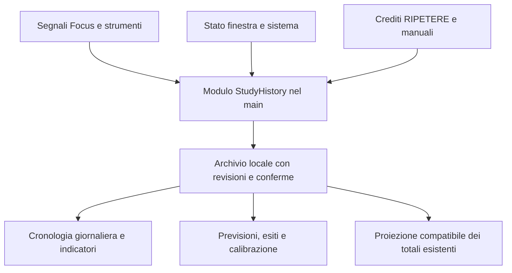

# Piano: cronologia dello studio e affidabilità della stima

Data: 9 novembre 2026. Stato: **piano, implementazione non avviata**.

Ambito: punti **5 e 6 della lista in chat**, corrispondenti alle voci
**130 e 131** della [lista futura](idee-future-2026-10-13.md).
Base verificata: commit `f57b00a4bddab5af54421aac6978ad5f3761149d`.
Decisioni da leggere: D-0481–D-0483 e D-0485, oltre al
[resoconto dell'8 novembre](stima-tempi-2026-11-08.md).

La richiesta di oggi autorizza verifiche e questo documento. Le modifiche
descritte sotto sono da realizzare successivamente: non sono già presenti
nel prodotto e non chiudono le due voci della coda.

## 1. Risultato da ottenere

Un'unica base di osservazioni locali deve permettere due letture diverse:

1. **Quando e come si è studiato:** cronologia giornaliera, pause, strumenti,
   cambi di contesto e periodi senza informazioni sufficienti.
2. **Quanto è affidabile il tempo restante:** confronto fra previsioni fatte
   durante lo studio ed esiti successivi, usando lo stesso tempo accreditato.

L'utente ha confermato oggi:

- cronologia e indicatori concreti, **senza punteggio unico di attenzione**;
- inclusione di **Focus, RIPETERE e studio manuale**, con provenienza distinta.

Il Q&A continua a contare come studio; Memo, traduttore e pause restano esclusi
dal cronometro. Il target della stima resta il **tempo attivo in Focus fino
al completamento esplicito della lezione**, come in D-0482. Le altre modalità
entrano nel grafico, ma non vengono aggiunte automaticamente a questo esito.

Non servono servizi AI, account, telemetria remota o nuove dipendenze per la
prima versione. Non si raccolgono nomi delle altre applicazioni, URL, tasti
premuti, screenshot o contenuti delle conversazioni.

## 2. Verifiche sullo stato attuale

### 2.1 Che cosa si può riusare

| Area | Stato verificato | Riferimento nel commit di base |
| --- | --- | --- |
| Tempo di studio | Tick accreditato comune a cronometro e stima; esclusioni di strumenti, pausa e perdita focus | `src/utils/studyActivity.ts`, `src/hooks/useStudyTracker.ts:307` |
| Persistenza dei totali | Sessioni con ID, lezione/corso, inizio/fine, durata, modalità e giorno; aggiornamenti idempotenti per ID | `shared/archive.ts:438`, `electron/main/archive.ts:2413` |
| Analisi attuale | Totali giornalieri, ultimi sette giorni, corsi e medie; non una cronologia intragiornaliera | `shared/archive.ts:463`, `electron/main/archive.ts:2498`, `src/components/Dashboard.tsx:458` |
| Rettifiche | Sottrazioni non distruttive applicate alle sessioni; i conteggi usano `effectiveStudySeconds` | `shared/studyCorrections.ts`, `electron/main/archive.ts:2472` |
| RIPETERE | Crediti audio ripartiti per giorno; 900 secondi stimati alla prima lettura della valutazione | `shared/repetitionStudy.ts`, `electron/main/archive.ts:2397` |
| Inattività | Soglia personale e raccolta facoltativa di durate fra interazioni, senza la loro posizione temporale | `src/utils/studyInactivity.ts` |
| Stima puntuale | Modello locale per paragrafi e ripiego a viewport; fattori aggiuntivi subordinati a validazione | `src/utils/paragraphEstimate.ts`, `src/utils/paragraphObservation.ts`, `src/utils/studyEstimate.ts` |
| Intervallo | Casi prospettici locali, tre fasi, lingua e metodo separati nella selezione, livello nominale 90%, soglia 20 lezioni | `src/utils/studyForecast.ts` |
| Scritture locali | Scrittura atomica con backup e lettura recuperabile, già usate dall'archivio | `electron/main/atomicFile.ts`, `electron/main/fileStorage.ts:377` |

### 2.2 Limiti che impediscono di costruire il grafico dai soli dati vecchi

Una sessione «09:00–10:00, 30 minuti accreditati» è compatibile sia con studio
09:00–09:30 e pausa successiva, sia con pausa iniziale e studio 09:30–10:00.
Il totale non rivela la disposizione dei minuti. Non si deve riempire l'intera
ora con un blocco di studio, né distribuire uniformemente i trenta minuti.

Inoltre:

- `getStudyMode()` restituisce `focus` per tutta la permanenza in Focus:
  lo storico delle sessioni non distingue già lettura, Q&A e slide;
- `studyInactivity.gaps` conserva durate, non istanti: non è una timeline;
- un inserimento manuale può avere inizio e fine uguali e una durata positiva;
  i 15 minuti della lettura RIPETERE sono anch'essi un credito, non un intervallo;
- le sessioni Focus lunghe non sono oggi spezzate a mezzanotte: il flush assegna
  il giorno corrente all'intero totale della sessione. È un rischio rilevato
  nell'ispezione di `useStudyTracker.ts:95` e `:99`, da coprire con una nuova
  regressione; non è stato collaudato oggi su un archivio personale;
- l'ora dell'audio RIPETERE può provenire dal registratore oppure dalla creazione
  della sessione: la precisione della collocazione deve rimanere visibile.

Lo storico personale non è stato aperto: **la numerosità reale dei casi di
calibrazione e la versione installata non sono state accertate oggi**.

### 2.3 Due casi riprodotti nella raccolta statistica

Sono stati eseguiti in memoria caricando il TypeScript corrente tramite
`typescript.transpileModule`, con `localStorage` sintetico e nessuna scrittura
all'archivio o ai sorgenti.

**V1 — Cambio di metodo nella stessa fase.**

1. Aprire un run sintetico e avanzare nella fase centrale.
2. Registrare una previsione `viewport-v2` in italiano.
3. Registrare una previsione `paragraph-v2` nella medesima fase e lingua.
4. Salvare e leggere i punti del run.

Esito: due richieste, **un solo punto conservato**, quello `viewport-v2`.
La condizione in `studyForecast.ts:77` controlla fase e lingua, ma non metodo;
il lettore ammette al massimo sei punti. La calibrazione distingue i metodi,
quindi questa deduplicazione può impedirle di raccogliere il nuovo metodo.

**V2 — Salvataggio finale del conteggio fallito.**

1. Salvare un run con una previsione e posizione idonea al completamento.
2. Accreditare altri trenta secondi soltanto in memoria.
3. Simulare il fallimento della scrittura del run, lasciando leggibile il
   precedente checkpoint e scrivibile lo storico.
4. Chiamare il completamento corrente.

Esito: `save()` restituisce `false`, ma il completamento restituisce `true`
e registra **zero secondi residui invece di trenta**. Il completamento rilegge
il checkpoint precedente; `useStudyEstimate.ts:144` non propaga l'esito del
salvataggio al chiamante. Il wrapper in `LectureDrawer.tsx:165` distingue il
fallimento del salvataggio dello stato della lezione, non questo caso.

Questi sono difetti della raccolta da correggere prima della validazione
personale; il piano non li presenta come già risolti. Le rettifiche del tempo,
inoltre, non sono collegate ai casi in `localStorage`: manca una relazione
duratura fra esito statistico e sessioni che lo hanno prodotto.

### 2.4 Test eseguiti oggi

```powershell
npm test -- tests/unit/studyForecast.test.ts tests/unit/studyStatistics.test.ts tests/unit/studyCorrections.test.ts tests/unit/repetitionStudy.test.ts
```

**18 test in quattro file superati**, eseguiti su dati sintetici temporanei.
Le prove V1/V2 sono verifiche aggiuntive, non già coperte da quei test.
Non sono stati eseguiti nuovi test UI, build, installer o chiamate AI.

## 3. Architettura proposta

Conservare il tick comune dell'8 novembre e aggiungere una cronologia delle
transizioni, con un proprietario della persistenza nel processo main.



### 3.1 Scelta del modulo e della sua interface

Il modulo proposto `StudyHistory` concentra ordinamento delle osservazioni,
deduplicazione, durata accreditata, taglio per giorno, completamento,
rettifiche, recupero e letture aggregate. I chiamanti non devono ricostruire
queste regole nei grafici o nel popover.

La sua interface pubblica deve coprire quattro operazioni concrete:

1. ricevere osservazioni in batch e restituire la revisione/sequence confermata;
2. registrare una previsione e restituire stato e margine della calibrazione;
3. coordinare un completamento con ID operativo, revisione e cutoff del tempo;
4. leggere giornata e riepilogo della calibrazione con filtri dichiarati.

Le rettifiche entrano dal comando archivio esistente, che notifica lo stesso
modulo: non si crea una seconda UI per correggere i minuti.

La seam di raccolta è fra segnali renderer e modulo main. Per la persistenza
si riusa il filesystem locale; nei test si usa un adapter in memoria e, per
atomicità/recupero, cartelle temporanee reali. Non occorre introdurre una
architettura di servizi remoti o un nuovo database.

**Alternative valutate:** aggiungere tutto a `localStorage` è più rapido ma
mantiene quota, silenziamento degli errori e separazione dai totali; introdurre
un database e una libreria di grafici amplia il lavoro senza una necessità
dimostrata. La proposta preferisce archivio main e grafico con strumenti già
disponibili; misurare le prestazioni prima di aggiungere dipendenze.

### 3.2 Osservazioni, intervalli e crediti sono oggetti diversi

**Osservazione:** transizione o checkpoint prodotto dalla sessione attiva.
Campi minimi: versione schema, `sessionId`, `runId` eventuale, sequence,
istante UTC, offset/fuso al momento dell'osservazione, tempo monotono relativo,
lezione/corso eventuali, attività, motivi di esclusione e contatore cumulativo
dei secondi accreditati. Non registrare ogni movimento del mouse.

**Intervallo derivato:** inizio/fine e attività ricostruiti da osservazioni
consecutive confermate. Deve indicare provenienza e qualità della collocazione
temporale. Una lacuna di osservazione produce `unknown`, non studio o pausa.

**Credito:** durata attribuita a giorno/corso e relativa fonte. Può non avere
un orario osservato. Deve distinguere `focus-observed`, `repetition-audio`,
`repetition-reading-estimated`, `manual` e `legacy-unlocated`.

L'attività di base e il motivo di sospensione devono restare separati: un
Q&A con Memo aperto è Q&A sospeso da Memo, non due attività contemporaneamente
accreditate. Più motivi possono sovrapporsi; la rimozione di uno non deve
riavviare lo studio mentre ne rimane un altro.

### 3.3 Invarianti del conteggio

- Un solo contatore accreditato alimenta cronometro, proiezione dei totali e
  target del forecast. Non introdurre un secondo timer nel grafico.
- Leggere, consultare Q&A e usare le slide della lezione sono studio; cambiare
  fra queste viste non è automaticamente un'interruzione.
- Memo, dizionario/traduttore, pausa volontaria, Focus Lock e perdita focus
  restano esclusioni. Una pausa programmata non diventa «calo di attenzione».
- La mancanza di input conserva la politica attuale della soglia confermata;
  non viene reinterpretata retroattivamente come distrazione.
- Gli ID/sequence rendono i batch ripetibili senza duplicare secondi. Un
  checkpoint cumulativo non è un delta da sommare ogni volta.
- Il giorno si determina per ciascun intervallo, non dall'ora dell'ultimo
  flush. Spezzare a mezzanotte senza cambiare il totale del run.
- Durate monotone e secondi accreditati prevalgono per il conteggio; istanti
  UTC e fuso servono a collocare la giornata. Un salto dell'orologio o un
  evento mancante deve produrre una discontinuità dichiarata.
- Il calendario usa confini locali reali: non assumere giornate tutte di
  86.400 secondi. Le due ore uguali nel cambio d'ora devono essere distinguibili.

Nel main riusare `BrowserWindow` e gli eventi Windows di `powerMonitor`
`suspend/resume` e `lock-screen/unlock-screen`. Sono capacità documentate
da [Electron](https://www.electronjs.org/docs/latest/api/power-monitor), già
dipendenza del progetto. Non equivalgono a una misura della concentrazione;
la loro resa effettiva va collaudata sul runtime Windows usato dall'app.

### 3.4 Scritture, recupero e compatibilità

Proposta iniziale: sotto la radice privata dell'archivio, aggiungere
`study/history/`, `study/forecasts/` e un manifesto versionato. Scrivere chunk
di osservazioni piccoli, per giorno e sessione, ruotati ogni dieci minuti o
al superamento di 64 KiB. Questi valori sono budget tecnici proposti, non
parametri statistici approvati: confermarli con il collaudo del disco.

Le transizioni rilevanti partono subito; heartbeat/checkpoint in batch non
oltre dieci secondi. Riutilizzare `atomicWrite`/`readRecoverable` per i chunk,
evitando di riscrivere l'intero semestre ogni secondo. L'ACK al renderer deve
arrivare solo dopo la scrittura duratura. La UI distingue «in attesa di
salvataggio» da «salvato» e non tratta un errore come assenza di dati.

`study_sessions.json` continua a sostenere le statistiche esistenti. Per le
nuove sessioni diventa una proiezione idempotente delle osservazioni confermate,
con ID di origine; il vecchio writer deve essere disattivato per quelle
sessioni. Non sommare proiezione e cronologia come due fonti di tempo.
Conservare i record legacy e le loro rettifiche senza riscriverne la storia.

Le scritture atomiche esistenti riguardano **un file alla volta**, non una
transazione fra libreria, cronologia e forecast. Per il completamento servirà
quindi un piccolo protocollo duraturo:

1. fissare cutoff e contatore finale dopo l'ultimo batch confermato;
2. salvare un'intenzione con `completionOperationId`, run e revisioni attese;
3. salvare lo stato della lezione con lo stesso riferimento operativo, nella
   medesima scrittura atomica dei suoi metadati;
4. finalizzare un solo esito, quindi aggiornare le proiezioni;
5. al riavvio riprendere operazioni interrotte usando il riferimento operativo,
   senza dedurre un completamento dal solo stato corrente della lezione.

Un errore deve lasciare il run ritentabile o dichiaratamente incompleto.
L'archivio non deve rimanere bloccato da una calibrazione non salvabile.
Nessun esito può usare un checkpoint precedente spacciandolo per quello finale.

## 4. Punto 5: cronologia giornaliera

### 4.1 Collocazione e navigazione

Estendere «Analisi del Tempo di Studio» nella Dashboard con «La mia giornata»:
selettore data, precedente/successiva, ritorno a oggi e filtri corso/attività.
Non aggiungere grafici permanenti alla barra Focus. La raccolta prosegue
indipendentemente dalla schermata che mostra il grafico.

Una timeline orizzontale con scala oraria mostra le attività collocabili;
un elenco/tabella equivalente è sempre disponibile da tastiera. Mostrare
nome attività e provenienza, non affidarsi al solo colore. Di default usare
l'intervallo utile della giornata, con opzione per vedere tutte le ore.

### 4.2 Cosa disegnare e cosa non inventare

| Fonte | Presentazione |
| --- | --- |
| Focus osservato | Blocchi lettura, Q&A e slide; pause e strumenti separati |
| Uscita/ritorno dalla finestra | Interruzione osservata, senza identificare l'altra applicazione |
| Inattività rilevata | Stato dalla soglia effettivamente raggiunta, senza cancellare retroattivamente il periodo precedente |
| PC bloccato/sospeso | Tratto distinto, escluso dallo studio |
| Audio RIPETERE | Fascia propria con origine dell'ora; data del registratore quando disponibile, fallback esplicitamente indicato |
| Lettura RIPETERE da 15 minuti | Credito stimato nel riepilogo, non fascia inventata di quindici minuti |
| Manuale con sola data | Elenco «studio senza orario registrato», non collocazione all'ora dell'inserimento |
| Sessioni vecchie senza dettaglio | Totali preesistenti e indicazione «dettaglio orario non disponibile» |
| App chiusa o dati mancanti | Spazio non osservato, non pausa o distrazione |

Prevedere, come estensione del form manuale, orario opzionale e durata con
provenienza «dichiarato dall'utente». Se non compilato, basta la data.
Non richiedere nuovi inserimenti per rendere utilizzabile il grafico.

RIPETERE e Focus possono avere fasce sovrapposte. Non colorarle come una
singola fascia cumulativa: usare righe distinte. Il totale accreditato mantiene
le regole esistenti; il tempo cronologico osservato è un'unione di intervalli,
non la loro somma. Spiegare la differenza quando i valori non coincidono.
Un credito stimato non entra nell'unione degli intervalli osservati.

### 4.3 Indicatori da mostrare

1. Tempo accreditato del giorno, con separazione per fonte e rettifiche.
2. Tempo osservato collocabile sulla timeline e quantità senza orario.
3. Durata mediana e massima dei blocchi continui di studio osservato.
4. Numero e durata delle interruzioni, separati per causa.
5. Tempo in pausa programmata e in strumenti esclusi, senza giudizi negativi.
6. Cambi fra lettura/Q&A/slide come cambi di contesto, distinti dalle uscite
   verso una finestra estranea.
7. Disponibilità del dettaglio: quali fasce sono osservate, quali legacy o
   ignote. L'assenza di dati non vale zero attenzione.

Per «blocco continuo» unire lettura, Q&A e slide finché non interviene una
vera esclusione. Conservare le transizioni brevi; si può raggruppare il disegno
per leggibilità, senza cancellare eventi o alterare i totali. Un eventuale
filtro di durata deve indicare la soglia e non essere chiamato misura cognitiva.

Il primo rilascio permette il confronto fra fasce della giornata, ma non
annuncia automaticamente «qui hai perso attenzione». Non serve un algoritmo
che assegni un voto o penalizzi una pausa rigenerante. Un'eventuale futura
comparazione personale userà gli stessi indicatori e dati osservabili.
Nella Dashboard sostituire anche la dicitura attuale «zero falsi positivi»
con una descrizione dei segnali disponibili: l'attività osservata non consente
quella garanzia.

## 5. Punto 6: completare e validare il margine statistico

### 5.1 Prima l'integrità delle osservazioni

- Trasformare V1 e V2 in regressioni prima delle correzioni.
- Identificare il checkpoint con run, fase, lingua, **metodo e versione della
  politica di campionamento**. Con due metodi e due lingue le tre fasi possono
  produrre dodici punti: aggiornare limite, schema e migrazione insieme.
- Mantenere la regola iniziale «prima previsione utilizzabile per gruppo»:
  decidere il campione prima dell'esito. La copertura descriverà quei checkpoint,
  non automaticamente tutte le previsioni intermedie mostrate ogni secondo.
- Conservare versione del modello e della misura del tempo, impronta della
  fonte, contatore accreditato al checkpoint e riferimento alla sua conferma
  duratura. Un cambiamento semantico di versione non si mescola senza verifica.
- Registrare tutti i percorsi di completamento nel main, non solo il wrapper
  del drawer. Un completamento senza run idoneo aggiorna lo stato ma non
  fabbrica un esempio statistico.
- Rendere espliciti run incompleto, annullato, invalidato e concluso. Solo
  concluso con contatore finale confermato produce l'esito.
- Collegare le rettifiche alle sessioni/intervalli del run. Se la sottrazione
  non può essere localizzata prima/dopo un checkpoint, rendere quel caso non
  idoneo alla calibrazione invece di distribuirla arbitrariamente.

### 5.2 Definizione dell'esito e dei gruppi

Per ogni checkpoint idoneo:

```text
effettivo_restante = contatore_finale_confermato - contatore_al_checkpoint
errore = effettivo_restante - previsione_al_checkpoint
```

Lo studio può attraversare più giorni e riprendere dallo stesso run. Si
contano solo secondi qualificati in Focus della lezione. Le pause e lo studio
manuale non allungano questo target; RIPETERE rimane nella sua provenienza.
Ricalcolo e cambio delle fonti chiudono la confrontabilità del run precedente.

Un nuovo studio della stessa lezione può rimanere nello storico, ma non
aumenta il numero di lezioni indipendenti. La calibrazione seleziona al massimo
un caso per lezione in ciascun gruppo, escludendo la lezione corrente. La
chiave della lezione va mantenuta anche se il contenuto cambia.

Per il primo rilascio conservare i gruppi per inizio/metà/fine, lingua, metodo
e versioni compatibili. Conservare anche posizione numerica e durata prevista
per diagnosticare differenze all'interno delle fasi. Non frammentare subito
anche per corso se ciò impedisce di raggiungere una numerosità utile.
Non unire silenziosamente gruppi poveri di dati.

### 5.3 Metodo iniziale e sua interpretazione

Riutilizzare la costruzione empirica attuale come baseline:

```text
score_i = abs(effettivo_i - previsto_i) / max(previsto_i, 60 secondi)
k = ceil((n + 1) * 0.90)
q = k-esimo score ordinato
margine = q * max(previsto_corrente, 60 secondi)
intervallo = [max(0, previsto_corrente - margine), previsto_corrente + margine]
```

Mantenere la soglia prudente di 20 lezioni confrontabili e il massimo iniziale
di 100 casi distinti per gruppo; queste soglie non attestano da sole la qualità.
Con dati insufficienti la previsione puntuale può essere mostrata, il margine
resta non disponibile. Non generare intervalli piccoli solo perché si è vicini
alla fine. Verificare sui casi tenuti fuori anche la baseline con errore
assoluto, prima di scegliere eventuali miglioramenti o intervalli asimmetrici.

Il quantile richiama la costruzione conforme, ma le garanzie formali richiedono
ipotesi sui campioni e un protocollo di calibrazione coerente. Il modello
personale è adattivo: il piano mantiene la dicitura **livello nominale 90%**,
senza attribuirgli una probabilità individuale garantita.
[Riferimento primario: Angelopoulos e Bates, §1.1 e §3](https://arxiv.org/html/2107.07511v6).

### 5.4 Validazione cronologica senza uso del futuro

1. Ordinare gli episodi con riferimenti temporali e revisioni del journal.
2. A ogni checkpoint calcolare il margine usando solo casi già conclusi prima
   di quel momento, escludendo la lezione corrente.
3. Salvare i limiti realmente emessi e la versione dei dati usata.
4. Al completamento confrontarli con l'esito; solo dopo rendere il nuovo caso
   utilizzabile per le previsioni successive.
5. Non ricalcolare gli intervalli storici col modello odierno e presentarli
   come se fossero quelli emessi allora.

Confrontare per gruppo: errore assoluto mediano/medio, errore firmato,
ampiezza mediana degli intervalli, copertura, conteggio delle lezioni e
quantità di casi non idonei. Un intervallo enorme può coprire quasi tutto
senza essere utile: copertura e ampiezza devono essere valutate insieme.

La copertura osservata deve avere denominatore e indicazione della sua
incertezza. Esempio di calcolo, **non dato personale**: 18 successi su 20
sono il 90%, ma l'intervallo Wilson al 95% è circa 69,9–97,2%; 90 su 100 danno
circa 82,6–94,5%. L'approssimazione riguarda una proporzione di casi distinti,
non le migliaia di tick correlati della stessa lezione. Non elimina eventuali
cambiamenti del ritmo o della difficoltà delle lezioni.
[Metodo: NIST, intervalli per proporzioni](https://www.itl.nist.gov/div898/handbook/prc/section2/prc241.htm).

Non promettere una data per «raggiungere il 90%»: senza nuovi esiti non è
misurabile. I test sintetici possono concludere l'implementazione e verificare
il protocollo; la copertura personale richiede un pilota separato e documentato.

### 5.5 Presentazione nell'icona già presente

Mantenere l'accesso 🌱. Il dettaglio deve separare:

- previsione e intervallo in minuti, con limiti non negativi;
- livello nominale scelto e fase di confronto;
- numero di lezioni per calibrazione, distinto da quelle della verifica;
- copertura prospettica, denominatore e indicazione «verifica ancora scarsa»
  quando il numero di esiti non consente conclusioni stabili;
- stato di raccolta, scrittura fallita o caso invalidato, distinti fra loro.

Nel grafico giornaliero si possono aggiungere marcatori apribili delle
previsioni emesse e dei completamenti, senza farne un grafico dell'attenzione.
Nessun nuovo numero lampeggiante o permanente nella barra Focus.

## 6. Migrazione, dati mancanti e conservazione

1. Migrazione solo additiva, con backup e ID/versione: ripeterla non duplica dati.
2. Importare le sessioni preesistenti come crediti legacy; non inventare pause,
   orari di studio o cambi di vista. Le registrazioni audio mantengono la propria
   qualità temporale e i riferimenti idempotenti già presenti.
3. I vecchi punti/casi forecast restano conservati come `legacy-v1`. Prima di
   includerli nella nuova calibrazione verificare provenienza e compatibilità;
   senza il contatore finale verificabile non contarli come casi v2 validati.
   Nessuna pulizia o riscrittura automatica dei campioni personali dei paragrafi.
4. Le rettifiche esistenti senza collocazione precisa restano rettifiche del
   totale; non tagliare a caso una porzione della timeline. La UI lo segnala.
5. Per la prima implementazione proporre dettaglio per 180 giorni, riepiloghi
   giornalieri e casi di calibrazione compatti conservati separatamente.
   Misurare dimensioni e tempi prima di attivare la compattazione; proteggere
   i riferimenti dei run aperti. La politica di conservazione è una proposta
   tecnica da confermare, non una cancellazione già autorizzata oggi.
6. File danneggiati, recupero da backup, porzioni non confermate dopo crash e
   intervalli fuori conservazione devono essere riconoscibili. Non confondere
   «nessuna attività registrata» con «registrazione indisponibile».
7. Corsi archiviati, cambio corso, lezione eliminata e audio duplicato devono
   seguire le regole esistenti dei totali. Filtri coerenti, conservazione delle
   fonti e nessun raddoppio di crediti o casi.

## 7. Sequenza di implementazione e criteri di uscita

| Fase | Lavoro concreto | Criterio di uscita |
| --- | --- | --- |
| P0 — Bloccare i difetti | Aggiungere regressioni V1/V2, mezzanotte e rettifiche; fissare schema e invarianti | Riproduzioni rosse prima delle correzioni; requisiti senza ambiguità sul target |
| P1 — Base affidabile | Modulo main, osservazioni, ACK/revisioni, clock comune, chunk recuperabili e completamento duraturo | Retry/crash non duplicano o inventano tempo; errore finale non crea esiti vecchi; conteggi coerenti |
| P2 — Copertura delle fonti | Integrare Focus/Q&A/slide, strumenti, sistema, RIPETERE e manuale; proiezione dei totali e migrazione additiva | Ogni fonte ha provenienza e qualità; vecchi totali invariati salvo correzioni esplicitamente autorizzate |
| P3 — Cronologia | Lettura giorno, timeline accessibile, elenco equivalente, filtri e indicatori | Scenario giornaliero noto restituisce fasce e indicatori attesi; niente orari inventati |
| P4 — Calibrazione | Correggere chiave per metodo, raccogliere checkpoint/esiti duraturi e integrare rettifiche/versioni | Gruppi corretti, nessun uso del futuro, un caso indipendente per lezione, cold start esplicito |
| P5 — Valutazione e UI | Replay cronologico, report copertura/ampiezza per fase, stati nel popover e pilota personale | Funzione verificata; beneficio personale dichiarato soltanto con dati adeguati |
| P6 — Consegna | Aggiornare documenti e decisioni, eseguire gate e, nel futuro intervento implementativo, verificare il pacchetto | Voci chiuse soltanto per criteri davvero soddisfatti; installer e pubblicazione secondo AGENTS se rigenerato |

P1 è condivisa dai due punti: non vanno creati due sistemi di tracking.
P3 può avanzare con scenari sintetici mentre P4 raccoglie dati reali. Nessuna
fase richiede di aspettare settimane per scrivere e collaudare la funzione;
la verifica personale della copertura rimane un criterio distinto.

### File e integrazioni previsti

I nuovi nomi sono proposte, non file già creati:

- `shared/studyHistory.ts`: contratti, provenienza, validazioni e risultati.
- `electron/main/studyHistory.ts`: modulo proprietario di journal, revisioni,
  recupero, proiezioni e forecast; helper interni solo se giustificati.
- `electron/main/archive.ts`, `fileStorage.ts`, `archiveValidation.ts`:
  integrazione con archivio, stato lezione, crediti e rettifiche.
- `electron/main/index.ts`, `electron/preload/index.ts`, `shared/archive.ts`:
  trasporto IPC e contratti del renderer.
- `src/hooks/useStudyTracker.ts`, `useStudyEstimate.ts`,
  `src/utils/studyActivity.ts`, `paragraphObservation.ts`, `studyForecast.ts`:
  segnali, produzione delle previsioni e transizione dal v1 al nuovo archivio.
- `src/components/Dashboard.tsx` e nuovo `StudyDayTimeline.tsx`:
  cronologia, tabella e filtri. Stili separati se il blocco lo richiede.
- `StudyEstimateDetails.tsx`, `StudyEstimateSettings.tsx` e
  `src/hooks/useLectureContent.ts`/`LectureDrawer.tsx`: stati leggibili e
  completamento unico, con rimozione della duplicazione del wrapper locale.
- Test unitari, scenari Electron e documentazione nelle cartelle già esistenti.

## 8. Matrice minima di collaudo

| Scenario | Esito richiesto |
| --- | --- |
| Lettura → Q&A → slide | Studio continuo, tre attività distinguibili, un solo credito per secondo |
| Memo e traduttore sovrapposti | Tempo escluso finché non sono chiuse tutte le esclusioni |
| Pausa scaduta, ritorno focus | Nessuna ripresa implicita della pausa volontaria |
| Inattività e lettura senza input confermata | Soglia rispettata; nessuna diagnosi di attenzione o sottrazione retroattiva |
| Altro programma, lock, sospensione | Periodi esclusi e classificati solo con le informazioni disponibili |
| Crash, replay, ACK perso | Deduplicazione; recupero o lacuna dichiarata; niente riempimento retroattivo |
| Mezzanotte e cambio d'ora | Giorni corretti, secondi conservati e fasce distinguibili |
| Manuale e lettura RIPETERE stimata | Crediti visibili senza un orario fittizio |
| Audio RIPETERE già importato o sovrapposto a Focus | Nessun duplicato; fonti separate; unione temporale distinta dai crediti |
| Cambio metodo nella stessa fase | Conservati entrambi i checkpoint, senza chiamarli due lezioni indipendenti |
| Scrittura finale fallita | Nessun esito da checkpoint vecchio; errore distinguibile da dati insufficienti |
| Completamento riuscito/fallito, ripetuto e da percorso diverso | Stato coerente e al massimo un esito per operazione idonea |
| Correzione dopo il completamento | Caso aggiornato quando determinabile, altrimenti escluso con motivazione |
| Cambio fonte, ricalcolo, lingua e versioni | Nessuna commistione involontaria di gruppi; storico conservato |
| Meno di 20 lezioni o gruppo vuoto | Previsione puntuale possibile, nessun margine percentuale inventato |
| Dataset con errori uguali a inizio/fine | Nessun restringimento imposto dalla sola posizione |
| Verifica cronologica | Limiti salvati prima dell'esito; lezione corrente e futuro esclusi |
| Tastiera, temi, finestra stretta e zoom 200% | Grafico comprensibile tramite elenco e popover senza clipping/uscita involontaria |

Misurare anche una giornata intensa con molte transizioni, 180 giorni di
dettaglio e batch ritentati. Obiettivi iniziali da verificare sul PC: apertura
del giorno caldo entro 300 ms e nessun lavoro di persistenza per tick sul
thread UI. Se non soddisfatti, profilare prima di cambiare stack.

Il gate finale dell'implementazione comprenderà typecheck, lint, test unitari
pertinenti e suite completa, regressioni Electron con riavvio, calendari e
recupero. Verifiche del pacchetto solo quando si rigenera realmente l'installer.

## 9. Chiusura delle voci e prossimo passo

**Voce 130:** completabile con raccolta, provenienza, grafico, indicatori,
migrazione e collaudi passati. Non richiede e non deve produrre una misura
diretta dell'attenzione.

**Voce 131:** la parte implementativa richiede raccolta integra, completamento
duraturo, raggruppamento corretto e valutazione senza futuro. La validazione
personale della copertura resta separata e documentata fino a dati sufficienti;
non basta una suite sintetica verde per dichiararla conclusa.

Primo passo del futuro intervento: P0 e P1, usando le due riproduzioni sopra.
Non iniziare dal disegno del grafico o dal rendere più stretto il margine.
Le scelte di prodotto necessarie sono state raccolte; restano da confermare
durante l'implementazione i budget tecnici di conservazione e prestazione,
con misure. Oggi si consegna solo questo piano e il relativo registro decisioni.


## Esecuzione autorizzata successivamente

Implementazione completata in D-0487. Il testo sopra conserva il piano iniziale;
[resoconto implementativo](cronologia-stima-2026-11-09.md) per architettura reale,
uso, verifiche, misure e conservazione. La compattazione automatica non è attivata
dopo il benchmark; il dettaglio resta locale. La verifica personale della copertura
della voce 131 richiede dati futuri e rimane distinta dal completamento del codice.
